<div align="center">

[简体中文](./README_CN.md) | **English**


# DeepStudent

### Just focus on learning. Leave the rest to me.

An open-source, local-first AI learning workbench.<br />
Its study agent works directly in every app on your Study Desktop.

[](https://github.com/helixnow/deep-student/releases/latest)
[](LICENSE)
[](https://github.com/helixnow/deep-student)

[Website](https://deepstudent.cn/en/) ·
[**Download**](#installation) ·
[Docs (Chinese)](https://deepstudent.cn/start) ·
[Report an issue](https://github.com/helixnow/deep-student/issues) ·
[Contributing](./.github/CONTRIBUTING.md)

**v0.20.x — Electron + Capacitor + WebUI + Cordis.**<br />
DeepStudent has completed its cutover from the legacy Tauri 2 / Rust backend (`0.11.x`) to a 100% TypeScript dual-kernel plugin architecture on [`@deepseek-ai/cordis`](https://github.com/cordiverse/cordis), unified here at [`helixnow/deep-student`](https://github.com/helixnow/deep-student).

</div>

<p align="center">
  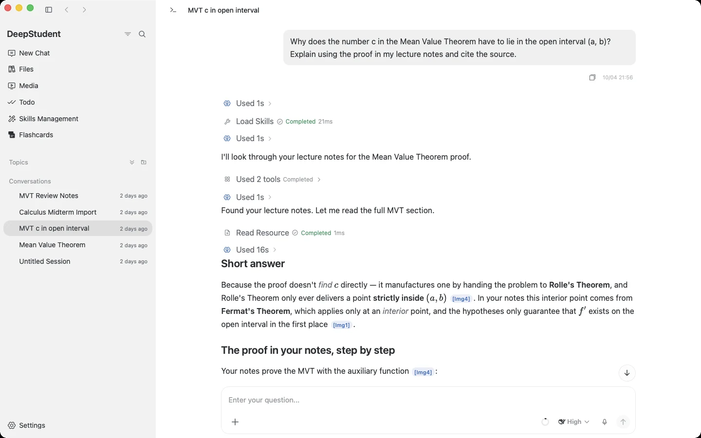
  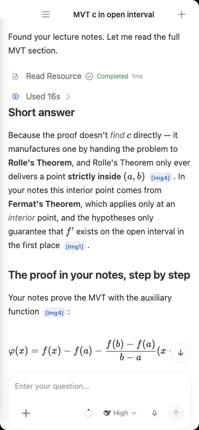
  <br />
  <sub>Classic layout (sidebar + single page) · Android</sub>
</p>

<p align="center">
  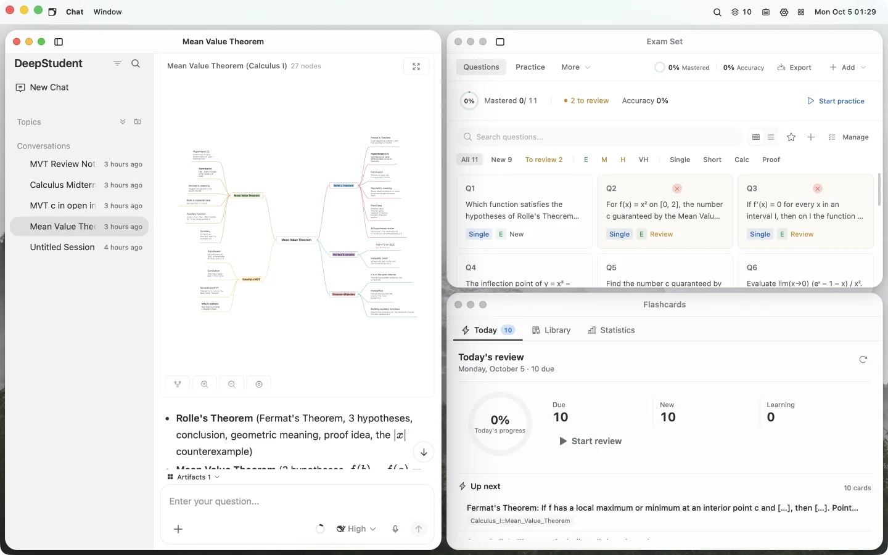
  <br />
  <sub>Study Desktop (the default on desktop)</sub>
</p>

---

## A study agent that works in every app

One sentence is enough. The agent opens the right app and produces the notes, mind maps, questions, cards and review plan; longer tasks it carries through on its own.

**It does the work.**
Notes, mind maps, exam sets, flashcards, todos, essay review and translation all have agent tools, so results land directly in the app instead of staying in a chat window. It can also operate the Study Desktop itself, research the web and academic papers, turn a recorded lecture into timestamped notes, produce Word, PowerPoint and Excel files, and render interactive explanations directly in chat via Generative UI (`openui-lang`).

**Long tasks, handed off.**
Research, organizing and question writing keep moving without you: goal mode continues across turns, sub-agents work in parallel, scheduled automations run on time, and the built-in **WeChat iLink Bot** (`ilinkbot`) lets you interact remotely from WeChat.

**Every step under control.**
Actions are approved by risk level, with Ask / Plan / Craft permission modes. Edits to notes and the Study Desktop can be undone (including per-turn diff review and revert), and answers cite the exact PDF page, quote or lecture timestamp with preserved backlinks across notes, chat exports and flashcards.

**Knows you, grows with you.**
It remembers your weak spots and study habits. **58 built-in skills** (8 workflow skills + 50 progressive-disclosure tool skills) load on demand, MCP connects external tools, **13 model providers** (plus native DeepSeek Responses, Search/Fetch, OCR, ASR and TTS APIs), **9 web search engines** and **6 OCR engines** are built in — and the **AI Plugin Workshop** lets the agent write, test and hot-load `.dstuplugin` extensions right inside the app.

<p align="center">
  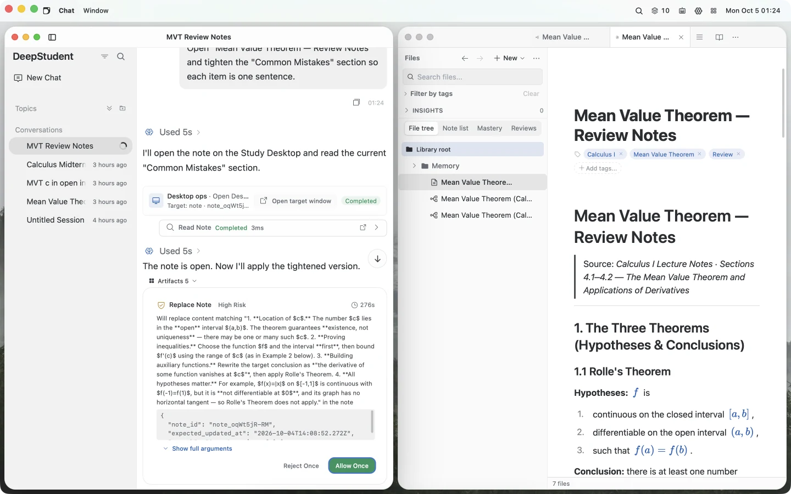
</p>

---

## The apps it works in

Every app sits in the Study Desktop's Dock. Open one on its own, place several side by side, or let the agent open them for you.

| App | What it does |
|---|---|
| **Chat** | Study around your own materials with document-first reading layout, Generative UI interactive cards, and citations linked to original pages. Groups, search, steering/queuing and export. |
| **Files** | Textbooks, notes, question sets, documents, audio and video in one library, indexed for AI search on import (with multi-engine OCR). |
| **Media** | Transcribe lectures and recordings with timestamps, follow along with a synced transcript, and get answers that cite and jump to the exact moment; turn a lesson into an illustrated handout in Notes. |
| **Textbook** | PDF, Word and EPUB reading with highlights, outline-guided AI reading, and PDF page/quote backlinks preserved across notes and cards; select text or drag a box to ask about it. |
| **Notes** | Markdown notes with backlinks, tags and math; agent edits are highlighted and can be undone. |
| **Mind Map** | A full mind map from one sentence; outline and canvas views, plus a recite mode that hides key nodes and converts missed blanks into flashcards. |
| **Exam Set** | Drop in an exam or textbook and get a question set; nine practice modes, auto grading, mistake book, and handwritten answers. |
| **Flashcards** | Review, card making and templates in one place: built-in FSRS-6 spaced repetition (plus an isolated FSRS-7 desktop trial), memory curves, cards from PDFs, images, notes or videos in one request, APKG import/export and Anki sync — no Anki install required. |
| **Essay Review** | Scores against exam rubrics (Gaokao, IELTS, postgraduate exams and more), inline marks, sentence polishing. |
| **Translation** | Full-text translation with paragraph-by-paragraph comparison and 7 domain presets. |
| **Todo · Pomodoro** | Today's reviews and tasks in one list; a focus timer with stats and heatmaps. |
| **Skills & Plugin Workshop** | Built-in and community skills, MCP servers, and AI-authored `.dstuplugin` extensions compiled and hot-loaded inside the app. |

<table>
  <tr>
    <td width="50%">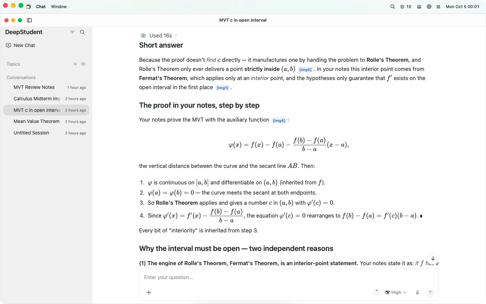</td>
    <td width="50%">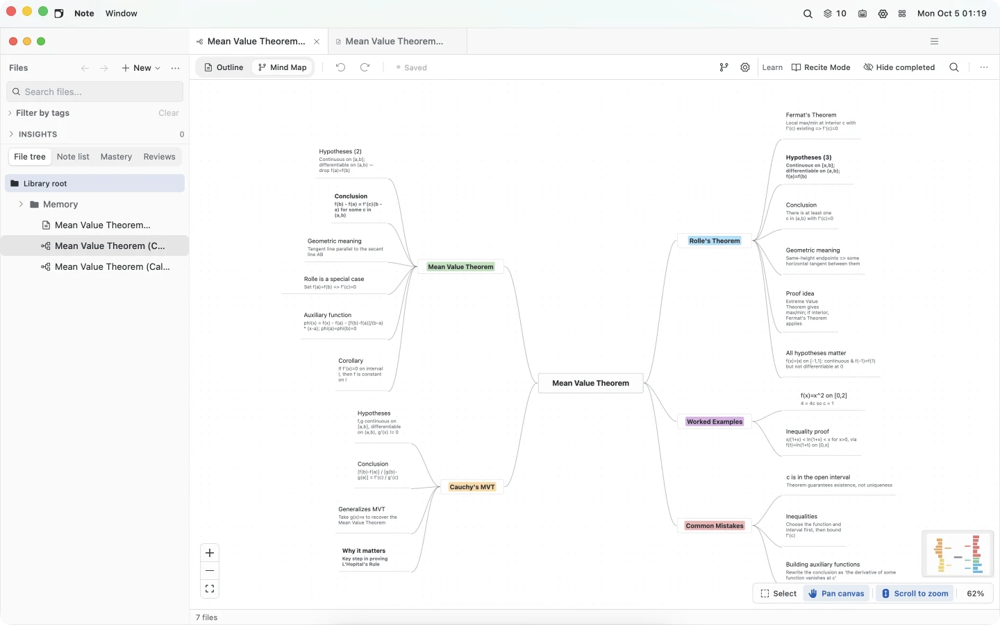</td>
  </tr>
  <tr>
    <td>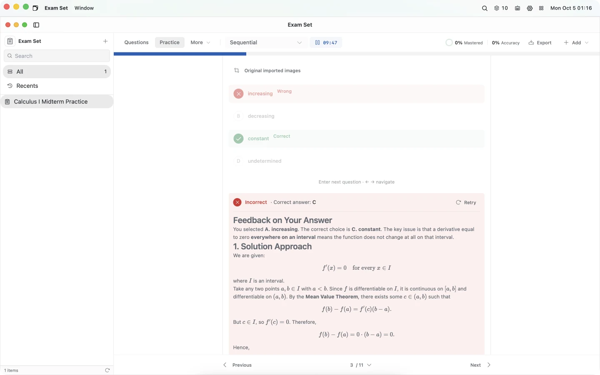</td>
    <td>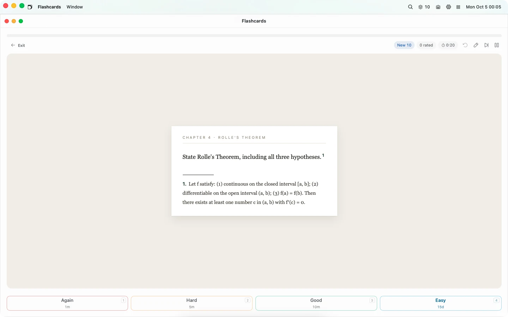</td>
  </tr>
  <tr>
    <td>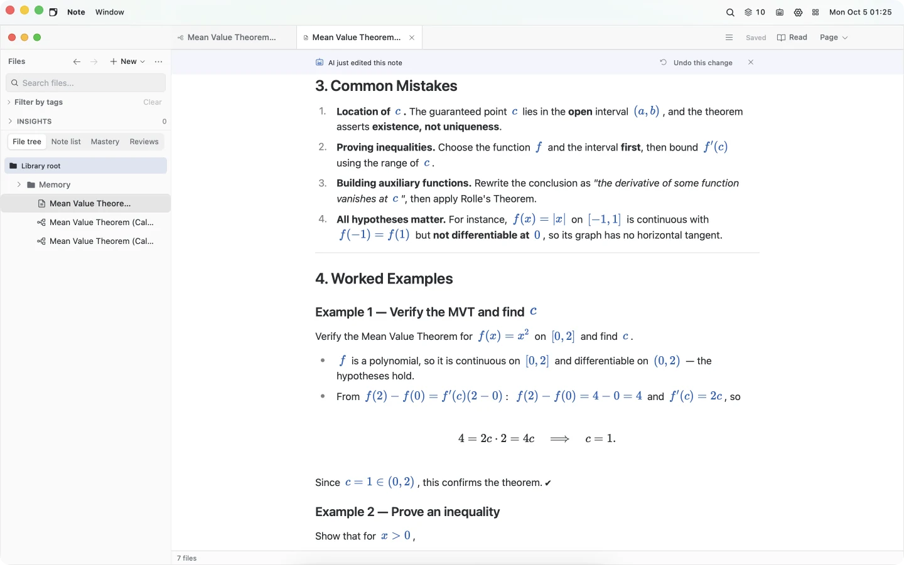</td>
    <td>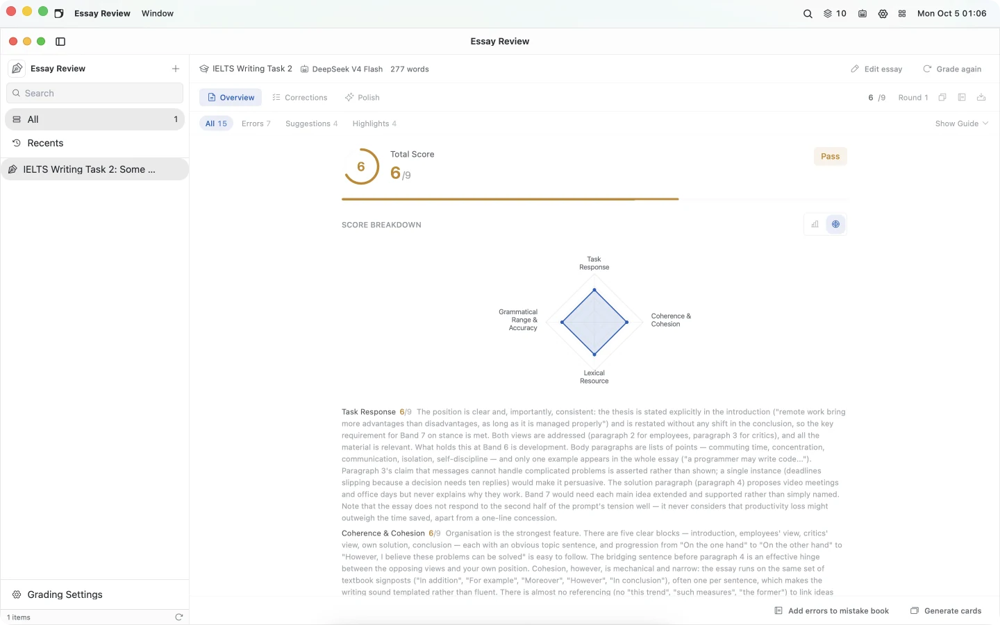</td>
  </tr>
</table>

<p align="center">
  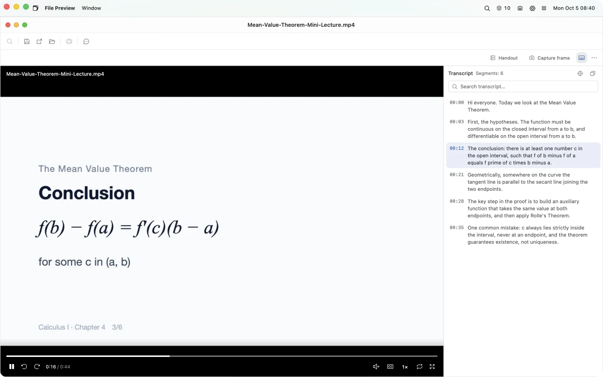
</p>

Full guides for every app: [deepstudent.cn/user-guide](https://deepstudent.cn/user-guide/) (Chinese; source in [`docs/user-guide`](./docs/user-guide/)).

---

## Your data stays on your machine

- **Local storage.** Materials, notes, chats and indexes are stored locally (SQLite, LanceDB and local files). Existing data directories from `0.11.x` mount in place with full SQL migration replay. Back up or migrate via *Settings → Data governance*.
- **When data leaves your machine.** Model calls, web search and MCP send the relevant requests to the services you configured; cloud sync, WeChat iLink Bot and Sentry error reporting send data only when you turn them on.
- **Cloud & LAN sync (Sync V5).** Desktop supports WebDAV, S3-compatible storage and experimental FTP; **Android is WebDAV only** (S3 and FTP are unsupported on mobile/Web). Sync V5 adds HLC causal ordering, Merkle vault snapshots, encrypted `.dsix` index packs and `DSPAIR2` LAN/QR device pairing; default cloud backup packages remain a **portable archive and cannot slot-restore** a full environment directly, and when no cloud end-to-end encryption password is set, encrypted export is refused.
- **Open source, verifiable.** AGPL-3.0-or-later. Everything privacy-related is in this repository.

---

## Installation

Download the latest release from [GitHub Releases](https://github.com/helixnow/deep-student/releases/latest) or [deepstudent.cn](https://deepstudent.cn/download):

| Platform | Package | Architecture |
|:---:|---|---|
| macOS | `.dmg` / `.zip` | Apple Silicon / Intel |
| Windows | `.exe` / `.zip` | x86_64 |
| Linux | `.deb` / `.AppImage` | x86_64 |
| Android | `.apk` | arm64 |
| WebUI / PWA | Self-hosted (`npm run web:prod`) | Any modern browser |

> **iOS:** source build only via Xcode + Capacitor. See [Build Configuration](./docs/BUILD-CONFIG.md).
>
> **macOS says the app "is damaged":** run `sudo xattr -r -d com.apple.quarantine "/Applications/Deep Student.app"`.

After installing, add an API key for one of the 13 preset model providers (or a local model) in *Settings*, open Chat and ask for something — for example: *"Read chapter 3 of my textbook, then make a mind map and 10 flashcards."*

---

## What Changed in 0.20.x: From Tauri/Rust 0.11.x to Electron/Cordis

Starting with **v0.20.x**, DeepStudent retired the legacy Tauri 2 / Rust backend (`0.11.x`) and moved to a unified TypeScript architecture on [`@deepseek-ai/cordis`](https://github.com/cordiverse/cordis). Existing React UI code and on-disk SQLite / LanceDB data remain compatible in place.

| Dimension | Legacy `0.11.x` (Tauri 2 / Rust) | Current `0.20.1` (Node / Electron / Cordis) |
|---|---|---|
| **Runtime & Kernel** | Tauri 2 + 25-crate Rust Cargo workspace + system WebView; compile-time command wiring | **Electron 45** + **UtilityProcess Host** (`MessagePortMain`) + **Cordis 4 microkernel** (`desktop.json`: 43 assembled modules across platform services & business plugins; `host/plugins/`: 29 plugin dirs; **19** official UI plugins under `src/ui-plugins/official/`); **1,061** IPC commands / **127** events governed by `contracts/ipc/`; drop-in `window.__TAURI_INTERNALS__` shim keeps `src/` React 18 untouched |
| **Self-Extensibility & Workshop** | Static built-in plugins only (e.g., `ilink_bot`); no runtime plugin package format or AI authoring | **AI Plugin Workshop** (`plugin-workshop`) with `dstu-plugin-development` skill & **14 Agent tools** (`dstu_plugin_*`): Host-owned `esbuild` compile + isolated Host lifecycle test-load with up to **3 auto-repair passes** → user-confirmed hot-install & live hot-reload without restart → portable **`.dstuplugin`** export, `versions/<v>/package` rollback, `UiErrorBudget` & `HostSupervisor` safe mode |
| **Hybrid Native + WASI-WASM** | 30+ native Rust crates baked into every build; Rust toolchain required | Native bindings isolated strictly to `host/platform/` & `electron/` (`better-sqlite3`, `@lancedb/lancedb`, `@embedpdf/pdfium`, `@napi-rs/keyring`, `@node-rs/argon2`, **`koffi` FFI** for Win32 ACL / ShellExecuteW & macOS AppKit) + prebuilt **`f7-native-wasm.wasm`** (`wasm32-wasip1`) running `regex`, `starlark`, `symphonia`, `image`, `fsrs`, `roxmltree` and `docx-rs`/`calamine`/`pptx-to-md` via `node:wasi` or in-memory WASI; **zero Rust toolchain required** |
| **Multi-Surface Parity** | Tauri 2 desktop + Tauri 2 mobile | One `src/` UI + one `host/` Cordis kernel across **3 surfaces**: **Desktop** (`electron/`, Electron 45), **WebUI & PWA** (`web/`, HTTP/WebSocket + binary framing + HTTP 206 streaming + installable PWA), and **Mobile** (`mobile/`, Capacitor 8.6 + Web Worker Host + `@sqlite.org/sqlite-wasm` / OPFS; `mobile.json` verified at **33 modules / 0 Node dependencies**) |
| **Security & Isolation** | Tauri capability ACLs + system WebView | **Electron Fuses** (`RunAsNode=false`, `EnableNodeOptionsEnvironmentVariable=false`, `EnableNodeCliInspectArguments=false`, `EnableEmbeddedAsarIntegrityValidation=true`, `OnlyLoadAppFromAsar=true`, `GrantFileProtocolExtraPrivileges=false`, `EnableCookieEncryption` on Win/Linux & signed macOS) + **`ds-plugin://`** locked by `plugins.lock.json` SHA-256 & path containment + **per-response cryptographic CSP nonces** on HTML + centralized `web-security.ts` guards + `tauri-plugin-updater` 2.10 Minisign compatibility with user-plugin preservation across upgrades |
| **Learning & AI Breakthroughs** | Markdown chat, FSRS-6, earlier cloud backup, single reading pane | **Generative UI** (`openui-lang` `OpenUILangRenderer`, `interactive-explainer`, live SVG diagrams, faithful HTML sandbox) · **DeepSeek Official APIs** (Responses, Search/Fetch, safety, 20-file docs, OCR, ASR, TTS) · **PDF page/quote backlinks** & document-first reading layout · **Sync V5** (HLC, Merkle, `.dsix` packs, `DSPAIR2` LAN/QR pairing) · **FSRS-7 isolated desktop trial** · **WeChat iLink Bot** (`ilinkbot`) · 7-row live activity window, turn diff review/revert & project knowledge DAG |

---

## For developers

### Architecture

```
DeepStudent
├── Surfaces       Electron 45 (macOS · Windows · Linux) · WebUI & PWA (web/) · Capacitor 8.6 (Android · iOS)
├── Host kernel    Cordis 4 plugin tree (host/kernel · host/platform · host/plugins · desktop.json 43 / mobile.json 33)
├── UI kernel      19 official UI plugins (src/ui-plugins/official/) · slots & registries · UiErrorBudget
├── Agent & Tools  58 built-in skills · MCP · AI Plugin Workshop (14 tools, .dstuplugin) · Generative UI (openui-lang)
├── Data & Engines SQLite (better-sqlite3 / sqlite-wasm) · LanceDB · koffi FFI · f7-native-wasm (WASI-WASM) · Sync V5
└── Integrations   13 model providers · DeepSeek Official APIs · 9 web search engines · 6 OCR engines · WeChat iLink Bot
```

<details>
<summary>Code structure</summary>

```
DeepStudent
├── host/                        # TypeScript backend — Cordis plugin tree
│   ├── kernel/                  #   command router, IPC contract validation, events, protocols, profile store,
│   │                            #   plugin lifecycle/admin, community context & consent ledger
│   ├── platform/                #   platform providers: crypto · diagnostics · errors · files · http · log · native
│   │                            #   (koffi FFI & f7-native-wasm) · paths · secrets · settings · storage (+ storage-mobile) · vector
│   ├── plugins/                 #   29 plugin directories (chat, chat-pipeline, llm, vfs, notes, qbank, anki,
│   │                            #   review, sync, ilink, plugin-workshop, mobile-compat, …)
│   ├── profiles/                #   generated desktop.json (43) / mobile.json (33) assembly
│   └── e2e/                     #   real-host, security, streaming, upgrade & tool coverage suites
├── electron/                    # Desktop shell
│   ├── main.ts                  #   windows, custom protocols, Electron Fuses & Host supervision
│   ├── preload/bridge.ts        #   drop-in Tauri API compatibility bridge (window.__TAURI_INTERNALS__)
│   ├── shell/                   #   protocols, ds-plugin:// lock, CSP nonces, web-security, updater, koffi native window
│   └── scripts/                 #   package.mjs, verify-fuses.mjs, app-hardening.cjs
├── web/                         # WebUI & PWA server/client runtime
│   ├── server/                  #   HTTP/WebSocket gateway, auth rate limiter, HTTP 206 streaming, staging
│   └── client/                  #   browser bootstrap & PWA service worker / manifest
├── mobile/                      # Capacitor 8.6 mobile shell
│   ├── src/worker/              #   Host kernel in a Web Worker (SQLite WASM + OPFS)
│   ├── src/shell/               #   Capacitor shell bridge & persistent storage
│   └── scripts/build-apk.mjs    #   Android APK build script
├── src/                         # React 18 renderer
│   ├── ui-kernel/               #   UI plugin runtime: slots, registries, lazy loading, UiErrorBudget
│   ├── ui-plugins/official/     #   19 official UI plugin packages
│   ├── ui-sdk/                  #   defineUiPlugin + typed services
│   ├── features/                #   chat, generative-ui, notes, mindmap, practice, flashcards, media, pdf, …
│   └── locales/                 #   i18n (zh-CN / en-US)
├── contracts/ipc/               # 1,061 commands · 127 events · 978 types (zero Rust required)
├── resources/                   # App config, capabilities, SQL migrations & dstu-workshop skills/templates
├── legal/                       # THIRD_PARTY_NOTICES.txt & WASM/frontend license manifests
└── .github/workflows/           # CI, typecheck & multi-platform packaging
```

</details>

### Tech stack

| Area | Technology |
|---|---|
| Frontend | React 18 · TypeScript 5.6 · Vite 6 · Tailwind CSS 3 · Radix UI · Zustand 5 |
| Desktop shell | Electron 45 · `electron-builder` 26 · UtilityProcess Host · Electron Fuses |
| WebUI & PWA | Node HTTP / WebSocket gateway · Service Worker + Web App Manifest |
| Mobile shell | Capacitor 8.6 · Web Worker Host · `@sqlite.org/sqlite-wasm` + OPFS |
| Backend runtime | Node.js 24+ · TypeScript · [`@deepseek-ai/cordis`](https://github.com/cordiverse/cordis) 4 · `esbuild` |
| Data & Native | `better-sqlite3` · `@lancedb/lancedb` · `@embedpdf/pdfium` · `@napi-rs/keyring` · `@node-rs/argon2` · `koffi` · `f7-native-wasm` (WASI-WASM) |
| Editors & Rendering | Milkdown 7 · CodeMirror · PDF.js · KaTeX · Mermaid · ECharts · React Flow · `openui-lang` |

### Local development

Requires **Node.js 24+** and npm (do not mix with pnpm or yarn). No Rust or Tauri toolchain is needed; Android builds additionally require JDK 21 and Android SDK platform 36.

```bash
git clone https://github.com/helixnow/deep-student.git
cd deep-student
npm ci --legacy-peer-deps
export DEEP_STUDENT_BUILD_NUMBER=20000
# PowerShell: $env:DEEP_STUDENT_BUILD_NUMBER = '20000'

# 1) Electron desktop app in development mode
npm run dev:electron

# 2) WebUI & PWA (dev server on :1428, or build & serve dist-web/)
npm run web
npm run build:web && npm run web:prod

# 3) Production frontend + desktop package (--dir for unpacked smoke, or --mac / --win / --linux)
npm run build
npx @electron/rebuild -f -w better-sqlite3
node electron/scripts/package.mjs --dir

# 4) Android APK (Capacitor + mobile Worker Host)
node mobile/scripts/build-apk.mjs

# 5) Type checks, contracts, plugin boundaries & test suites
npm run typecheck
npm run typecheck:host
npm run check:plugins
npm run contracts:check
npm test
npm run test:host
npm run test:plugins
npx vitest run -c mobile/vitest.config.ts
node scripts/portability/scan.mjs --profile host/profiles/mobile.json
```

Packaging and cross-platform builds: [BUILD-CONFIG.md](./docs/BUILD-CONFIG.md).

### Documentation

| Document | Description |
|---|---|
| [User guide](https://deepstudent.cn/user-guide/) | Every app and workflow (Chinese; source in [`docs/user-guide`](./docs/user-guide/)) |
| [Build configuration](./docs/BUILD-CONFIG.md) | Cross-platform Electron, Android & iOS build & packaging |
| [WebUI & PWA](./docs/WEBUI-AND-PWA.md) | Browser/PWA architecture, auth model, streaming & reverse proxy setup |
| [DeepSeek Application APIs](./docs/DEEPSEEK-API.md) | Official Responses, Search/Fetch, document parsing, OCR, ASR & TTS integration |
| [Plugin architecture](./docs/plugins/ARCHITECTURE.md) | Host kernel, UI kernel, contracts and extension points |
| [Plugin SDK](./docs/plugins/SDK.md) | Writing a plugin: services, slots, manifest, capability tiers |
| [Plugin security](./docs/plugins/SECURITY.md) | Community plugin permissions, `ds-plugin://` checks & boundaries |
| [Plugin upgrades](./docs/plugins/UPGRADES.md) | User plugin preservation and compatibility checks across app upgrades |
| [Plugin Workshop comparison](./docs/plugins/WORKSHOP-HARNESS-COMPARISON.md) | How the autonomous plugin loop is designed and guarded |
| [Changelog](./CHANGELOG.md) | Version history |
| [Security policy](./.github/SECURITY.md) | Reporting vulnerabilities |

---

## Contributing

1. Read [CONTRIBUTING.md](./.github/CONTRIBUTING.md) for the workflow.
2. Make sure `npm run lint`, `npm run typecheck`, `npm run typecheck:host`, and `npm run check:plugins` pass before opening a PR.
3. Report bugs and ideas in [Issues](https://github.com/helixnow/deep-student/issues).

## License

[AGPL-3.0-or-later](./LICENSE)

## Acknowledgments

DeepStudent is built on open-source software — see [ACKNOWLEDGMENTS.md](ACKNOWLEDGMENTS.md) and [legal/THIRD_PARTY_NOTICES.txt](legal/THIRD_PARTY_NOTICES.txt) for full attributions and license texts, including:

- **Runtimes & App Shells:** [Electron](https://www.electronjs.org) · [Capacitor](https://capacitorjs.com) · [Cordis](https://github.com/cordiverse/cordis) · [Node.js](https://nodejs.org) · [React](https://react.dev) · [Vite](https://vite.dev) · [TypeScript](https://www.typescriptlang.org)
- **Data, Vector & Native / WASI-WASM Engines:** [SQLite](https://www.sqlite.org) / [better-sqlite3](https://github.com/WiseLibs/better-sqlite3) / [@sqlite.org/sqlite-wasm](https://sqlite.org/wasm) · [LanceDB](https://lancedb.com) · [Apache Arrow](https://arrow.apache.org) · [koffi](https://koffi.dev) · F7 WASI Native Engines (Starlark / Symphonia / fsrs-rs / docx-rs / calamine) · [ts-fsrs](https://github.com/open-spaced-repetition/ts-fsrs)
- **Documents, Editors & Visualization:** [PDF.js](https://mozilla.github.io/pdf.js/) · [PDFium](https://github.com/embedpdf/embed-pdf-viewer) · [Milkdown](https://milkdown.dev) · [ProseMirror](https://prosemirror.net) · [CodeMirror](https://codemirror.net) · [KaTeX](https://katex.org) · [Mermaid](https://mermaid.js.org) · [ECharts](https://echarts.apache.org) · [React Flow](https://reactflow.dev) · [docx](https://github.com/dolanmiu/docx) · [ExcelJS](https://github.com/exceljs/exceljs) · [PptxGenJS](https://gitbrent.github.io/PptxGenJS/) · [DOMPurify](https://github.com/cure53/DOMPurify)
- **UI, State & Dev/Test Tooling:** [Tailwind CSS](https://tailwindcss.com) · [Radix UI](https://www.radix-ui.com) · [Phosphor Icons](https://phosphoricons.com) · [Zustand](https://zustand.docs.pmnd.rs) · [i18next](https://www.i18next.com) · dev/testing tooling ([Vitest](https://vitest.dev) · [Playwright](https://playwright.dev) · [ESLint](https://eslint.org))
