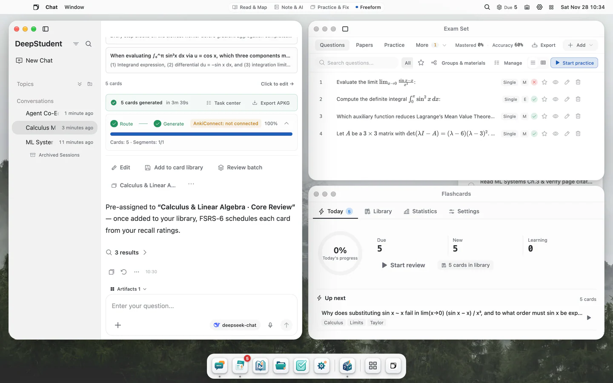
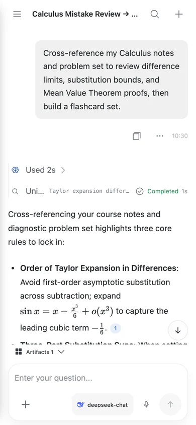
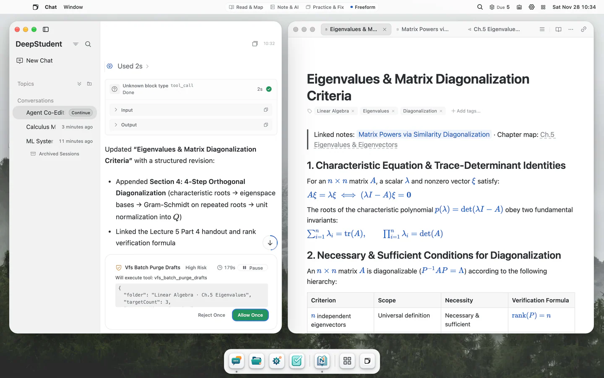
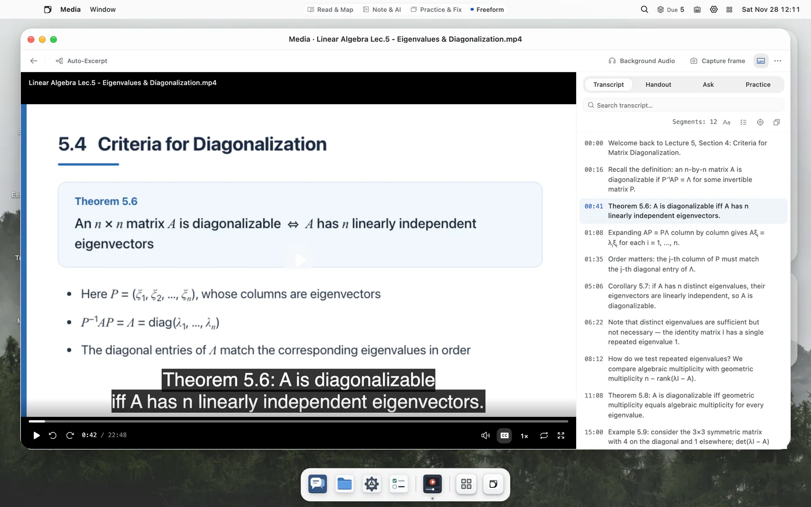
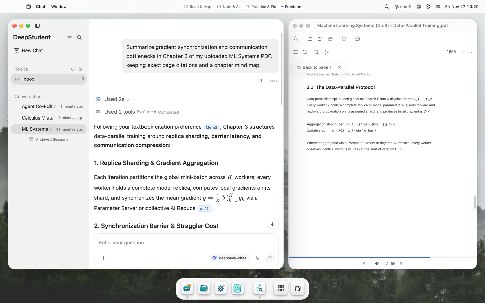
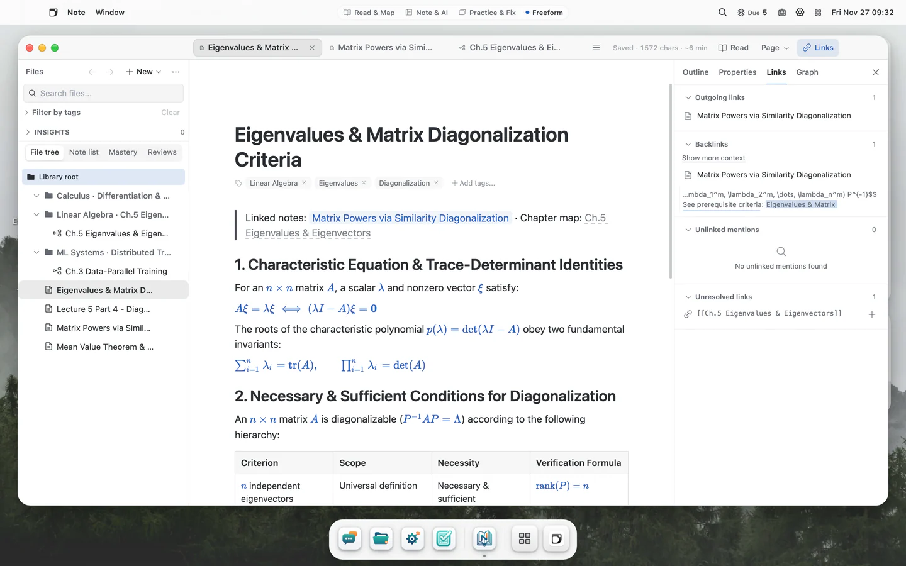
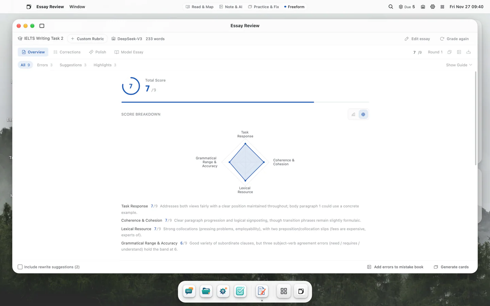

<div align="center">

[简体中文](./README_CN.md) | **English**


# DeepStudent

### Just focus on learning. Leave the rest to me.

An open-source, local-first AI learning workbench.<br />
Integrates 12 native study apps operated directly by an autonomous study agent.

[](https://github.com/helixnow/deep-student/releases/latest)
[](./LICENSE)
[](https://github.com/helixnow/deep-student)

[Website & Live Demo](https://deepstudent.cn/en/) ·
[**Download**](#installation) ·
[**Quickstart**](./docs/user-guide/en/01-quickstart.md) ·
[User Guide (EN)](./docs/user-guide/en/README.md) ·
[使用指南 (中文)](./docs/user-guide/README.md) ·
[Report an Issue](https://github.com/helixnow/deep-student/issues) ·
[Contributing](./.github/CONTRIBUTING.md)

</div>

<p align="center">
  
  &nbsp;
  
  <br />
  <sub>Desktop Main Interface (Study Desktop · macOS / Windows / Linux / WebUI) &nbsp;·&nbsp; Mobile Main Interface (Android / iOS / Mobile WebUI)</sub>
</p>

<details>
<summary>Prefer a traditional single-window left sidebar? Switch to Classic Layout anytime</summary>

<p align="center">
  
</p>

</details>

---

## Core Capabilities

Conventional AI study workflows split context across browser chat tabs, PDF readers, lecture players, note editors, and flashcard apps. DeepStudent unifies these tools in one local-first workspace where the study agent reads your materials, writes structured outputs directly into each app, and maintains long-term study context.

### 1. Cross-App Execution & Task Orchestration

- **Direct in-app actions**: Notes, Mind Map, Exam Set, Flashcards, Todo, Essay Review, and Translation expose native agent tools so outputs land directly in the target app. The agent also generates Word, PowerPoint, and Excel files, and renders interactive visual cards, live SVG diagrams, and HTML sandboxes inline in chat.
- **Long-horizon & parallel runs**: Goal mode continues multi-step work across turns, sub-agents execute research in parallel, scheduled automations run on time, and the built-in WeChat channel enables remote task dispatch and updates.
- **Risk-tiered approval & reversible edits**: Actions follow Ask / Plan / Craft permission modes. High-risk operations require explicit approval, and agent edits to notes and workspace state are highlighted with per-turn diff review and one-click undo.

<p align="center">
  
</p>

### 2. Document Reading, Literature & Media Study

- **Deep document reading**: Read PDF, Word, and EPUB files with AI Paper Guide, 5-color semantic highlights, region-selection Q&A, cross-page pinned figure references, and annotated PDF export (including rotated and encrypted PDFs).
- **Academic search & translation**: Search arXiv and OpenAlex with batch ingestion and formatted citations; translate full documents paragraph by paragraph across 7 domain presets with version rollback.
- **Lecture & audio/video study**: Transcribe local recordings or import Bilibili course links (including multi-part collections) with synced timestamps, ask playback-anchored questions (`mm:ss`), run in-lecture checkpoints that jump back on missed answers, and generate illustrated chapter handouts.
- **End-to-end source backlinks**: Chat answers, note excerpts, and flashcards retain clickable citations that jump straight back to the exact PDF page, mind map node, or media timestamp.

<p align="center">
  
</p>

### 3. Notes, Question Sets, Flashcards & Grading

- **Linked notes & mind maps**: Write Markdown notes with backlinks, tags, math formulas, and templates, or convert notes into mind maps in one step. Mind Map offers outline and canvas views plus a recall mode that masks key nodes and turns missed items into flashcards.
- **Full-format practice & mock exams**: Import exam papers or photographed questions into structured sets across 13 question types and 9 practice modes, with handwritten image answers, multimodal AI grading, and a cross-set mistake book.
- **Spaced repetition & exam sprints**: Built-in FSRS-6 scheduling and Exam Cram Sprint combine due flashcards, overdue mistakes, and weak mind map nodes into a daily queue based on your exam date, with bidirectional `.apkg` import/export (preserving review progress) and AnkiConnect sync — no external Anki installation required.
- **Rubric-based grading & study tracking**: Essay Review scores against 10 built-in exam rubrics (such as IELTS and graduate entrance exams) or custom rubrics with inline annotations and sentence polishing; Todo, Pomodoro, study heatmaps, and weekly reports track progress alongside `⌘K` / `Ctrl+K` deep search across flashcards, notes, and chats.

<table>
  <tr>
    <td width="50%"></td>
    <td width="50%"></td>
  </tr>
  <tr>
    <td></td>
    <td></td>
  </tr>
  <tr>
    <td></td>
    <td></td>
  </tr>
</table>

### 4. Long-Term Memory, Models & Extensions

- **Transparent long-term memory**: Separates user-defined **standing interaction rules** (scoped globally, by subject, or by study mode) from an evolving **learner profile** synthesized from practice and grading weak spots. Includes version rollback and per-message attribution chips in chat to inspect, edit, or remove any applied rule.
- **Flexible model & search providers**: Ships with 15 preset model providers (automatic API key detection and slot assignment, Codex OAuth and OpenCode Go subscriptions, official DeepSeek APIs, keyless local Ollama models, and side-by-side multi-model comparison); one-click local scan or paste import with incremental sync from **CC Switch** (including `ccswitch://` deep links and `.db`/`.sql` backups), **Magpie**, **OpenCode**, **Claude Code**, and **Codex** (auto-filtering local proxy placeholders to import real upstream providers); plus 9 web search engines and 6 OCR engines.
- **Native local coding CLI collaboration (Desktop)**: Auto-detects and invokes local **Claude Code**, **Codex CLI**, **OpenCode**, **Pi Agent**, **Antigravity CLI**, **DeepSeek Harness**, and custom CLI tools directly in chat via the unified model picker or `@handle` (and `/swarm` / `/handoff` multi-agent collaboration), with per-CLI model and reasoning effort selection, inline tool approval, live steering, concurrent file leases, instant turn revert via hidden snapshots, and shared study context.
- **Layered skills & plugins**: Includes 58 on-demand built-in skills, community skill repositories, and MCP server integration; supports zero-code `.dspack` Study Packs (sharing rubrics, prompts, and workflows) and the **AI Plugin Workshop** for generating, compiling, verifying, and hot-reloading `.dstuplugin` extensions from natural language.

---

## Built-in Apps Overview

All study apps reside in the Study Desktop Dock, supporting multi-window tiling, four workflow stage presets, or switching to the classic left-sidebar single-pane layout at any time.

| App | Core Function |
|---|---|
| **Chat** | Document-first split-pane Q&A, interactive visual cards, multi-model comparison, memory attribution chips, and source jumps. |
| **Files** | Unified library for textbooks, papers, notes, question sets, and media with automatic full-text and vector indexing. |
| **Media** | Lecture transcription and Bilibili import with synced transcripts, `mm:ss`-anchored Q&A, checkpoints, and illustrated handouts. |
| **Textbook** | PDF, Word, and EPUB reader with AI Paper Guide, 5-color highlights, region Q&A, pinned figures, and annotated PDF export. |
| **Notes** | Markdown editor with backlinks, math, tags, source jump-back, and reversible highlighted AI edits. |
| **Mind Map** | Outline and canvas concept mapping with masked recall testing and one-click flashcard generation for missed blanks. |
| **Exam Set** | Document and image question extraction across 13 question types, 9 practice modes, handwritten answer grading, and mistake book. |
| **Flashcards** | Card creation, templates, and FSRS-6 scheduling with Exam Cram Sprint, `.apkg` import/export, and AnkiConnect sync. |
| **Essay Review** | Rubric-based scoring across 10 built-in modes or custom rubrics, with inline marks, polishing, and weak-spot tracking. |
| **Translation** | Paragraph-aligned full-text translation with 7 domain presets, persistent formality preferences, and version rollback. |
| **Todo · Pomodoro** | Unified daily review and task queue with focus timer, activity heatmaps, and weekly study reports. |
| **Skills & Plugin Workshop** | Manage built-in/community skills, MCP servers, `.dspack` Study Packs, AI-authored `.dstuplugin` extensions, and Safe Mode recovery. |

Complete learner documentation: [**English User Guide**](./docs/user-guide/en/README.md) · [**中文使用指南**](./docs/user-guide/README.md) ([online mirror](https://deepstudent.cn/user-guide/)).

---

## Data Storage & Privacy

- **Local storage by default**: Materials, notes, conversations, and search indexes are stored locally on your device (SQLite, LanceDB, and local files) with no account required. Before any backup restore cutover, DeepStudent automatically creates a verified safety snapshot for one-click rollback.
- **Explicit outbound boundaries**: Outbound requests occur only when calling your configured model providers, search engines, or MCP servers. Cloud sync, WeChat remote access, and error reporting remain off unless explicitly enabled.
- **Encrypted cross-device sync & pairing**: Supports QR-paired device setup and encrypted sync (WebDAV and S3-compatible storage on Desktop and WebUI; WebDAV on native Android), with saved credentials masked at rest and in the UI.
- **Open source & auditable**: Licensed under [AGPL-3.0-or-later](./LICENSE), with all storage, sync, and security implementations inspectable in this repository.

<details>
<summary>Per-platform cloud sync scope & archive backup notes</summary>

- **Supported sync backends by surface**:
  - **Desktop & Desktop WebUI**: WebDAV, S3-compatible storage, and experimental FTP.
  - **Mobile WebUI**: WebDAV and S3-compatible storage (FTP hidden in mobile WebUI).
  - **Android native**: Android is WebDAV only.
- **Whole-package cloud archive rules**: Full-package cloud backups upload a complete ZIP archive without incremental delta transfer. Without a cloud end-to-end encryption password configured, a default cloud whole-package backup is a portable archive and cannot slot-restore; when encryption is enabled but the local password cannot be read, export is refused rather than silently downgrading to plaintext. See [Backups, Cloud Sync, Mobile & WebUI](./docs/user-guide/en/06-sync-backup-mobile-webui.md).

</details>

---

## Installation

Download the latest release from [GitHub Releases](https://github.com/helixnow/deep-student/releases/latest) or [deepstudent.cn/download](https://deepstudent.cn/download):

| Platform | Package | Architecture |
|:---:|---|---|
| macOS | `.dmg` / `.app.tar.gz` | Apple Silicon / Intel |
| Windows | `.exe` | x86_64 |
| Linux | `.deb` / `.AppImage` | x86_64 |
| Android | `.apk` | arm64 |
| WebUI / PWA | Self-hosted (`npm run web:prod`) | Modern desktop & mobile browsers |

> **iOS**: Source build via Xcode + Capacitor. See [Build Configuration](./docs/BUILD-CONFIG.md).
>
> **macOS Gatekeeper "app is damaged" prompt**: Run `sudo xattr -r -d com.apple.quarantine "/Applications/Deep Student.app"` and reopen the app.

### Quickstart Workflows

On first launch, paste an API key from any of the **15 preset providers** for automatic setup, or one-click import existing **CC Switch / Magpie / OpenCode / Claude Code / Codex** configs or `ccswitch://` deep links (on Desktop you can also invoke local coding CLIs directly, or connect local Ollama / Codex OAuth under *Settings → Model Service*), then follow a guided 3-minute workflow:

1. **[3-Minute Exam Cram Sprint](./docs/user-guide/en/01-quickstart.md#quick-scenario-1-3-minute-exam-cram-sprint)** — Import lecture notes or past papers to generate flashcards and practice questions, set your target exam date and daily budget, and launch a prioritized daily review sprint.
2. **[3-Minute 40-Page Paper Deep Read](./docs/user-guide/en/01-quickstart.md#quick-scenario-2-3-minute-40-page-paper-deep-read)** — Map out core contributions with AI Paper Guide, read side-by-side with 5-color semantic highlights and pinned figures, and export linked notes plus an annotated PDF.

> **Troubleshooting**: If a third-party plugin causes UI issues or profile errors, launch Safe Mode via *Settings → Plugins* or `--safe-mode` to disable faulted plugins, reset the layout cache, or repair plugin configuration with zero study data loss (see [1-Minute Safe Mode Self-Rescue](./docs/user-guide/en/01-quickstart.md#quick-scenario-3-1-minute-safe-mode-self-rescue)).

---

## For Developers

DeepStudent runs on a 100% TypeScript dual-kernel plugin architecture powered by [`@deepseek-ai/cordis`](https://github.com/cordiverse/cordis) 4, sharing one React UI and one Host kernel across Electron Desktop, Node WebUI / PWA, and Capacitor Mobile.

### Architecture

```
DeepStudent
├── Surfaces       Electron 45 (macOS · Windows · Linux) · WebUI & PWA (web/) · Capacitor 8.6 (Android · iOS)
├── Host Kernel    Cordis 4 plugin tree (host/kernel · host/platform · host/plugins · desktop.json 45 / mobile.json 37)
├── UI Kernel      20 official UI plugin directories (src/ui-plugins/official/) · slots & registries · UiErrorBudget
├── IPC Contracts  contracts/ipc/ schema governance (1,072 commands · 128 events · 998 types)
├── Data & Engines SQLite (better-sqlite3 / sqlite-wasm) · LanceDB · koffi FFI · f7-native-wasm (WASI-WASM)
└── Ecosystem      58 built-in skills · MCP · local CLI mesh · 3-tier plugins (.dspack / .dstuplugin / Cordis) · 15 LLM vendors · 9 search · 6 OCR
```

### Tech Stack

| Area | Technology |
|---|---|
| Frontend | React 18 · TypeScript 5.6 · Vite 6 · Tailwind CSS 3 · Radix UI · Zustand 5 |
| Desktop Shell | Electron 45 · `electron-builder` 26 · UtilityProcess Host · Electron Fuses |
| WebUI & PWA | Node HTTP / WebSocket gateway · HTTP 206 streaming · Service Worker + Web App Manifest |
| Mobile Shell | Capacitor 8.6 · Web Worker Host · `@sqlite.org/sqlite-wasm` + OPFS |
| Backend Runtime | Node.js 24+ · TypeScript · [`@deepseek-ai/cordis`](https://github.com/cordiverse/cordis) 4 · `esbuild` |
| Data & Native | `better-sqlite3` · `@lancedb/lancedb` · `@embedpdf/pdfium` · `@napi-rs/keyring` · `@node-rs/argon2` · `koffi` · `f7-native-wasm` |
| Editors & Rendering | Milkdown 7 · CodeMirror · PDF.js · KaTeX · Mermaid · ECharts · React Flow · Univer |

### Local Development

Requires **Node.js 24+** and **npm** (use `npm ci --legacy-peer-deps`; do not mix pnpm or yarn; no Rust toolchain required).

```bash
git clone https://github.com/helixnow/deep-student.git
cd deep-student
npm ci --legacy-peer-deps

# Start Electron desktop app in development mode (Frontend + Host kernel)
npm run dev:electron

# Or start the WebUI development server (default port :1428)
npm run web
```

<details>
<summary>Production packaging & verification commands</summary>

When building from a shallow clone that omits historical baseline commits, set an explicit build number first:

```bash
export DEEP_STUDENT_BUILD_NUMBER=20000
# PowerShell: $env:DEEP_STUDENT_BUILD_NUMBER = '20000'

# 1) Build and serve production WebUI & PWA (dist-web/)
npm run build:web && npm run web:prod

# 2) Build desktop package (--dir for unpacked smoke test, or --mac / --win / --linux)
npm run build
npx @electron/rebuild -f -w better-sqlite3
node electron/scripts/package.mjs --dir

# 3) Build Android APK (requires JDK 21 and Android SDK Platform 36)
npm --prefix mobile ci --legacy-peer-deps
node mobile/scripts/build-apk.mjs

# 4) Lint, typecheck, contracts, architecture boundaries & test suites
npm run lint
npm run typecheck
npm run typecheck:host
npm run check:plugins
npm run check:arch
npm run contracts:check
npm run check:public-surface
npm test
npm run test:host
npm run test:plugins
```

See [BUILD-CONFIG.md](./docs/BUILD-CONFIG.md) and [README-BUILD.md](./docs/README-BUILD.md) for cross-platform signing and packaging details.

</details>

<details>
<summary>Repository directory layout</summary>

```
DeepStudent
├── host/                        # TypeScript backend — Cordis plugin tree
│   ├── kernel/                  #   command router, IPC contract validation, events, protocols, profile store, plugin lifecycle & consent ledger
│   ├── platform/                #   platform providers: crypto · diagnostics · errors · files · http · log · native
│   │                            #   (koffi FFI & f7-native-wasm) · paths · secrets · settings · storage (+ storage-mobile) · vector
│   ├── plugins/                 #   31 domain & system plugin directories (agent-mesh, chat, chat-pipeline, llm, memory, vfs, notes,
│   │                            #   qbank, anki, review, sync, ilink, plugin-workshop, mobile-compat, …)
│   ├── profiles/                #   generated desktop.json (45) / mobile.json (37) assembly manifests
│   └── e2e/                     #   real-host, security, streaming, upgrade & tool coverage suites
├── electron/                    # Desktop shell
│   ├── main.ts                  #   window lifecycle, custom protocols, Electron Fuses & Host supervision
│   ├── preload/bridge.ts        #   drop-in frontend IPC compatibility bridge (window.__TAURI_INTERNALS__)
│   ├── shell/                   #   protocol routing, ds-plugin:// lock verification, CSP nonces, web-security, updater
│   └── scripts/                 #   package.mjs, verify-fuses.mjs, app-hardening.cjs
├── web/                         # WebUI & PWA server and client runtime
│   ├── server/                  #   HTTP/WebSocket gateway, auth rate limiter, HTTP 206 streaming, file staging
│   └── client/                  #   browser bootstrap & PWA Service Worker / Manifest
├── mobile/                      # Capacitor 8.6 mobile shell
│   ├── src/worker/              #   Host kernel inside a Web Worker (SQLite WASM + OPFS)
│   ├── src/shell/               #   Capacitor native bridge & persistent storage
│   └── scripts/build-apk.mjs    #   Android APK build script
├── src/                         # React 18 renderer
│   ├── ui-kernel/               #   UI plugin runtime: slots, registries, lazy loading, UiErrorBudget
│   ├── ui-plugins/official/     #   20 official UI plugin directories
│   ├── ui-sdk/                  #   defineUiPlugin & typed frontend services
│   ├── features/                #   domain UI modules (chat, generative-ui, notes, mindmap, practice, flashcards, media, pdf, …)
│   └── locales/                 #   i18n catalogs (zh-CN / en-US)
├── contracts/ipc/               # 1,072 commands · 128 events · 998 types
├── resources/                   # App config, SQL migrations, workshop templates & legal/ third-party notices
└── .github/workflows/           # CI gates & multi-platform release pipelines
```

</details>

<details>
<summary>Architectural evolution from v0.11.x (Tauri / Rust) to v0.20.x (Electron / Cordis)</summary>

Starting in **v0.20.x**, DeepStudent retired the legacy Tauri 2 / Rust backend (`0.11.x`) and unified on `@deepseek-ai/cordis` in TypeScript. Existing SQLite / LanceDB data directories and installed user plugins migrate in place across upgrades.

| Dimension | `0.11.x` (Tauri 2 / Rust) | `0.20.x` (Node / Electron / Cordis) |
|---|---|---|
| **Runtime & Kernel** | Tauri 2 + 25-crate Rust Cargo workspace + system WebView; compile-time command wiring | Electron 45 + `UtilityProcess` Host (`MessagePortMain`) + Cordis 4 microkernel (`desktop.json`: 45 modules; `mobile.json`: 37 modules); `contracts/ipc/` governing 1,072 commands, 128 events, and 998 types; compatibility bridge preserving the `src/` React UI |
| **Plugin Ecosystem & Isolation** | Static built-in plugins only; no runtime package format or AI build loop | 3-tier extension model: zero-code `.dspack` Study Packs, AI Plugin Workshop (14 agent tools, `esbuild` compilation with up to 3 auto-repair passes, hot reload, and version rollback), and full Cordis plugins; Manifest v2 network permissions and Safe Mode recovery |
| **Native + WASI-WASM Engines** | 30+ native Rust crates compiled into every binary; Rust toolchain required | Native bindings isolated to `host/platform/` and `electron/` (`better-sqlite3`, `@lancedb/lancedb`, `@embedpdf/pdfium`, `@napi-rs/keyring`, `@node-rs/argon2`, `koffi` FFI), paired with prebuilt `f7-native-wasm.wasm` (`wasm32-wasip1`) for document parsing, audio decoding, Starlark, and FSRS — zero Rust toolchain required |
| **Multi-Surface Parity** | Tauri desktop + Tauri mobile | Shared `src/` UI and `host/` kernel across Desktop (Electron 45), WebUI & PWA (HTTP/WebSocket binary framing + HTTP 206 streaming), and Mobile (Capacitor 8.6 + Web Worker Host + SQLite WASM / OPFS with zero Node runtime dependencies) |
| **Security & Upgrades** | Tauri capability ACLs + system WebView | Electron Fuses (`RunAsNode` and CLI inspect disabled, embedded ASAR integrity enforced), `ds-plugin://` SHA-256 lock containment, per-response cryptographic CSP nonces, centralized `web-security.ts` guards, and Minisign updater compatibility |

</details>

### Documentation

| Document | Description |
|---|---|
| [User Guide (English)](./docs/user-guide/en/README.md) | Complete English learner guide and [3-Minute Quickstarts](./docs/user-guide/en/01-quickstart.md) |
| [User Guide (Chinese)](./docs/user-guide/README.md) | Full 21-chapter Chinese user manual ([online mirror](https://deepstudent.cn/user-guide/)) |
| [WebUI & PWA](./docs/WEBUI-AND-PWA.md) | Self-hosted browser/PWA architecture, authentication, streaming, and reverse proxy setup |
| [DeepSeek Application APIs](./docs/DEEPSEEK-API.md) | Official DeepSeek Responses, Search/Fetch, document parsing, OCR, ASR, and TTS integration |
| [Build Configuration](./docs/BUILD-CONFIG.md) · [Build Quick Reference](./docs/README-BUILD.md) | Cross-platform desktop, Android, and iOS build setup, environment variables, and scripts |
| [Code Style](./docs/CODE_STYLE.md) · [Frontend Guide](./docs/frontend/README.md) | Coding conventions, layer boundaries, component catalog, and design tokens |
| [Plugin System v2](./docs/plugins/PLUGIN-V2.md) · [Plugin Architecture](./docs/plugins/ARCHITECTURE.md) | 3-tier extension model, `.dspack` Study Packs, dual-kernel design, and extension points |
| [Plugin SDK](./docs/plugins/SDK.md) · [Capabilities Reference](./docs/plugins/CAPABILITIES.md) | Authoring plugins: services, UI slots, manifests, and capability tiers |
| [Plugin Security](./docs/plugins/SECURITY.md) · [Plugin Upgrades](./docs/plugins/UPGRADES.md) | Community plugin sandboxing, `ds-plugin://` verification, and upgrade compatibility |
| [Good First Issues](./docs/community/good-first-issues.md) | Entry-level modules and starter ideas for new contributors |
| [Changelog](./CHANGELOG.md) · [Security Policy](./.github/SECURITY.md) | Release history and vulnerability reporting procedure |

---

## Contributing

1. Read [CONTRIBUTING.md](./.github/CONTRIBUTING.md) for branching, commit conventions, i18n guidelines, and CLA signing.
2. Ensure `npm run lint`, `npm run typecheck`, `npm run typecheck:host`, `npm run check:plugins`, `npm run contracts:check`, and `npm run check:public-surface` pass before opening a pull request.
3. Submit bug reports and feature requests via [GitHub Issues](https://github.com/helixnow/deep-student/issues).

## License

[AGPL-3.0-or-later](./LICENSE)

## Acknowledgments

DeepStudent builds upon open-source software — see [ACKNOWLEDGMENTS.md](./ACKNOWLEDGMENTS.md), [docs/THIRD_PARTY_LICENSES.md](./docs/THIRD_PARTY_LICENSES.md), and [resources/legal/THIRD_PARTY_NOTICES.txt](./resources/legal/THIRD_PARTY_NOTICES.txt) for full attributions and license texts:

- **Runtimes & App Shells**: [Electron](https://www.electronjs.org) · [Capacitor](https://capacitorjs.com) · [Cordis](https://github.com/cordiverse/cordis) · [Node.js](https://nodejs.org) · [React](https://react.dev) · [Vite](https://vite.dev) · [TypeScript](https://www.typescriptlang.org)
- **Storage, Vector & Native / WASM Engines**: [SQLite](https://www.sqlite.org) / [better-sqlite3](https://github.com/WiseLibs/better-sqlite3) / [@sqlite.org/sqlite-wasm](https://sqlite.org/wasm) · [LanceDB](https://lancedb.com) · [Apache Arrow](https://arrow.apache.org) · [koffi](https://koffi.dev) · F7 WASI Native Engines (Starlark / Symphonia / fsrs-rs / docx-rs / calamine) · [ts-fsrs](https://github.com/open-spaced-repetition/ts-fsrs)
- **Documents, Editors & Visualization**: [PDF.js](https://mozilla.github.io/pdf.js/) · [PDFium](https://github.com/embedpdf/embed-pdf-viewer) · [Milkdown](https://milkdown.dev) · [ProseMirror](https://prosemirror.net) · [CodeMirror](https://codemirror.net) · [KaTeX](https://katex.org) · [Mermaid](https://mermaid.js.org) · [ECharts](https://echarts.apache.org) · [React Flow](https://reactflow.dev) · [Univer](https://univer.ai) · [docx](https://github.com/dolanmiu/docx) · [ExcelJS](https://github.com/exceljs/exceljs) · [PptxGenJS](https://gitbrent.github.io/PptxGenJS/) · [DOMPurify](https://github.com/cure53/DOMPurify)
- **UI, State & Tooling**: [Tailwind CSS](https://tailwindcss.com) · [Radix UI](https://www.radix-ui.com) · [Phosphor Icons](https://phosphoricons.com) · [Zustand](https://zustand.docs.pmnd.rs) · [i18next](https://www.i18next.com) · [Vitest](https://vitest.dev) · [Playwright](https://playwright.dev) · [ESLint](https://eslint.org)
