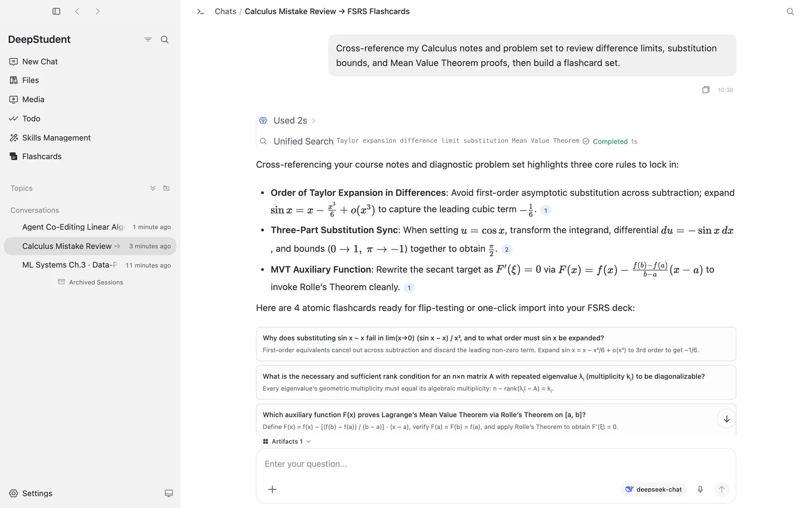
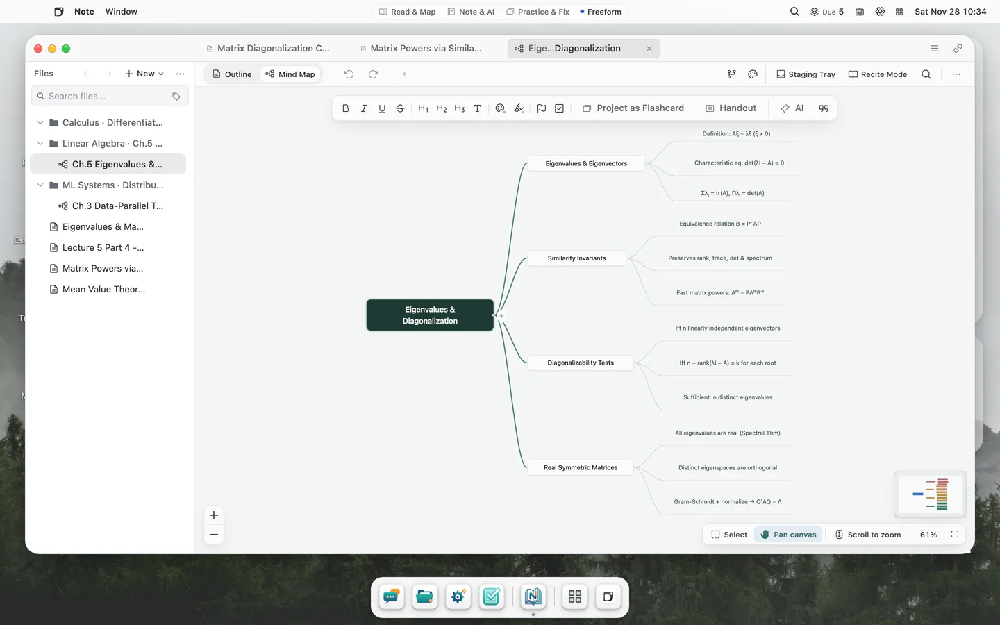
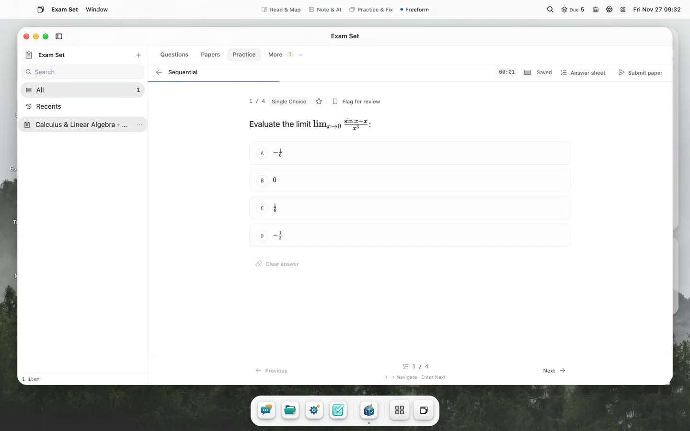
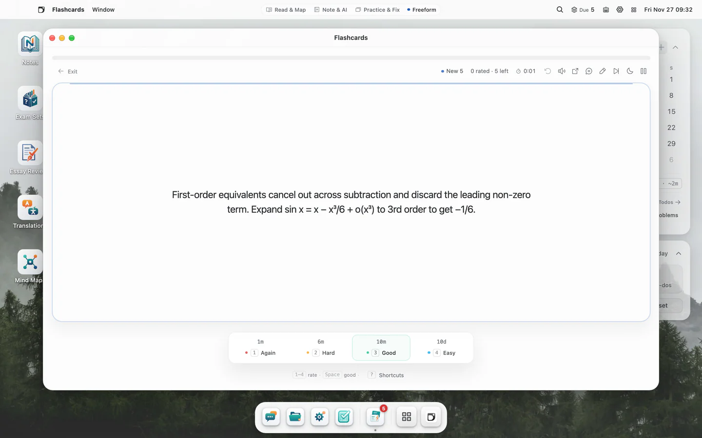

<div align="center">

[简体中文](./README_CN.md) | **English**


# DeepStudent

### Just focus on learning. Leave the rest to me.

An open-source, local-first AI learning workbench.<br />
Its study agent works directly in every app on your Study Desktop.

[](https://github.com/helixnow/deep-student/releases/latest)
[](LICENSE)
[](https://github.com/helixnow/deep-student)

[Website](https://deepstudent.cn/en/) ·
[**Download**](#installation) ·
[**User Guide (EN)**](./docs/user-guide/en/README.md) ·
[3-Min Quickstarts](./docs/user-guide/en/01-quickstart.md) ·
[用户指南 (中文)](./docs/user-guide/README.md) ·
[Report an issue](https://github.com/helixnow/deep-student/issues) ·
[Contributing](./.github/CONTRIBUTING.md)

**v0.20.9 — Electron + Capacitor + WebUI + Cordis.**<br />
DeepStudent runs on a 100% TypeScript dual-kernel plugin architecture powered by [`@deepseek-ai/cordis`](https://github.com/cordiverse/cordis) — featuring **Memory v2**, **Plugin v2 (`.dspack` Study Packs & Safe Mode Anti-SPOF)**, and verified **`pre_restore` safety snapshots**, unified at [`helixnow/deep-student`](https://github.com/helixnow/deep-student).

</div>

<p align="center">
  
  
  <br />
  <sub>Classic layout (sidebar + single page) · Android</sub>
</p>

<p align="center">
  
  <br />
  <sub>Study Desktop (the default on desktop and desktop browser WebUI)</sub>
</p>

---

## A study agent that works in every app

One sentence is enough. The agent opens the right app and produces the notes, mind maps, questions, cards and review plan; longer tasks it carries through on its own.

**It does the work.**
Notes, mind maps, exam sets, flashcards, todos, essay review and translation all have agent tools, so results land directly in the app instead of staying in a chat window. It can also operate the Study Desktop itself, research the web and academic papers, turn a recorded lecture into timestamped notes, produce Word, PowerPoint and Excel files, and render interactive learning cards directly in chat.

**Long tasks, handed off.**
Research, organizing and question writing keep moving without you: goal mode continues across turns, sub-agents work in parallel, scheduled automations run on time, and the built-in **WeChat iLink Bot** (`ilinkbot`) lets you interact remotely from WeChat.

**Every step under control.**
Actions are approved by risk level, with Ask / Plan / Craft permission modes. Edits to notes and the Study Desktop can be undone (including per-turn diff review and revert), and answers cite the exact PDF page, quote or lecture timestamp with clickable backlinks across notes, chat exports and flashcards.

**Knows you, grows with you (Memory v2 & Plugin v2).**
**Memory v2** separates standing **Interaction Hard Rules** (scoped by global, subject, or study mode) from an evolving **Learner Profile** (with 10-version 1-click rollback, dialectic **Suggestions**, and a clickable per-message **Memory Kernel** attribution chip so you can inspect or forget any rule right in chat). **58 built-in skills** load on demand, MCP connects external tools, **15 preset model providers** (plus native DeepSeek Responses, Search/Fetch, OCR, ASR and TTS APIs), **9 web search engines** and **6 OCR engines** are built in — and **Plugin v2** lets you share zero-code **`.dspack` Study Packs** or build and refine `.dstuplugin` extensions inside the **AI Plugin Workshop**, protected by **Safe Mode Anti-SPOF** 1-minute rescue and 1-click profile reset.

<p align="center">
  
</p>

---

## The apps it works in

Every app sits in the Study Desktop's Dock. Open one on its own, place several side by side, or let the agent open them for you.

| App | What it does |
|---|---|
| **Chat** | Study around your own materials with document-first reading layout, interactive visual cards, inline missing-API-key onboarding, per-message Memory Kernel attribution chips, and clickable citations. |
| **Files** | Textbooks, notes, question sets, documents, audio and video in one library, indexed for AI search on import (with multi-engine OCR). |
| **Media** | Transcribe lectures and recordings with timestamps, follow along with a synced transcript, ask grounded Companion QA anchored to the exact playback moment (`mm:ss`) with clickable jumps, and turn lessons into illustrated notes. |
| **Textbook** | PDF, Word and EPUB reading with 5-color semantic highlights, AI Paper Guide, split-pane Notes/PDF citation jump-back, and annotated PDF export (including rotated and encrypted PDFs). |
| **Notes** | Markdown notes with backlinks, tags, math, clickable PDF/media source jump-back, and same-name tab disambiguation; agent edits are highlighted and reversible. |
| **Mind Map** | A full mind map from one sentence; outline and canvas views, plus a recite mode that hides key nodes and converts missed blanks into flashcards. |
| **Exam Set** | Drop in an exam or textbook and get a question set; nine practice modes, auto grading, mistake book, and handwritten answers. |
| **Flashcards** | Review, card making and templates in one place: built-in FSRS-6 spaced repetition (with local-midnight DST-safe scheduling and Exam Cram Sprint), large-deck filter/scroll memory, `.apkg` import/export (with WebUI embedded media parity), and AnkiConnect v6 sync — no Anki install required. |
| **Essay Review** | Scores against exam rubrics (Gaokao, IELTS, postgraduate exams and custom `.dspack` YAML rubrics), inline marks, sentence polishing, and weak-point signals into Memory v2. |
| **Translation** | Full-text translation with paragraph-by-paragraph comparison, 7 domain presets, persistent language/formality choices, and version history rollback. |
| **Todo · Pomodoro** | Today's reviews and tasks in one list; a focus timer with stats, heatmaps, and `⌘K` / `Ctrl+K` deep content search across flashcards, notes, and chats. |
| **Skills & Plugin Workshop** | Built-in and community skills, MCP servers, zero-code `.dspack` Study Packs, AI-authored `.dstuplugin` extensions (`✦ Refine with AI`), and Safe Mode rescue. |

<table>
  <tr>
    <td width="50%"></td>
    <td width="50%"></td>
  </tr>
  <tr>
    <td></td>
    <td></td>
  </tr>
  <tr>
    <td></td>
    <td></td>
  </tr>
</table>

<p align="center">
  
</p>

Full learner guides for every workflow: [**English User Guide (`docs/user-guide/en/`)**](./docs/user-guide/en/README.md) · [**中文使用指南 (`docs/user-guide/`)**](./docs/user-guide/README.md) ([online mirror](https://deepstudent.cn/user-guide/)).

---

## Your data stays on your machine

- **Local storage & `pre_restore` safety snapshots.** Materials, notes, chats and indexes are stored locally (SQLite, LanceDB and local files). Existing data directories from `0.11.x` mount in place with full SQL migration replay. Before any backup restore cutover, DeepStudent automatically creates and verifies a **`pre_restore` safety snapshot** (kept visible in your Backup List for 1-click rollback) via *Settings → Data governance*.
- **When data leaves your machine.** Model calls, web search and MCP send the relevant requests to the services you configured; cloud sync, WeChat iLink Bot and Sentry error reporting send data only when you turn them on.
- **Cloud & LAN sync (Sync V5).**
  - **Desktop & Desktop WebUI:** WebDAV, S3-compatible storage, and experimental FTP.
  - **Mobile WebUI:** WebDAV and S3-compatible storage (FTP hidden in mobile WebUI).
  - **Android native:** WebDAV only.
  - Saved cloud passwords are masked and never echoed in plaintext (leave blank to keep existing credentials). Sync V5 guards weak networks with lease heartbeats and automatic self-residual reclaim. Cross-device QR pairing uses **`DSPAIR1`** in the current UI (6-digit PIN QR, full-screenshot auto-decode, and paste-code fallback), while **`DSPAIR2`** is backend-ready. Default cloud whole-package archives remain **portable archives (not direct slot-restore)**, and encrypted export requires a cloud end-to-end encryption password.
- **Open source, verifiable.** AGPL-3.0-or-later. Everything privacy-related is in this repository.

---

## Installation

Download the latest release from [GitHub Releases](https://github.com/helixnow/deep-student/releases/latest) or [deepstudent.cn](https://deepstudent.cn/download):

| Platform | Package | Architecture |
|:---:|---|---|
| macOS | `.dmg` / `.zip` | Apple Silicon / Intel |
| Windows | `.exe` / `.zip` | x86_64 |
| Linux | `.deb` / `.AppImage` | x86_64 |
| Android | `.apk` | arm64 |
| WebUI / PWA | Self-hosted (`npm run web:prod`) | Any modern browser |

> **iOS:** source build only via Xcode + Capacitor. See [Build Configuration](./docs/BUILD-CONFIG.md).
>
> **macOS says the app "is damaged":** run `sudo xattr -r -d com.apple.quarantine "/Applications/Deep Student.app"`.

After installing, paste an API key for one of the **15 preset model providers** (or connect a local model) in the welcome setup or via *Settings → Model Services*, pick one of the 3 starter steps, and jump straight in.

### 3-Minute Scenario Quickstarts

Follow a 3-minute walkthrough right after installing ([English](./docs/user-guide/en/01-quickstart.md) · [中文版](./docs/user-guide/01-快速上手.md#3-分钟场景速通)):

1. **Exam Cram Sprint (3 min)** — Import past exams/notes, generate flashcards & practice questions, set your exam date and daily budget, and click **Start Daily Sprint** (auto-pauses new cards in the final 3 days). → [English](./docs/user-guide/en/01-quickstart.md) · [中文](./docs/user-guide/01-快速上手.md#3-分钟考前冲刺)
2. **40-Page Paper Deep Read (3 min)** — Run **AI Paper Guide**, read in single-column fit with split-pane chat, add 5-color highlights & pinned figures, export clickable citation notes, and export an annotated PDF (even on rotated or encrypted PDFs). → [English](./docs/user-guide/en/01-quickstart.md) · [中文](./docs/user-guide/01-快速上手.md#3-分钟精读-40-页论文)
3. **Safe Mode 1-Minute Self-Rescue (1 min)** — Recover from a faulty plugin, broken UI layout, or corrupted `user.profile.json` via **Restart in Safe Mode**, 1-click profile reset, and exit verification — with zero study data loss. → [English](./docs/user-guide/en/01-quickstart.md) · [中文](./docs/user-guide/01-快速上手.md#1-分钟安全模式自救)

---

## What Changed in 0.20.x: From Tauri/Rust 0.11.x to Electron/Cordis

Starting with **v0.20.x**, DeepStudent retired the legacy Tauri 2 / Rust backend (`0.11.x`) and moved to a unified TypeScript architecture on [`@deepseek-ai/cordis`](https://github.com/cordiverse/cordis). Existing React UI code and on-disk SQLite / LanceDB data remain compatible in place.

| Dimension | Legacy `0.11.x` (Tauri 2 / Rust) | Current `0.20.9` (Node / Electron / Cordis) |
|---|---|---|
| **Runtime & Kernel** | Tauri 2 + 25-crate Rust Cargo workspace + system WebView; compile-time command wiring | **Electron 45** + **UtilityProcess Host** (`MessagePortMain`) + **Cordis 4 microkernel** (`desktop.json`: **44** assembled modules across platform services & business plugins; `host/plugins/`: **30** plugin dirs; **19** official UI plugin packages under `src/ui-plugins/official/`); **1,066** IPC commands / **128** events / **989** types governed by `contracts/ipc/`; drop-in `window.__TAURI_INTERNALS__` shim keeps `src/` React 18 untouched |
| **Plugin v2, Workshop & Safe Mode** | Static built-in plugins only (e.g., `ilink_bot`); no runtime plugin package format or AI authoring | **Plugin v2** 3-tier model: Tier 1 zero-code **`.dspack` Study Packs** (YAML rubrics, `SKILL.md`, templates, workflows), Tier 2 **AI Plugin Workshop** (`plugin-workshop`, 14 Agent tools, `esbuild` compile + 3 auto-repair passes, `✦ Refine with AI`, brokered `studyData`/`pluginModel`/`pluginNotify`), Tier 3 full Cordis plugins; Manifest v2 fine-grained network permissions; **Safe Mode Anti-SPOF** UI rescue (`Restart in Safe Mode`, `SafeModeExitDialog`, UI layout cache reset, MCP auto-connect pause) & 1-click `reset-profile` recovery for corrupted `user.profile.json` |
| **Hybrid Native + WASI-WASM** | 30+ native Rust crates baked into every build; Rust toolchain required | Native bindings isolated strictly to `host/platform/` & `electron/` (`better-sqlite3`, `@lancedb/lancedb`, `@embedpdf/pdfium`, `@napi-rs/keyring`, `@node-rs/argon2`, **`koffi` FFI** for Win32 ACL / ShellExecuteW & macOS AppKit) + prebuilt **`f7-native-wasm.wasm`** (`wasm32-wasip1`) running `regex`, `starlark`, `symphonia`, `image`, `fsrs`, `roxmltree` and `docx-rs`/`calamine`/`pptx-to-md` via `node:wasi` or in-memory WASI; **zero Rust toolchain required** |
| **Multi-Surface Parity** | Tauri 2 desktop + Tauri 2 mobile | One `src/` UI + one `host/` Cordis kernel across **3 surfaces**: **Desktop** (`electron/`, Electron 45), **WebUI & PWA** (`web/`, HTTP/WebSocket + binary framing + HTTP 206 streaming + installable PWA; desktop browsers run full Study Desktop, mobile browsers auto-switch to mobile shell), and **Mobile** (`mobile/`, Capacitor 8.6 + Web Worker Host + `@sqlite.org/sqlite-wasm` / OPFS; `mobile.json` verified at **37 modules / 0 Node dependencies**) |
| **Security & Isolation** | Tauri capability ACLs + system WebView | **Electron Fuses** (`RunAsNode=false`, `EnableNodeOptionsEnvironmentVariable=false`, `EnableNodeCliInspectArguments=false`, `EnableEmbeddedAsarIntegrityValidation=true`, `OnlyLoadAppFromAsar=true`, `GrantFileProtocolExtraPrivileges=false`, `EnableCookieEncryption` on Win/Linux & signed macOS) + **`ds-plugin://`** locked by `plugins.lock.json` SHA-256 & path containment + **per-response cryptographic CSP nonces** on HTML + centralized `web-security.ts` guards + `tauri-plugin-updater` 2.10 Minisign compatibility with user-plugin preservation across upgrades |
| **Learning & AI Breakthroughs** | Markdown chat, FSRS-6, earlier cloud backup, single reading pane | **Memory v2** (L1 Hard Rules, Learner Profile 10-version rollback, per-message attribution chip, Dialectic Reflection, Turn-1 session-frozen `<memory_kernel>` + `<memory_delta>`) · **Generative UI** (`openui-lang`, `interactive-explainer`, live SVG diagrams, HTML sandbox) · **DeepSeek Official APIs** · **PDF rotated/encrypted annotated export & 460px split-pane backlinks** · **Sync V5** (HLC, Merkle, `.dsix`, weak-network lease guard, `pre_restore` safety snapshots, `DSPAIR1` UI / `DSPAIR2` backend) · **FSRS-6 local-midnight & FSRS-7 desktop trial** · **WeChat iLink Bot** (`ilinkbot`) |

---

## For developers

### Architecture

```
DeepStudent
├── Surfaces       Electron 45 (macOS · Windows · Linux) · WebUI & PWA (web/) · Capacitor 8.6 (Android · iOS)
├── Host kernel    Cordis 4 plugin tree (host/kernel · host/platform · host/plugins · desktop.json 44 / mobile.json 37)
├── UI kernel      19 official UI plugin packages (src/ui-plugins/official/) · slots & registries · UiErrorBudget
├── Agent & Tools  58 built-in skills · Memory v2 · MCP · Plugin v2 (.dspack / .dstuplugin, Workshop 14 tools) · Generative UI
├── Data & Engines SQLite (better-sqlite3 / sqlite-wasm) · LanceDB · koffi FFI · f7-native-wasm (WASI-WASM) · Sync V5
└── Integrations   15 model providers · DeepSeek Official APIs · 9 web search engines · 6 OCR engines · WeChat iLink Bot
```

<details>
<summary>Code structure</summary>

```
DeepStudent
├── host/                        # TypeScript backend — Cordis plugin tree
│   ├── kernel/                  #   command router, IPC contract validation, events, protocols, profile store,
│   │                            #   plugin lifecycle/admin, community context & consent ledger
│   ├── platform/                #   platform providers: crypto · diagnostics · errors · files · http · log · native
│   │                            #   (koffi FFI & f7-native-wasm) · paths · secrets · settings · storage (+ storage-mobile) · vector
│   ├── plugins/                 #   30 plugin directories (chat, chat-pipeline, llm, memory, vfs, notes, qbank, anki,
│   │                            #   review, sync, ilink, plugin-workshop, mobile-compat, …)
│   ├── profiles/                #   generated desktop.json (44) / mobile.json (37) assembly
│   └── e2e/                     #   real-host, security, streaming, upgrade & tool coverage suites
├── electron/                    # Desktop shell
│   ├── main.ts                  #   windows, custom protocols, Electron Fuses & Host supervision
│   ├── preload/bridge.ts        #   drop-in Tauri API compatibility bridge (window.__TAURI_INTERNALS__)
│   ├── shell/                   #   protocols, ds-plugin:// lock, CSP nonces, web-security, updater, koffi native window
│   └── scripts/                 #   package.mjs, verify-fuses.mjs, app-hardening.cjs
├── web/                         # WebUI & PWA server/client runtime
│   ├── server/                  #   HTTP/WebSocket gateway, auth rate limiter, HTTP 206 streaming, staging
│   └── client/                  #   browser bootstrap & PWA service worker / manifest
├── mobile/                      # Capacitor 8.6 mobile shell
│   ├── src/worker/              #   Host kernel in a Web Worker (SQLite WASM + OPFS)
│   ├── src/shell/               #   Capacitor shell bridge & persistent storage
│   └── scripts/build-apk.mjs    #   Android APK build script
├── src/                         # React 18 renderer
│   ├── ui-kernel/               #   UI plugin runtime: slots, registries, lazy loading, UiErrorBudget
│   ├── ui-plugins/official/     #   19 official UI plugin packages
│   ├── ui-sdk/                  #   defineUiPlugin + typed services
│   ├── features/                #   chat, generative-ui, notes, mindmap, practice, flashcards, media, pdf, …
│   └── locales/                 #   i18n (zh-CN / en-US)
├── contracts/ipc/               # 1,066 commands · 128 events · 989 types (zero Rust required)
├── resources/                   # App config, capabilities, SQL migrations & dstu-workshop skills/templates
├── legal/                       # THIRD_PARTY_NOTICES.txt & WASM/frontend license manifests
└── .github/workflows/           # CI, typecheck & multi-platform packaging
```

</details>

### Tech stack

| Area | Technology |
|---|---|
| Frontend | React 18 · TypeScript 5.6 · Vite 6 · Tailwind CSS 3 · Radix UI · Zustand 5 |
| Desktop shell | Electron 45 · `electron-builder` 26 · UtilityProcess Host · Electron Fuses |
| WebUI & PWA | Node HTTP / WebSocket gateway · Service Worker + Web App Manifest |
| Mobile shell | Capacitor 8.6 · Web Worker Host · `@sqlite.org/sqlite-wasm` + OPFS |
| Backend runtime | Node.js 24+ · TypeScript · [`@deepseek-ai/cordis`](https://github.com/cordiverse/cordis) 4 · `esbuild` |
| Data & Native | `better-sqlite3` · `@lancedb/lancedb` · `@embedpdf/pdfium` · `@napi-rs/keyring` · `@node-rs/argon2` · `koffi` · `f7-native-wasm` (WASI-WASM) |
| Editors & Rendering | Milkdown 7 · CodeMirror · PDF.js · KaTeX · Mermaid · ECharts · React Flow · `openui-lang` |

### Local development

Requires **Node.js 24+** and npm (do not mix with pnpm or yarn). No Rust or Tauri toolchain is needed; Android builds additionally require JDK 21 and Android SDK platform 36.

```bash
git clone https://github.com/helixnow/deep-student.git
cd deep-student
npm ci --legacy-peer-deps
export DEEP_STUDENT_BUILD_NUMBER=20000
# PowerShell: $env:DEEP_STUDENT_BUILD_NUMBER = '20000'

# 1) Electron desktop app in development mode
npm run dev:electron

# 2) WebUI & PWA (dev server on :1428, or build & serve dist-web/)
npm run web
npm run build:web && npm run web:prod

# 3) Production frontend + desktop package (--dir for unpacked smoke, or --mac / --win / --linux)
npm run build
npx @electron/rebuild -f -w better-sqlite3
node electron/scripts/package.mjs --dir

# 4) Android APK (Capacitor + mobile Worker Host)
node mobile/scripts/build-apk.mjs

# 5) Type checks, contracts, plugin boundaries & test suites
npm run typecheck
npm run typecheck:host
npm run check:plugins
npm run contracts:check
npm test
npm run test:host
npm run test:plugins
npx vitest run -c mobile/vitest.config.ts
node scripts/portability/scan.mjs --profile host/profiles/mobile.json
```

Packaging and cross-platform builds: [BUILD-CONFIG.md](./docs/BUILD-CONFIG.md).

### Documentation

| Document | Description |
|---|---|
| [User Guide (English)](./docs/user-guide/en/README.md) | Complete English learner guides, including [3-Minute Quickstarts](./docs/user-guide/en/01-quickstart.md) |
| [User Guide (Chinese)](./docs/user-guide/README.md) | Full 21-chapter Chinese user guide ([online mirror](https://deepstudent.cn/user-guide/)) |
| [Memory System v2](./docs/dev/MEMORY-V2.md) | L1 Hard Rules, Learner Profile rollback, session-frozen `<memory_kernel>`, and dialectic reflection |
| [Plugin System v2](./docs/plugins/PLUGIN-V2.md) | 3-tier extension model, `.dspack` Study Packs, Manifest v2 permissions, and portable sandbox |
| [Build configuration](./docs/BUILD-CONFIG.md) | Cross-platform Electron, Android & iOS build & packaging |
| [WebUI & PWA](./docs/WEBUI-AND-PWA.md) | Browser/PWA architecture, auth model, streaming & reverse proxy setup |
| [DeepSeek Application APIs](./docs/DEEPSEEK-API.md) | Official Responses, Search/Fetch, document parsing, OCR, ASR & TTS integration |
| [Plugin architecture](./docs/plugins/ARCHITECTURE.md) | Host kernel, UI kernel, contracts and extension points |
| [Plugin SDK](./docs/plugins/SDK.md) | Writing a plugin: services, slots, manifest, capability tiers |
| [Plugin security](./docs/plugins/SECURITY.md) | Community plugin permissions, `ds-plugin://` checks & boundaries |
| [Plugin upgrades](./docs/plugins/UPGRADES.md) | User plugin preservation and compatibility checks across app upgrades |
| [Plugin Workshop comparison](./docs/plugins/WORKSHOP-HARNESS-COMPARISON.md) | How the autonomous plugin loop is designed and guarded |
| [Changelog](./CHANGELOG.md) | Version history |
| [Security policy](./.github/SECURITY.md) | Reporting vulnerabilities |

---

## Contributing

1. Read [CONTRIBUTING.md](./.github/CONTRIBUTING.md) for the workflow.
2. Make sure `npm run lint`, `npm run typecheck`, `npm run typecheck:host`, and `npm run check:plugins` pass before opening a PR.
3. Report bugs and ideas in [Issues](https://github.com/helixnow/deep-student/issues).

## License

[AGPL-3.0-or-later](./LICENSE)

## Acknowledgments

DeepStudent is built on open-source software — see [ACKNOWLEDGMENTS.md](ACKNOWLEDGMENTS.md) and [legal/THIRD_PARTY_NOTICES.txt](legal/THIRD_PARTY_NOTICES.txt) for full attributions and license texts, including:

- **Runtimes & App Shells:** [Electron](https://www.electronjs.org) · [Capacitor](https://capacitorjs.com) · [Cordis](https://github.com/cordiverse/cordis) · [Node.js](https://nodejs.org) · [React](https://react.dev) · [Vite](https://vite.dev) · [TypeScript](https://www.typescriptlang.org)
- **Data, Vector & Native / WASI-WASM Engines:** [SQLite](https://www.sqlite.org) / [better-sqlite3](https://github.com/WiseLibs/better-sqlite3) / [@sqlite.org/sqlite-wasm](https://sqlite.org/wasm) · [LanceDB](https://lancedb.com) · [Apache Arrow](https://arrow.apache.org) · [koffi](https://koffi.dev) · F7 WASI Native Engines (Starlark / Symphonia / fsrs-rs / docx-rs / calamine) · [ts-fsrs](https://github.com/open-spaced-repetition/ts-fsrs)
- **Documents, Editors & Visualization:** [PDF.js](https://mozilla.github.io/pdf.js/) · [PDFium](https://github.com/embedpdf/embed-pdf-viewer) · [Milkdown](https://milkdown.dev) · [ProseMirror](https://prosemirror.net) · [CodeMirror](https://codemirror.net) · [KaTeX](https://katex.org) · [Mermaid](https://mermaid.js.org) · [ECharts](https://echarts.apache.org) · [React Flow](https://reactflow.dev) · [docx](https://github.com/dolanmiu/docx) · [ExcelJS](https://github.com/exceljs/exceljs) · [PptxGenJS](https://gitbrent.github.io/PptxGenJS/) · [DOMPurify](https://github.com/cure53/DOMPurify)
- **UI, State & Dev/Test Tooling:** [Tailwind CSS](https://tailwindcss.com) · [Radix UI](https://www.radix-ui.com) · [Phosphor Icons](https://phosphoricons.com) · [Zustand](https://zustand.docs.pmnd.rs) · [i18next](https://www.i18next.com) · dev/testing tooling ([Vitest](https://vitest.dev) · [Playwright](https://playwright.dev) · [ESLint](https://eslint.org))
