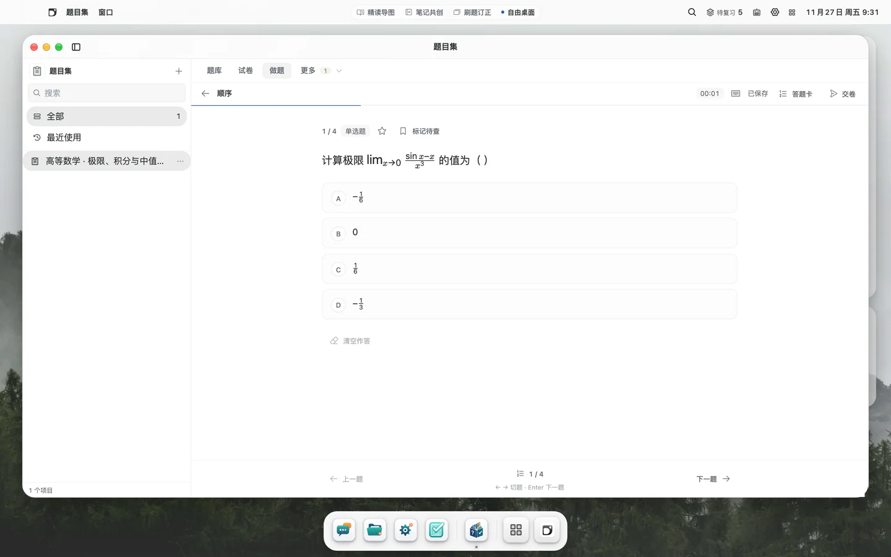
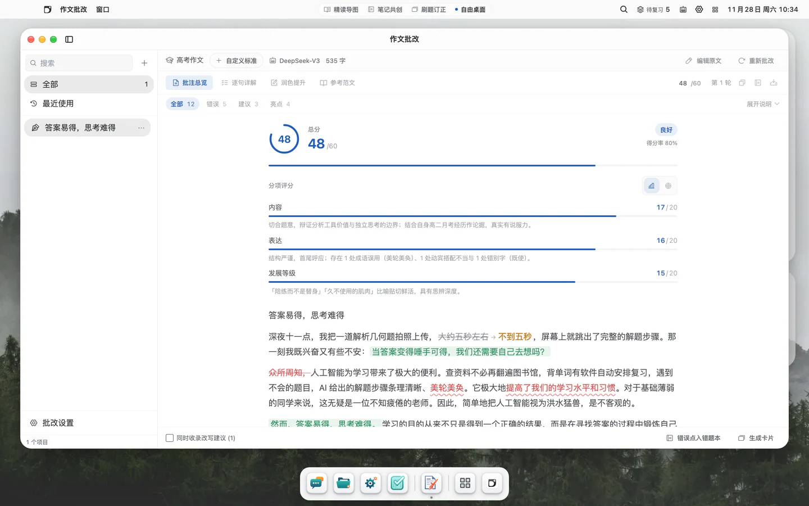

<div align="center">

**简体中文** | [English](./README.md)


# DeepStudent

### 只专注学习本身就够了，剩下的都交给我。

开源、本地优先的 AI 学习工作台。<br />
集成 12 个原生学习应用，由学习 Agent 直接跨应用读写、检索、制卡、组卷与规划复习。

[](https://github.com/helixnow/deep-student/releases/latest)
[](./LICENSE)
[](https://github.com/helixnow/deep-student)

[官网与在线演示](https://deepstudent.cn) ·
[**下载安装**](#安装) ·
[**快速上手**](./docs/user-guide/01-快速上手.md#3-分钟场景速通) ·
[使用指南 (中文)](./docs/user-guide/README.md) ·
[User Guide (EN)](./docs/user-guide/en/README.md) ·
[问题反馈](https://github.com/helixnow/deep-student/issues) ·
[参与贡献](./.github/CONTRIBUTING.md)

</div>

<p align="center">
  
  &nbsp;
  
  <br />
  <sub>桌面端主界面（学习桌面 · macOS / Windows / Linux / WebUI） &nbsp;·&nbsp; 移动端主界面（Android / iOS / 移动 WebUI）</sub>
</p>

<details>
<summary>偏好传统单窗口与左侧导航栏？支持一键切换经典布局</summary>

<p align="center">
  
</p>

</details>

---

## 核心能力

在传统流程中，问答停留在聊天网页，教材、网课、笔记、题库与闪卡分散在不同软件中，上下文难以延续。DeepStudent 将学习全流程整合在同一桌面环境下，使 AI 能够围绕本地资料直接操作各应用并沉淀长期学习记录。

### 1. 跨应用执行与任务协同

- **直接写入应用**：笔记、思维导图、题目集、闪卡、待办、作文批改与翻译均配备原生 Agent 工具，生成结果直接落入对应应用；同时支持生成 Word、PPT、Excel 文档，并在对话中渲染交互式图表、动态 SVG 与 HTML 沙箱。
- **长程与并行调度**：支持目标模式跨轮自动续跑、多子代理并行调研、定时自动化执行，并可通过内置微信通道远程下达任务与接收汇报。
- **风险分级与可逆编辑**：提供 Ask / Plan / Craft 三档权限模式；高风险操作执行前需经用户确认，对笔记与桌面状态的修改均高亮标识并支持按回合一键回退。

<p align="center">
  
</p>

### 2. 资料精读、文献检索与音视频伴读

- **文档深度阅读**：支持 PDF、Word、EPUB 阅读，提供 AI 论文导读、五色语义高亮、框选提问、跨页视图固定对照及带批注 PDF 导出（兼容旋转与加密 PDF）。
- **学术文献与翻译**：内置 arXiv 与 OpenAlex 双路论文检索、批量下载入库及标准引用生成；配备 7 类领域预设的整篇逐段对照翻译与版本回退。
- **网课与录音精学**：支持本地音视频流式转写及 B 站链接（含多 P 合集）字幕导入，提供锚定播放时刻（`mm:ss`）的伴读问答、课中检查点答错自动回跳，以及一键整理章节化图文讲义。
- **全链路出处回跳**：对话回答、笔记摘录与闪卡均保留精确来源反向链接，点击即可跳转至原 PDF 页码、导图节点或音视频对应时刻。

<p align="center">
  
</p>

### 3. 笔记、题库、闪卡与批改闭环

- **结构化笔记与思维导图**：支持双向链接、标签、数学公式与模板库的 Markdown 笔记，可一键转换为思维导图；导图提供大纲与画布双视图，支持挖空背诵自测并将未掌握节点直接转为闪卡。
- **全题型练习与模拟考**：支持导入试卷文档或拍照识题生成题目集，覆盖 13 种题型与 9 种练习模式，主观题与填空题支持手写图片作答与多模态批改，做错题目自动汇入跨题集错题本。
- **间隔重复与考前冲刺**：内置 FSRS-6 调度算法与考前冲刺规划（按考期与每日预算动态整合到期闪卡、错题与薄弱节点），支持 `.apkg` 保留进度双向导入导出与 AnkiConnect 同步，无需安装外部客户端即可独立完成复习。
- **量表级批改与学习看板**：作文批改内置高考、雅思、考研等 10 种标准并支持自定义评分量表，提供分项打分、原文批注、逐句润色与错点入库；待办、番茄钟、学习热力图与学习周报统一汇总进度，支持 `⌘K` / `Ctrl+K` 全局检索直达闪卡、笔记与会话正文。

<table>
  <tr>
    <td width="50%"></td>
    <td width="50%"></td>
  </tr>
  <tr>
    <td></td>
    <td></td>
  </tr>
  <tr>
    <td></td>
    <td></td>
  </tr>
</table>

### 4. 长期记忆、多模型与插件扩展

- **透明可控的长期记忆**：区分按全局、学科或模式生效的「固定交互规则」与自动归纳错题及批改薄弱点的「学习者画像」；支持历史版本一键回退，每条回答底部均标注所引用的记忆条目，可随时查看、编辑或移除。
- **多模型与检索自由**：预置 15 家模型服务商（支持粘贴 API Key 自动识别并分配能力槽位、Codex OAuth 与 OpenCode Go 订阅、DeepSeek 官方全套 API、Ollama 等本地模型无密钥接入，以及同屏多模型并排对比）；支持从 **CC Switch**（含 `ccswitch://` 深链与 `.db`/`.sql` 备份）、**Magpie**、**OpenCode**、**Claude Code** 与 **Codex** 一键扫描本机配置或粘贴导入并增量同步（自动过滤本地代理占位地址，导入真实上游服务商）；内置 9 个联网搜索引擎与 6 种 OCR 引擎。
- **本地编程 CLI 原生协同（桌面端）**：自动探测并在对话中直接调用本机 **Claude Code**、**Codex CLI**、**OpenCode**、**Pi Agent**、**Antigravity CLI**、**DeepSeek Harness** 及自定义 CLI 工具——可通过统一模型选择器或 `@handle` 直呼（支持 `/swarm`、`/handoff` 多代理协作），提供分 CLI 的模型与推理强度选择、内联工具审批、运行中实时引导、并发文件租约、隐藏快照一键回合回退与共享学习上下文。
- **分层插件与技能生态**：内置 58 个按需加载技能并支持社区技能市场与 MCP 外部工具接入；支持导入零代码 `.dspack` 学习包（共享评分标准、提示词与工作流），或通过内置 **AI 插件工坊**以自然语言生成、自动编译校验并热加载 `.dstuplugin` 扩展。

---

## 内置应用一览

学习桌面程序坞（Dock）收纳全部内置应用，支持独立多窗口、边缘半屏平铺、四套学习流排布预设，或随时切回经典左侧导航单页布局。

| 应用 | 核心定位 |
|---|---|
| **对话** | 文档优先分栏阅读问答、交互式讲解卡片、多模型对比、记忆引用标注与精确出处跳转。 |
| **资源库** | 教材、讲义、论文、笔记、题集与音视频统一管理，导入自动建立全文与向量检索索引。 |
| **音视频** | 本地音视频转写与 B 站课程导入，时间戳字幕同步、锚定时刻伴读问答、课中测验与图文讲义生成。 |
| **教材** | PDF / Word / EPUB 阅读器，提供 AI 论文导读、五色语义高亮、框选提问、固定对照与带批注 PDF 导出。 |
| **笔记** | 支持双链、公式、标签与出处反向跳转的 Markdown 笔记，AI 编辑高亮且可按回合撤销。 |
| **思维导图** | 支持大纲与画布双视图的导图工具，内置挖空背诵模式与未掌握节点一键制卡。 |
| **题目集** | 试卷与图片识题建库，支持 13 种题型、9 种练习模式、手写作答批改与跨题集错题本。 |
| **闪卡** | 集成制卡、模板管理与 FSRS-6 复习调度，支持考前冲刺、`.apkg` 双向互通与 AnkiConnect 同步。 |
| **作文批改** | 基于 10 种内置考试标准或自定义量表进行分项评分、原文标注、润色与薄弱项归档。 |
| **翻译** | 整篇文档逐段对照翻译，提供 7 种专业领域预设、术语与正式度记忆及历史版本回退。 |
| **待办 · 番茄钟** | 汇总每日到期复习与待办事项，提供专注计时、统计热力图与学习周报。 |
| **技能与插件工坊** | 管理内置/社区技能、MCP 服务、`.dspack` 学习包与 AI 插件工坊，支持安全模式一键排查。 |

完整功能说明请参阅 [**中文使用指南（21 章）**](./docs/user-guide/README.md)（[在线版](https://deepstudent.cn/user-guide/)）与 [**English User Guide**](./docs/user-guide/en/README.md)。

---

## 数据存储与隐私

- **默认本地存储**：教材、笔记、对话记录与检索索引均保存在本机（SQLite、LanceDB 与本地文件），无需注册账号；每次执行备份恢复前均自动生成当前状态的安全备份快照，可随时无损回退。
- **外部通信透明可控**：仅在调用已配置的模型服务、联网搜索或 MCP 工具时向对应服务发送请求；云同步、微信远程通道与错误上报默认关闭，仅在用户主动启用后生效。
- **多端加密同步与配对**：支持局域网或跨设备扫码配对同步（桌面端与浏览器 WebUI 支持 WebDAV 及 S3 兼容存储，Android 原生客户端支持 WebDAV），云存储凭据全程脱敏保存。
- **开源可核查**：采用 [AGPL-3.0-or-later](./LICENSE) 许可证开源，全部数据流向与安全边界实现均在本仓库公开。

<details>
<summary>各端云同步范围与整包备份说明</summary>

- **平台同步支持范围**：
  - **桌面端与桌面浏览器 WebUI**：支持 WebDAV、S3 兼容存储与实验性 FTP；
  - **手机浏览器 WebUI**：支持 WebDAV 与 S3 兼容存储（界面隐藏 FTP）；
  - **Android 原生客户端**：Android 仅 WebDAV（不支持 S3 与 FTP）。
- **整包备份与端到端加密约束**：云端整包备份每次上传完整 ZIP（没有增量传输）。未配置云端端到端加密密码时，生成的默认云端备份包属于便携归档、不能整槽恢复；若已启用加密但本机无法读取加密密码，系统将直接拒绝导出，不会静默降级为明文。详见 [数据管理与云同步](./docs/user-guide/16-数据管理与云同步.md)。

</details>

---

## 安装

从 [GitHub Releases](https://github.com/helixnow/deep-student/releases/latest) 或 [官网下载页](https://deepstudent.cn/download) 获取最新安装包：

| 平台 | 安装包格式 | 架构 |
|:---:|---|---|
| macOS | `.dmg` / `.app.tar.gz` | Apple Silicon / Intel |
| Windows | `.exe` | x86_64 |
| Linux | `.deb` / `.AppImage` | x86_64 |
| Android | `.apk` | arm64 |
| WebUI / PWA | 自托管（`npm run web:prod`） | 现代桌面与移动浏览器 |

> **iOS**：支持通过 Xcode + Capacitor 从源码构建，详见 [构建配置](./docs/BUILD-CONFIG.md)。
>
> **macOS 提示「已损坏，无法打开」**：在终端执行 `sudo xattr -r -d com.apple.quarantine "/Applications/Deep Student.app"` 后重新打开。

### 快速上手

首次启动后，可在引导页直接粘贴 **15 家预置模型服务商**之一的 API Key 完成自动识别配置，或一键导入本机已有的 **CC Switch / Magpie / OpenCode / Claude Code / Codex** 配置及 `ccswitch://` 深链（桌面端还可直接调用本地编程 CLI，或在「设置 → 模型服务」接入本地 Ollama 与 Codex OAuth），随后可按场景体验完整闭环：

1. **[3 分钟考前冲刺](./docs/user-guide/01-快速上手.md#3-分钟考前冲刺)**：导入讲义或历年真题生成闪卡与练习题，设定考试日期与每日复习时长，开启按遗忘曲线动态排期的冲刺队列。
2. **[3 分钟精读 40 页论文](./docs/user-guide/01-快速上手.md#3-分钟精读-40-页论文)**：使用 AI 论文导读提炼脉络，配合单栏贴合分屏问答、五色语义高亮与跨页图表固定对照，导出可回跳原页的结构化笔记与带批注 PDF。

> **故障排查提示**：如安装第三方插件后出现界面异常或配置损坏，可通过「设置 → 插件」或命令行 `--safe-mode` 进入安全模式一键停用异常插件、重置布局缓存或修复配置，不影响任何学习数据（详见 [1 分钟安全模式自救](./docs/user-guide/01-快速上手.md#1-分钟安全模式自救)）。

---

## 开发者与架构

DeepStudent 采用基于 [`@deepseek-ai/cordis`](https://github.com/cordiverse/cordis) 4 的 100% TypeScript 双内核插件架构，同一套前端与 Host 内核同时驱动 Electron 桌面端、Node WebUI / PWA 与 Capacitor 移动端。

### 架构分层

```
DeepStudent
├── 运行形态       Electron 45 (macOS · Windows · Linux) · WebUI & PWA (web/) · Capacitor 8.6 (Android · iOS)
├── Host 内核      Cordis 4 插件树 (host/kernel · host/platform · host/plugins · desktop.json 45 / mobile.json 37)
├── UI 内核        20 个官方 UI 插件目录 (src/ui-plugins/official/) · 插槽与注册表 · UiErrorBudget
├── IPC 契约       contracts/ipc/ 统一治理 (1,072 条命令 · 128 个事件 · 998 个类型定义)
├── 数据与原生层   SQLite (better-sqlite3 / sqlite-wasm) · LanceDB · koffi FFI · f7-native-wasm (WASI-WASM)
└── 扩展与集成     58 个内置技能 · MCP · 本地 CLI 协同 · 三层插件体系 (.dspack / .dstuplugin / Cordis) · 15 家模型商 · 9 搜索 · 6 OCR
```

### 技术栈

| 领域 | 技术选型 |
|---|---|
| 前端渲染 | React 18 · TypeScript 5.6 · Vite 6 · Tailwind CSS 3 · Radix UI · Zustand 5 |
| 桌面外壳 | Electron 45 · `electron-builder` 26 · UtilityProcess Host · Electron Fuses |
| WebUI & PWA | Node HTTP / WebSocket 网关 · HTTP 206 流式传输 · Service Worker + Web App Manifest |
| 移动外壳 | Capacitor 8.6 · Web Worker Host · `@sqlite.org/sqlite-wasm` + OPFS |
| 后端运行时 | Node.js 24+ · TypeScript · [`@deepseek-ai/cordis`](https://github.com/cordiverse/cordis) 4 · `esbuild` |
| 存储与原生引擎 | `better-sqlite3` · `@lancedb/lancedb` · `@embedpdf/pdfium` · `@napi-rs/keyring` · `@node-rs/argon2` · `koffi` · `f7-native-wasm` |
| 编辑器与可视化 | Milkdown 7 · CodeMirror · PDF.js · KaTeX · Mermaid · ECharts · React Flow · Univer |

### 本地开发

环境要求：**Node.js 24+** 与 **npm**（请使用 `npm ci --legacy-peer-deps`，勿混用 pnpm 或 yarn；无需安装 Rust 工具链）。

```bash
git clone https://github.com/helixnow/deep-student.git
cd deep-student
npm ci --legacy-peer-deps

# 启动 Electron 桌面开发环境（前端 + Host 内核）
npm run dev:electron

# 或启动 WebUI 开发服务（默认端口 :1428）
npm run web
```

<details>
<summary>打包构建与门禁校验命令</summary>

若使用浅克隆仓库（缺少历史基准提交），构建前请先设置内部构建号环境变量：

```bash
export DEEP_STUDENT_BUILD_NUMBER=20000
# PowerShell: $env:DEEP_STUDENT_BUILD_NUMBER = '20000'

# 1) 构建并运行生产级 WebUI & PWA (dist-web/)
npm run build:web && npm run web:prod

# 2) 构建桌面端安装包（--dir 生成未打包目录冒烟；正式打包可用 --mac / --win / --linux）
npm run build
npx @electron/rebuild -f -w better-sqlite3
node electron/scripts/package.mjs --dir

# 3) 构建 Android APK（需 JDK 21 与 Android SDK Platform 36）
npm --prefix mobile ci --legacy-peer-deps
node mobile/scripts/build-apk.mjs

# 4) 类型检查、契约、架构边界与测试套件
npm run lint
npm run typecheck
npm run typecheck:host
npm run check:plugins
npm run check:arch
npm run contracts:check
npm run check:public-surface
npm test
npm run test:host
npm run test:plugins
```

更多构建参数与签名说明请参阅 [BUILD-CONFIG.md](./docs/BUILD-CONFIG.md) 与 [README-BUILD.md](./docs/README-BUILD.md)。

</details>

<details>
<summary>代码目录结构</summary>

```
DeepStudent
├── host/                        # TypeScript 后端 —— Cordis 插件树
│   ├── kernel/                  #   命令路由、IPC 契约校验、事件、协议、profile 存储、插件生命周期与权限账本
│   ├── platform/                #   平台服务：crypto · diagnostics · errors · files · http · log · native
│   │                            #   (koffi FFI & f7-native-wasm) · paths · secrets · settings · storage (+ storage-mobile) · vector
│   ├── plugins/                 #   31 个业务与系统插件目录 (agent-mesh, chat, chat-pipeline, llm, memory, vfs, notes,
│   │                            #   qbank, anki, review, sync, ilink, plugin-workshop, mobile-compat 等)
│   ├── profiles/                #   自动生成的 desktop.json (45) / mobile.json (37) 装配清单
│   └── e2e/                     #   真实 Host、安全、流式传输、跨版本升级与工具覆盖测试
├── electron/                    # 桌面端外壳
│   ├── main.ts                  #   窗口管理、自定义协议、Electron Fuses 与 Host 进程监管
│   ├── preload/bridge.ts        #   前端 IPC 兼容桥 (window.__TAURI_INTERNALS__)
│   ├── shell/                   #   协议分发、ds-plugin:// 完整性校验、CSP nonce、web-security、自动更新
│   └── scripts/                 #   package.mjs、verify-fuses.mjs、app-hardening.cjs
├── web/                         # WebUI & PWA 服务端与客户端运行时
│   ├── server/                  #   HTTP/WebSocket 网关、鉴权限流、HTTP 206 流式读取、文件暂存
│   └── client/                  #   浏览器引导与 PWA Service Worker / Manifest
├── mobile/                      # Capacitor 8.6 移动端外壳
│   ├── src/worker/              #   运行于 Web Worker 的 Host 内核 (SQLite WASM + OPFS)
│   ├── src/shell/               #   Capacitor 原生桥接与持久化存储
│   └── scripts/build-apk.mjs    #   Android APK 构建脚本
├── src/                         # React 18 渲染层
│   ├── ui-kernel/               #   UI 插件运行时：插槽、注册表、懒加载、UiErrorBudget
│   ├── ui-plugins/official/     #   20 个官方 UI 插件目录
│   ├── ui-sdk/                  #   defineUiPlugin 与类型化前端服务
│   ├── features/                #   各业务域界面模块 (chat, generative-ui, notes, mindmap, practice, flashcards, media, pdf 等)
│   └── locales/                 #   国际化词条 (zh-CN / en-US)
├── contracts/ipc/               # 1,072 条命令 · 128 个事件 · 998 个类型定义
├── resources/                   # 应用配置、SQL 迁移、插件工坊模板及 legal/ 第三方许可证声明
└── .github/workflows/           # CI 门禁与多平台发布流水线
```

</details>

<details>
<summary>从 v0.11.x (Tauri / Rust) 到 v0.20.x (Electron / Cordis) 的架构演进</summary>

自 **v0.20.x** 起，DeepStudent 退役原 Tauri 2 / Rust 后端（`0.11.x`），统一迁移至基于 `@deepseek-ai/cordis` 的 TypeScript 架构；旧版磁盘 SQLite / LanceDB 数据目录与用户插件在升级时保持原地兼容并自动执行迁移。

| 维度 | `0.11.x`（Tauri 2 / Rust） | `0.20.x`（Node / Electron / Cordis） |
|---|---|---|
| **运行时与内核** | Tauri 2 + 25 个 crate 的 Cargo workspace + 系统 WebView，编译期静态注册命令 | Electron 45 + `UtilityProcess` Host（`MessagePortMain`）+ Cordis 4 微内核（`desktop.json` 装配 45 个模块，`mobile.json` 装配 37 个模块）；`contracts/ipc/` 治理 1,072 条命令、128 个事件与 998 个类型定义；兼容桥使 `src/` React 前端平滑保留 |
| **插件体系与故障隔离** | 仅支持编译期内置插件，无运行时插件包与 AI 构建闭环 | 三层插件架构：零代码 `.dspack` 学习包、AI 插件工坊（14 个 Agent 工具、`esbuild` 编译与最多 3 轮自动修复、热安装与版本回滚）、完整 Cordis 插件；Manifest v2 细粒度网络权限与安全模式隔离恢复 |
| **原生性能与无 Rust 构建** | 30+ 个原生 Rust crate 编入二进制，强依赖 Rust 工具链 | 原生绑定收敛于 `host/platform/` 与 `electron/`（`better-sqlite3`、`@lancedb/lancedb`、`@embedpdf/pdfium`、`@napi-rs/keyring`、`@node-rs/argon2`、`koffi` FFI），文档解析、音频解码、Starlark 与 FSRS 等通过预编译 `f7-native-wasm.wasm`（`wasm32-wasip1`）运行 |
| **多端同构** | Tauri 桌面端 + Tauri 移动端 | 同一套 `src/` 与 `host/` 覆盖桌面端（Electron 45）、自托管 WebUI & PWA（HTTP/WebSocket 二进制帧 + HTTP 206 流式读取）与移动端（Capacitor 8.6 + Web Worker Host + SQLite WASM / OPFS，移动端内核零 Node 运行时依赖） |
| **安全加固与升级兼容** | Tauri capability ACL + 系统 WebView | 启用 Electron Fuses（禁用 `RunAsNode` 与调试注入，校验内置 ASAR 完整性）、`ds-plugin://` SHA-256 锁校验、逐响应随机 CSP nonce、`web-security.ts` 集中权限策略，并兼容原有 Minisign 自动更新签名链 |

</details>

### 文档索引

| 文档 | 说明 |
|---|---|
| [使用指南（中文）](./docs/user-guide/README.md) | 21 章完整用户手册与 [快速上手](./docs/user-guide/01-快速上手.md)（[在线版](https://deepstudent.cn/user-guide/)） |
| [User Guide (English)](./docs/user-guide/en/README.md) | 英文完整用户手册与 [Quickstart](./docs/user-guide/en/01-quickstart.md) |
| [WebUI 与 PWA](./docs/WEBUI-AND-PWA.md) | 自托管架构、鉴权安全模型、流式传输与反向代理配置 |
| [DeepSeek 应用 API](./docs/DEEPSEEK-API.md) | DeepSeek 官方 Responses、搜索/读链接、文档解析、OCR、ASR 与 TTS 集成说明 |
| [构建配置](./docs/BUILD-CONFIG.md) · [构建脚本速查](./docs/README-BUILD.md) | 跨平台桌面端、Android 与 iOS 构建环境、环境变量与打包脚本说明 |
| [代码规范](./docs/CODE_STYLE.md) · [前端体系](./docs/frontend/README.md) | 代码风格、分层约束、组件体系与设计令牌规范 |
| [插件体系概览](./docs/plugins/PLUGIN-V2.md) · [插件架构](./docs/plugins/ARCHITECTURE.md) | 三层扩展模型、`.dspack` 学习包、双内核机制与扩展点设计 |
| [插件 SDK](./docs/plugins/SDK.md) · [能力清单](./docs/plugins/CAPABILITIES.md) | 插件开发接口、插槽、服务目录与权限分档 |
| [插件安全边界](./docs/plugins/SECURITY.md) · [升级兼容](./docs/plugins/UPGRADES.md) | 社区插件沙箱权限、`ds-plugin://` 校验与应用升级时的用户插件保留机制 |
| [新手贡献参考](./docs/community/good-first-issues.md) | 适合首次参与开源贡献的入门模块与任务参考 |
| [更新日志](./CHANGELOG.md) · [安全策略](./.github/SECURITY.md) | 版本演进记录与安全漏洞披露流程 |

---

## 参与贡献

1. 阅读 [CONTRIBUTING.md](./.github/CONTRIBUTING.md) 了解分支、提交规范、国际化词条要求与 CLA 签署说明。
2. 提交 PR 前请确保 `npm run lint`、`npm run typecheck`、`npm run typecheck:host`、`npm run check:plugins`、`npm run contracts:check` 与 `npm run check:public-surface` 通过。
3. 缺陷报告与功能建议请提交至 [GitHub Issues](https://github.com/helixnow/deep-student/issues)。

## 许可证

[AGPL-3.0-or-later](./LICENSE)

## 致谢

DeepStudent 基于众多优秀的开源项目构建，完整归属与许可证文本请参阅 [ACKNOWLEDGMENTS.md](./ACKNOWLEDGMENTS.md)、[docs/THIRD_PARTY_LICENSES.md](./docs/THIRD_PARTY_LICENSES.md) 与 [resources/legal/THIRD_PARTY_NOTICES.txt](./resources/legal/THIRD_PARTY_NOTICES.txt)：

- **框架、运行时与外壳**：[Electron](https://www.electronjs.org) · [Capacitor](https://capacitorjs.com) · [Cordis](https://github.com/cordiverse/cordis) · [Node.js](https://nodejs.org) · [React](https://react.dev) · [Vite](https://vite.dev) · [TypeScript](https://www.typescriptlang.org)
- **存储、向量与原生 / WASM 引擎**：[SQLite](https://www.sqlite.org) / [better-sqlite3](https://github.com/WiseLibs/better-sqlite3) / [@sqlite.org/sqlite-wasm](https://sqlite.org/wasm) · [LanceDB](https://lancedb.com) · [Apache Arrow](https://arrow.apache.org) · [koffi](https://koffi.dev) · F7 WASI Native Engines（Starlark / Symphonia / fsrs-rs / docx-rs / calamine） · [ts-fsrs](https://github.com/open-spaced-repetition/ts-fsrs)
- **文档、编辑器与可视化**：[PDF.js](https://mozilla.github.io/pdf.js/) · [PDFium](https://github.com/embedpdf/embed-pdf-viewer) · [Milkdown](https://milkdown.dev) · [ProseMirror](https://prosemirror.net) · [CodeMirror](https://codemirror.net) · [KaTeX](https://katex.org) · [Mermaid](https://mermaid.js.org) · [ECharts](https://echarts.apache.org) · [React Flow](https://reactflow.dev) · [Univer](https://univer.ai) · [docx](https://github.com/dolanmiu/docx) · [ExcelJS](https://github.com/exceljs/exceljs) · [PptxGenJS](https://gitbrent.github.io/PptxGenJS/) · [DOMPurify](https://github.com/cure53/DOMPurify)
- **UI、状态管理与测试工具链**：[Tailwind CSS](https://tailwindcss.com) · [Radix UI](https://www.radix-ui.com) · [Phosphor Icons](https://phosphoricons.com) · [Zustand](https://zustand.docs.pmnd.rs) · [i18next](https://www.i18next.com) · [Vitest](https://vitest.dev) · [Playwright](https://playwright.dev) · [ESLint](https://eslint.org)
