<div align="center">

[简体中文](./README_CN.md) | [English](./README.md) | **Türkçe**


# DeepStudent

### Sadece öğrenmeye odaklanın. Gerisini bana bırakın.

Açık kaynaklı, yerel öncelikli (local-first) bir yapay zeka öğrenme çalışma alanı.<br />
Otonom bir çalışma ajanı tarafından doğrudan yönetilen 12 yerel çalışma uygulamasını tek çatı altında birleştirir.

[](https://github.com/helixnow/deep-student/releases/latest)
[](./LICENSE)
[](https://github.com/helixnow/deep-student)

[Web Sitesi ve Canlı Demo](https://deepstudent.cn/en/) ·
[**İndir**](#kurulum) ·
[**Hızlı Başlangıç**](./docs/user-guide/en/01-quickstart.md) ·
[Kullanım Kılavuzu (EN)](./docs/user-guide/en/README.md) ·
[使用指南 (中文)](./docs/user-guide/README.md) ·
[Sorun Bildir](https://github.com/helixnow/deep-student/issues) ·
[Katkıda Bulun](./.github/CONTRIBUTING.md)

</div>

<p align="center">
  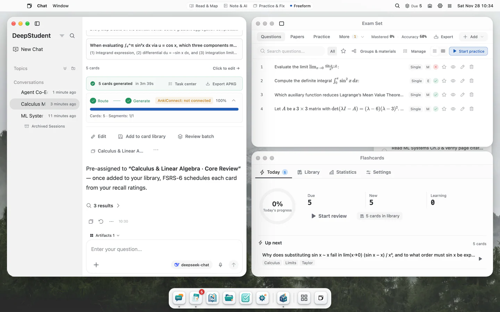
  &nbsp;
  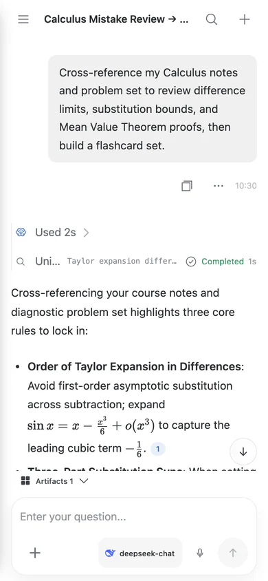
  <br />
  <sub>Masaüstü Ana Arayüzü (Study Desktop · macOS / Windows / Linux / WebUI) &nbsp;·&nbsp; Mobil Ana Arayüzü (Android / iOS / Mobil WebUI)</sub>
</p>

<details>
<summary>Geleneksel tek pencereli sol kenar çubuğunu mu tercih edersiniz? İstediğiniz zaman Klasik Düzen'e geçin</summary>

<p align="center">
  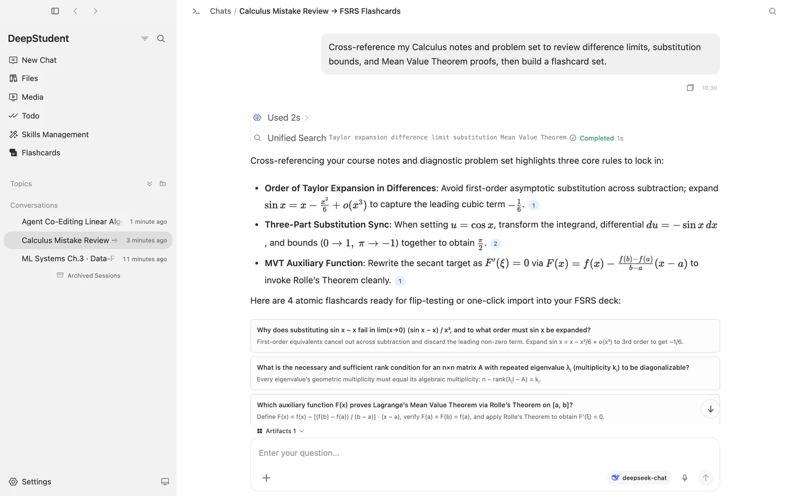
</p>

</details>

---

## Temel Yetenekler

Geleneksel yapay zeka çalışma akışları bağlamı tarayıcı sohbet sekmeleri, PDF okuyucular, ders oynatıcıları, not editörleri ve bilgi kartı uygulamaları arasında böler. DeepStudent, çalışma ajanının materyallerinizi okuduğu, yapılandırılmış çıktıları doğrudan her uygulamaya yazdığı ve uzun süreli çalışma bağlamını koruduğu tek bir yerel öncelikli çalışma alanında bu araçları birleştirir.

### 1. Uygulamalar Arası Yürütme ve Görev Orkestrasyonu

- **Doğrudan uygulama içi eylemler**: Notlar, Zihin Haritası, Sınav Seti, Bilgi Kartları, Yapılacaklar, Kompozisyon Değerlendirme ve Çeviri yerel ajan araçları sunar; böylece çıktılar doğrudan hedef uygulamaya aktarılır. Ajan ayrıca Word, PowerPoint ve Excel dosyaları oluşturur ve sohbet içinde etkileşimli görsel kartlar, canlı SVG diyagramları ve HTML korumalı alanları (sandbox) işler.
- **Uzun soluklu ve paralel çalıştırmalar**: Hedef (Goal) modu çok adımlı çalışmaları turlar boyunca sürdürür, alt ajanlar araştırmaları paralel yürütür, zamanlanmış otomasyonlar tam vaktinde çalışır ve yerleşik WeChat kanalı uzaktan görev gönderimi ile güncellemeleri sağlar.
- **Risk katmanlı onay ve geri alınabilir düzenlemeler**: Eylemler Ask / Plan / Craft izin modlarını izler. Yüksek riskli işlemler açık onay gerektirir ve ajanın notlar ile çalışma alanı durumundaki düzenlemeleri tur bazlı fark (diff) incelemesi ve tek tıkla geri alma ile vurgulanır.

<p align="center">
  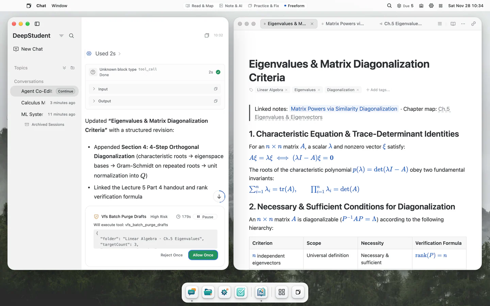
</p>

### 2. Belge Okuma, Literatür ve Medya Çalışması

- **Derin belge okuma**: AI Paper Guide, 5 renkli anlamsal vurgulama, bölge seçerek soru-cevap, sayfalar arası sabitlenmiş şekil referansları ve açıklamalı PDF dışa aktarma (döndürülmüş ve şifreli PDF'ler dahil) ile PDF, Word ve EPUB dosyalarını okuyun.
- **Akademik arama ve çeviri**: Toplu içe aktarma ve biçimlendirilmiş alıntılarla arXiv ve OpenAlex'te arama yapın; sürüm geri alma desteğiyle 7 alan ön ayarında tüm belgeleri paragraf paragraf çevirin.
- **Ders ve ses/video çalışması**: Yerel kayıtları metne dökün veya Bilibili ders bağlantılarını (çok parçalı koleksiyonlar dahil) senkronize zaman damgalarıyla içe aktarın, oynatma anına sabitlenmiş (`mm:ss`) sorular sorun, yanlış cevaplarda geri atlayan ders içi kontrol noktaları çalıştırın ve resimli bölüm ders notları oluşturun.
- **Uçtan uca kaynak geri bağlantıları**: Sohbet yanıtları, not alıntıları ve bilgi kartları doğrudan ilgili PDF sayfasına, zihin haritası düğümüne veya medya zaman damgasına atlayan tıklanabilir alıntıları korur.

<p align="center">
  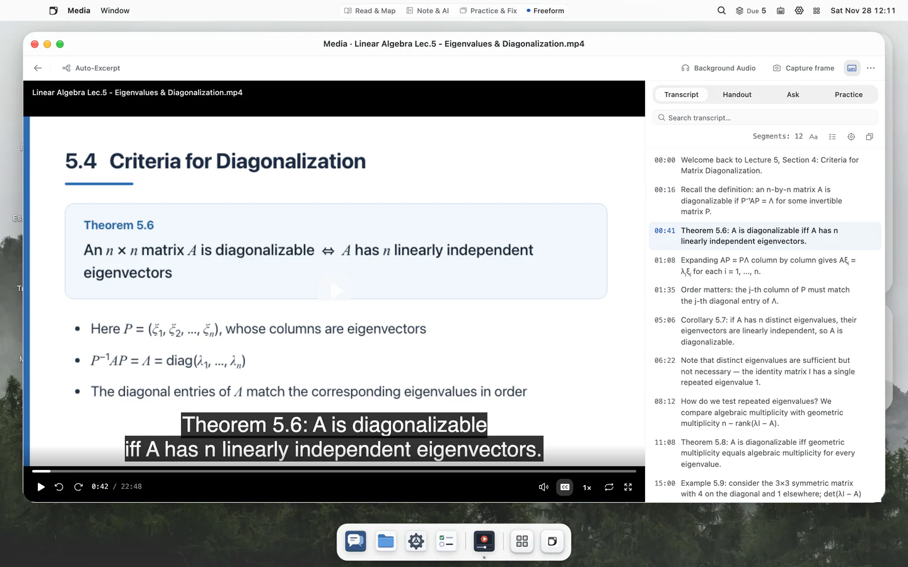
</p>

### 3. Notlar, Soru Setleri, Bilgi Kartları ve Değerlendirme

- **Bağlantılı notlar ve zihin haritaları**: Geri bağlantılar, etiketler, matematik formülleri ve şablonlarla Markdown notları yazın veya notları tek adımda zihin haritalarına dönüştürün. Zihin Haritası, ana hat ve tuval görünümlerinin yanı sıra temel düğümleri gizleyen ve kaçırılan öğeleri bilgi kartlarına dönüştüren bir hatırlama modu sunar.
- **Tam formatlı pratik ve deneme sınavları**: El yazısı görsel yanıtlar, çok modlu yapay zeka değerlendirmesi ve setler arası hata defteri ile sınav kağıtlarını veya fotoğraflanmış soruları 13 soru türü ve 9 pratik modunda yapılandırılmış setlere aktarın.
- **Aralıklı tekrar ve sınav kampları**: Yerleşik FSRS-6 zamanlama ve Sınav Kampı (Exam Cram Sprint), sınav tarihinize göre günü gelen bilgi kartlarını, süresi geçmiş hataları ve zayıf zihin haritası düğümlerini günlük bir kuyrukta birleştirir; çift yönlü `.apkg` içe/dışa aktarma (inceleme ilerlemesini koruyarak) ve AnkiConnect senkronizasyonu sunar — harici Anki kurulumu gerektirmez.
- **Ölçek tabanlı değerlendirme ve çalışma takibi**: Kompozisyon Değerlendirme, satır içi açıklamalar ve cümle iyileştirme ile 10 yerleşik sınav ölçeğine (IELTS ve lisansüstü giriş sınavları gibi) veya özel ölçeklere göre puanlama yapar; Yapılacaklar, Pomodoro, çalışma ısı haritaları ve haftalık raporlar, bilgi kartları, notlar ve sohbetler arasında `⌘K` / `Ctrl+K` derin aramasıyla birlikte ilerlemeyi izler.

<table>
  <tr>
    <td width="50%">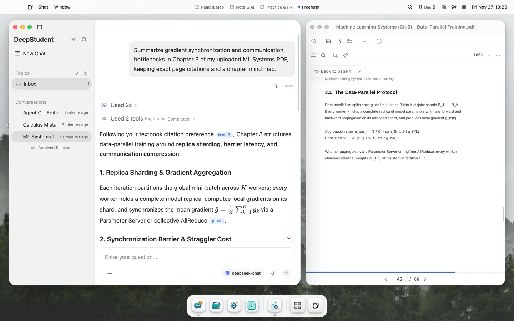</td>
    <td width="50%">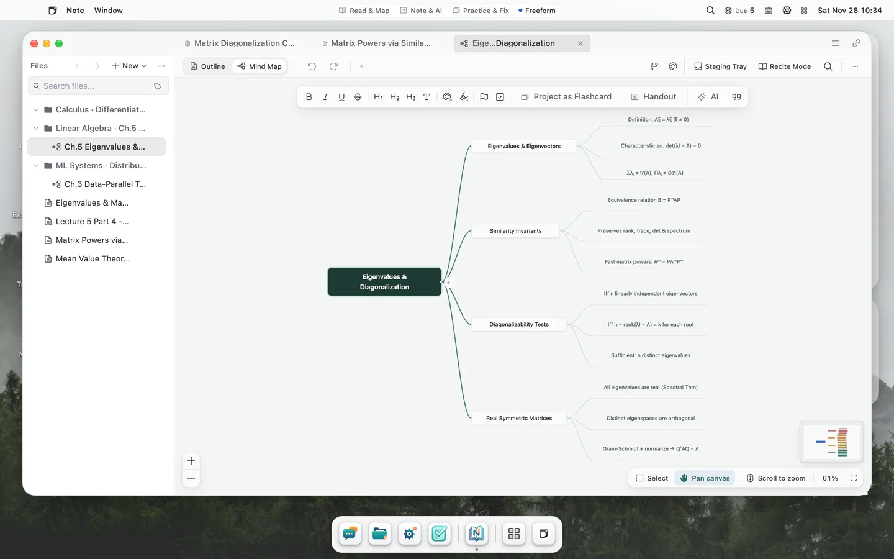</td>
  </tr>
  <tr>
    <td>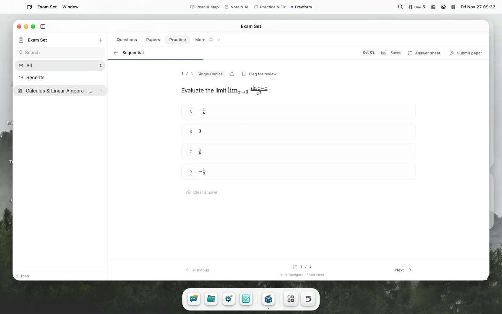</td>
    <td>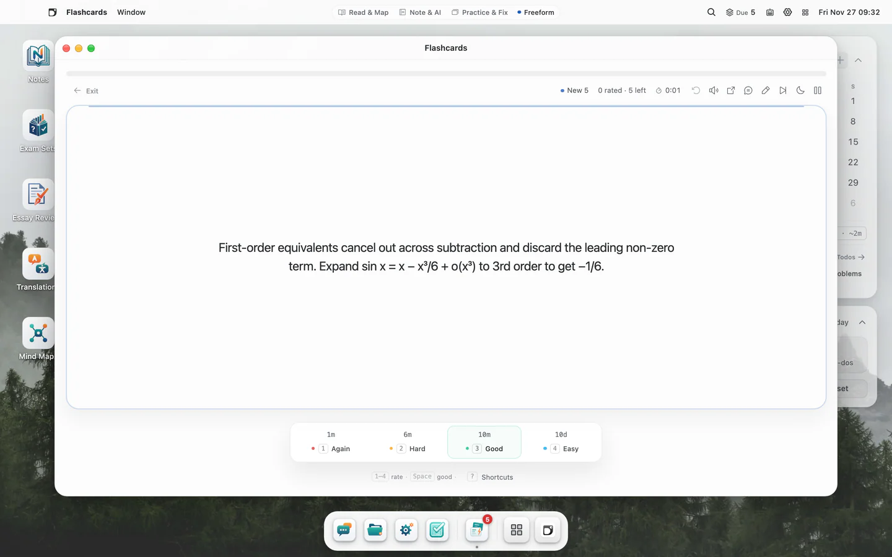</td>
  </tr>
  <tr>
    <td>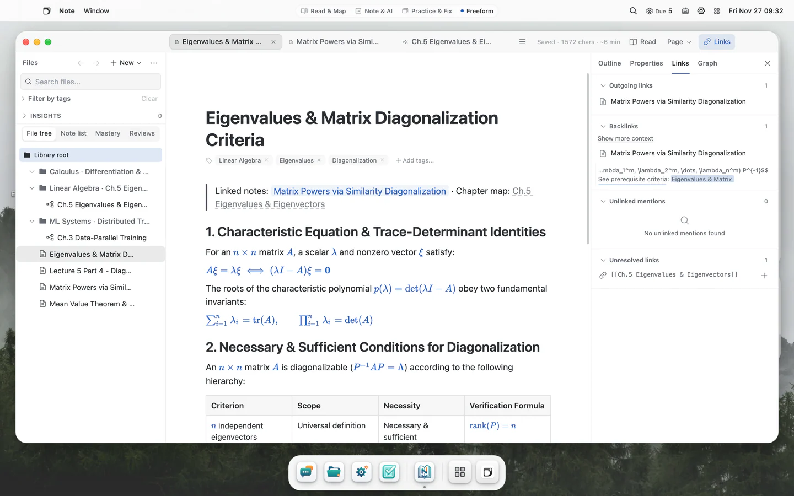</td>
    <td>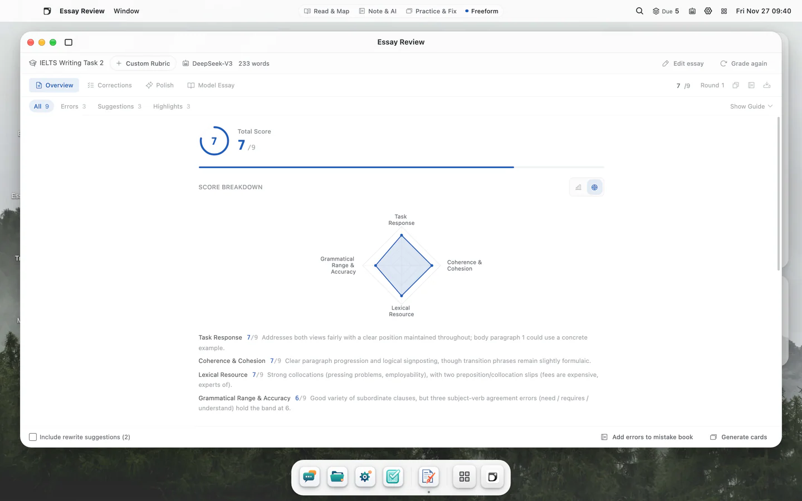</td>
  </tr>
</table>

### 4. Uzun Süreli Bellek, Modeller ve Uzantılar

- **Şeffaf uzun süreli bellek**: Kullanıcı tanımlı **kalıcı etkileşim kurallarını** (genel, ders veya çalışma moduna göre kapsamlandırılmış) pratik ve değerlendirme zayıf noktalarından sentezlenen gelişen bir **öğrenen profilinden** ayırır. Uygulanan herhangi bir kuralı incelemek, düzenlemek veya kaldırmak için sürüm geri alma ve sohbette mesaj başına ilişkilendirme etiketleri içerir.
- **Esnek model ve arama sağlayıcıları**: 15 ön ayarlı model sağlayıcısıyla (otomatik API anahtarı algılama ve yuva atama, Codex OAuth ve OpenCode Go abonelikleri, resmi DeepSeek API'leri, anahtarsız yerel Ollama modelleri ve yan yana çoklu model karşılaştırması) gelir; **CC Switch** (`ccswitch://` derin bağlantıları ve `.db`/`.sql` yedekleri dahil), **Magpie**, **OpenCode**, **Claude Code** ve **Codex** üzerinden tek tıkla yerel tarama veya yapıştırarak içe aktarma ile artımlı senkronizasyon (gerçek üst akış sağlayıcılarını içe aktarmak için yerel proxy yer tutucularını otomatik filtreler); ayrıca 9 web arama motoru ve 6 OCR motoru sunar.
- **Yerel kodlama CLI'ları ile doğal işbirliği (Masaüstü)**: Birleşik model seçici veya `@handle` (ve `/swarm` / `/handoff` çoklu ajan işbirliği) aracılığıyla doğrudan sohbette yerel **Claude Code**, **Codex CLI**, **OpenCode**, **Pi Agent**, **Antigravity CLI**, **DeepSeek Harness** ve özel CLI araçlarını otomatik olarak algılar ve çağırır; CLI başına model ve akıl yürütme düzeyi seçimi, satır içi araç onayı, canlı yönlendirme, eşzamanlı dosya kiralamaları, gizli anlık görüntülerle anında tur geri alma ve paylaşılan çalışma bağlamı sunar.
- **Katmanlı beceriler ve eklentiler**: İsteğe bağlı 58 yerleşik beceri, topluluk beceri depoları ve MCP sunucu entegrasyonu içerir; kodsuz `.dspack` Çalışma Paketlerini (değerlendirme ölçeklerini, istemleri ve iş akışlarını paylaşan) ve doğal dilden `.dstuplugin` uzantıları oluşturmak, derlemek, doğrulamak ve çalışırken yeniden yüklemek (hot-reload) için **AI Plugin Workshop**'u destekler.

---

## Yerleşik Uygulamalara Genel Bakış

Tüm çalışma uygulamaları Study Desktop Dock içinde yer alır; çok pencereli döşeme, dört iş akışı aşaması ön ayarı veya istediğiniz zaman klasik sol kenar çubuklu tek bölmeli düzene geçme imkanı sunar.

| Uygulama | Temel İşlev |
|---|---|
| **Chat** | Belge öncelikli bölünmüş bölmeli soru-cevap, etkileşimli görsel kartlar, çoklu model karşılaştırması, bellek ilişkilendirme etiketleri ve kaynak atlamaları. |
| **Files** | Otomatik tam metin ve vektör indekslemeli ders kitapları, makaleler, notlar, soru setleri ve medya için birleşik kütüphane. |
| **Media** | Senkronize transkriptler, `mm:ss` sabitli soru-cevap, kontrol noktaları ve resimli ders notlarıyla ders transkripsiyonu ve Bilibili içe aktarma. |
| **Textbook** | AI Paper Guide, 5 renkli vurgular, bölge soru-cevap, sabitlenmiş şekiller ve açıklamalı PDF dışa aktarma özellikli PDF, Word ve EPUB okuyucu. |
| **Notes** | Geri bağlantılar, matematik, etiketler, kaynağa geri atlama ve geri alınabilir vurgulu yapay zeka düzenlemeleri içeren Markdown editörü. |
| **Mind Map** | Maskeli hatırlama testi ve kaçırılan boşluklar için tek tıkla bilgi kartı oluşturma özellikli ana hat ve tuval kavram haritalama. |
| **Exam Set** | 13 soru türü, 9 pratik modu, el yazısı yanıt değerlendirme ve hata defteri ile belge ve görselden soru çıkarma. |
| **Flashcards** | Exam Cram Sprint, `.apkg` içe/dışa aktarma ve AnkiConnect senkronizasyonu ile kart oluşturma, şablonlar ve FSRS-6 zamanlama. |
| **Essay Review** | Satır içi işaretler, iyileştirme ve zayıf nokta takibi ile 10 yerleşik modda veya özel ölçeklerde ölçek tabanlı puanlama. |
| **Translation** | 7 alan ön ayarı, kalıcı resmiyet tercihleri ve sürüm geri alma ile paragraf hizalı tam metin çevirisi. |
| **Todo · Pomodoro** | Odak zamanlayıcısı, etkinlik ısı haritaları ve haftalık çalışma raporlarıyla birleşik günlük tekrar ve görev kuyruğu. |
| **Skills & Plugin Workshop** | Yerleşik/topluluk becerilerini, MCP sunucularını, `.dspack` Çalışma Paketlerini, yapay zeka tarafından yazılan `.dstuplugin` uzantılarını ve Güvenli Mod kurtarmayı yönetin. |

Eksiksiz öğrenen dokümantasyonu: [**İngilizce Kullanım Kılavuzu**](./docs/user-guide/en/README.md) · [**中文使用指南**](./docs/user-guide/README.md) ([çevrimiçi yansı](https://deepstudent.cn/user-guide/)).

---

## Veri Depolama ve Gizlilik

- **Varsayılan olarak yerel depolama**: Materyaller, notlar, sohbetler ve arama indeksleri hesap gerektirmeden cihazınızda yerel olarak (SQLite, LanceDB ve yerel dosyalar) saklanır. Herhangi bir yedekten geri yükleme geçişinden önce DeepStudent, tek tıkla geri alma için otomatik olarak doğrulanmış bir güvenlik anlık görüntüsü oluşturur.
- **Açık giden trafik sınırları**: Giden istekler yalnızca yapılandırdığınız model sağlayıcılarını, arama motorlarını veya MCP sunucularını çağırırken gerçekleşir. Bulut senkronizasyonu, WeChat uzaktan erişimi ve hata raporlama açıkça etkinleştirilmedikçe kapalı kalır.
- **Şifreli cihazlar arası senkronizasyon ve eşleştirme**: Kayıtlı kimlik bilgileri depolamada ve kullanıcı arayüzünde maskelenmiş olarak QR ile eşleştirilmiş cihaz kurulumunu ve şifreli senkronizasyonu (Masaüstü ve WebUI'da WebDAV ve S3 uyumlu depolama; yerel Android'de WebDAV) destekler.
- **Açık kaynaklı ve denetlenebilir**: [AGPL-3.0-or-later](./LICENSE) kapsamında lisanslanmıştır; tüm depolama, senkronizasyon ve güvenlik uygulamaları bu depoda incelenebilir.

<details>
<summary>Platform bazlı bulut senkronizasyonu kapsamı ve arşiv yedekleme notları</summary>

- **Yüzeye göre desteklenen senkronizasyon arka uçları**:
  - **Masaüstü ve Masaüstü WebUI**: WebDAV, S3 uyumlu depolama ve deneysel FTP.
  - **Mobil WebUI**: WebDAV ve S3 uyumlu depolama (mobil WebUI'da FTP gizlidir).
  - **Android yerel**: Android yalnızca WebDAV destekler.
- **Tam paket bulut arşivi kuralları**: Tam paket bulut yedeklemeleri, artımlı delta aktarımı olmadan eksiksiz bir ZIP arşivi yükler. Bulut uçtan uca şifreleme parolası yapılandırılmadan, varsayılan tam paket bulut yedeği taşınabilir bir arşivdir ve yuvadan geri yükleme (slot-restore) yapamaz; şifreleme etkinleştirildiğinde ancak yerel parola okunamadığında, sessizce düz metne düşmek yerine dışa aktarma reddedilir. Bkz. [Yedeklemeler, Bulut Senkronizasyonu, Mobil ve WebUI](./docs/user-guide/en/06-sync-backup-mobile-webui.md).

</details>

---

## Kurulum

En son sürümü [GitHub Releases](https://github.com/helixnow/deep-student/releases/latest) veya [deepstudent.cn/download](https://deepstudent.cn/download) adresinden indirin:

| Platform | Paket | Mimari |
|:---:|---|---|
| macOS | `.dmg` / `.zip` | Apple Silicon / Intel |
| Windows | `.exe` / `.zip` | x86_64 |
| Linux | `.deb` / `.AppImage` | x86_64 |
| Android | `.apk` | arm64 |
| WebUI / PWA | Kendi sunucunuzda (`npm run web:prod`) | Modern masaüstü ve mobil tarayıcılar |

> **iOS**: Xcode + Capacitor aracılığıyla kaynaktan derleme. Bkz. [Derleme Yapılandırması](./docs/BUILD-CONFIG.md).
>
> **macOS Gatekeeper "app is damaged" uyarısı**: `sudo xattr -r -d com.apple.quarantine "/Applications/Deep Student.app"` komutunu çalıştırın ve uygulamayı yeniden açın.

### Hızlı Başlangıç İş Akışları

İlk açılışta otomatik kurulum için **15 ön ayarlı sağlayıcıdan** herhangi birinin API anahtarını yapıştırın veya mevcut **CC Switch / Magpie / OpenCode / Claude Code / Codex** yapılandırmalarını ya da `ccswitch://` derin bağlantılarını tek tıkla içe aktarın (Masaüstünde doğrudan yerel kodlama CLI'larını da çağırabilir veya *Settings → Model Service* altından yerel Ollama / Codex OAuth bağlayabilirsiniz), ardından rehberli 3 dakikalık iş akışını izleyin:

1. **[3 Dakikada Sınav Kampı](./docs/user-guide/en/01-quickstart.md#quick-scenario-1-3-minute-exam-cram-sprint)** — Bilgi kartları ve pratik soruları oluşturmak için ders notlarını veya geçmiş sınavları içe aktarın, hedef sınav tarihinizi ve günlük bütçenizi belirleyin ve önceliklendirilmiş günlük tekrar kampını başlatın.
2. **[3 Dakikada 40 Sayfalık Makaleyi Derinlemesine Okuma](./docs/user-guide/en/01-quickstart.md#quick-scenario-2-3-minute-40-page-paper-deep-read)** — AI Paper Guide ile temel katkıları çıkarın, 5 renkli anlamsal vurgular ve sabitlenmiş şekillerle yan yana okuyun ve bağlantılı notlarla birlikte açıklamalı bir PDF dışa aktarın.

> **Sorun Giderme**: Üçüncü taraf bir eklenti arayüz sorunlarına veya profil hatalarına neden olursa, sıfır çalışma verisi kaybıyla hatalı eklentileri devre dışı bırakmak, düzen önbelleğini sıfırlamak veya eklenti yapılandırmasını onarmak için *Settings → Plugins* veya `--safe-mode` üzerinden Güvenli Mod'u başlatın (bkz. [1 Dakikada Güvenli Mod Kendi Kendini Kurtarma](./docs/user-guide/en/01-quickstart.md#quick-scenario-3-1-minute-safe-mode-self-rescue)).

---

## Geliştiriciler İçin

DeepStudent, Electron Masaüstü, Node WebUI / PWA ve Capacitor Mobil genelinde tek bir React arayüzü ve tek bir Host çekirdeği paylaşan, [`@deepseek-ai/cordis`](https://github.com/cordiverse/cordis) 4 destekli %100 TypeScript çift çekirdekli eklenti mimarisi üzerinde çalışır.

### Mimari

```
DeepStudent
├── Surfaces       Electron 45 (macOS · Windows · Linux) · WebUI & PWA (web/) · Capacitor 8.6 (Android · iOS)
├── Host Kernel    Cordis 4 plugin tree (host/kernel · host/platform · host/plugins · desktop.json 45 / mobile.json 37)
├── UI Kernel      20 official UI plugin directories (src/ui-plugins/official/) · slots & registries · UiErrorBudget
├── IPC Contracts  contracts/ipc/ schema governance (1,072 commands · 128 events · 998 types)
├── Data & Engines SQLite (better-sqlite3 / sqlite-wasm) · LanceDB · koffi FFI · f7-native-wasm (WASI-WASM)
└── Ecosystem      58 built-in skills · MCP · local CLI mesh · 3-tier plugins (.dspack / .dstuplugin / Cordis) · 15 LLM vendors · 9 search · 6 OCR
```

### Teknoloji Yığını

| Alan | Teknoloji |
|---|---|
| Ön Yüz (Frontend) | React 18 · TypeScript 5.6 · Vite 6 · Tailwind CSS 3 · Radix UI · Zustand 5 |
| Masaüstü Kabuğu | Electron 45 · `electron-builder` 26 · UtilityProcess Host · Electron Fuses |
| WebUI & PWA | Node HTTP / WebSocket ağ geçidi · HTTP 206 akışı · Service Worker + Web App Manifest |
| Mobil Kabuk | Capacitor 8.6 · Web Worker Host · `@sqlite.org/sqlite-wasm` + OPFS |
| Arka Uç Çalışma Zamanı | Node.js 24+ · TypeScript · [`@deepseek-ai/cordis`](https://github.com/cordiverse/cordis) 4 · `esbuild` |
| Veri ve Yerel Motorlar | `better-sqlite3` · `@lancedb/lancedb` · `@embedpdf/pdfium` · `@napi-rs/keyring` · `@node-rs/argon2` · `koffi` · `f7-native-wasm` |
| Editörler ve İşleme | Milkdown 7 · CodeMirror · PDF.js · KaTeX · Mermaid · ECharts · React Flow · Univer |

### Yerel Geliştirme

**Node.js 24+** ve **npm** gerektirir (`npm ci --legacy-peer-deps` kullanın; pnpm veya yarn karıştırmayın; Rust araç zinciri gerekmez).

```bash
git clone https://github.com/helixnow/deep-student.git
cd deep-student
npm ci --legacy-peer-deps

# Start Electron desktop app in development mode (Frontend + Host kernel)
npm run dev:electron

# Or start the WebUI development server (default port :1428)
npm run web
```

<details>
<summary>Üretim paketleme ve doğrulama komutları</summary>

Geçmiş temel commit'leri dışlayan sığ bir klondan (shallow clone) derleme yaparken önce açık bir derleme numarası ayarlayın:

```bash
export DEEP_STUDENT_BUILD_NUMBER=20000
# PowerShell: $env:DEEP_STUDENT_BUILD_NUMBER = '20000'

# 1) Build and serve production WebUI & PWA (dist-web/)
npm run build:web && npm run web:prod

# 2) Build desktop package (--dir for unpacked smoke test, or --mac / --win / --linux)
npm run build
npx @electron/rebuild -f -w better-sqlite3
node electron/scripts/package.mjs --dir

# 3) Build Android APK (requires JDK 21 and Android SDK Platform 36)
npm --prefix mobile ci --legacy-peer-deps
node mobile/scripts/build-apk.mjs

# 4) Lint, typecheck, contracts, architecture boundaries & test suites
npm run lint
npm run typecheck
npm run typecheck:host
npm run check:plugins
npm run check:arch
npm run contracts:check
npm run check:public-surface
npm test
npm run test:host
npm run test:plugins
```

Platformlar arası imzalama ve paketleme ayrıntıları için [BUILD-CONFIG.md](./docs/BUILD-CONFIG.md) ve [README-BUILD.md](./docs/README-BUILD.md) belgelerine bakın.

</details>

<details>
<summary>Depo dizin yapısı</summary>

```
DeepStudent
├── host/                        # TypeScript backend — Cordis plugin tree
│   ├── kernel/                  #   command router, IPC contract validation, events, protocols, profile store, plugin lifecycle & consent ledger
│   ├── platform/                #   platform providers: crypto · diagnostics · errors · files · http · log · native
│   │                            #   (koffi FFI & f7-native-wasm) · paths · secrets · settings · storage (+ storage-mobile) · vector
│   ├── plugins/                 #   31 domain & system plugin directories (agent-mesh, chat, chat-pipeline, llm, memory, vfs, notes,
│   │                            #   qbank, anki, review, sync, ilink, plugin-workshop, mobile-compat, …)
│   ├── profiles/                #   generated desktop.json (45) / mobile.json (37) assembly manifests
│   └── e2e/                     #   real-host, security, streaming, upgrade & tool coverage suites
├── electron/                    # Desktop shell
│   ├── main.ts                  #   window lifecycle, custom protocols, Electron Fuses & Host supervision
│   ├── preload/bridge.ts        #   drop-in frontend IPC compatibility bridge (window.__TAURI_INTERNALS__)
│   ├── shell/                   #   protocol routing, ds-plugin:// lock verification, CSP nonces, web-security, updater
│   └── scripts/                 #   package.mjs, verify-fuses.mjs, app-hardening.cjs
├── web/                         # WebUI & PWA server and client runtime
│   ├── server/                  #   HTTP/WebSocket gateway, auth rate limiter, HTTP 206 streaming, file staging
│   └── client/                  #   browser bootstrap & PWA Service Worker / Manifest
├── mobile/                      # Capacitor 8.6 mobile shell
│   ├── src/worker/              #   Host kernel inside a Web Worker (SQLite WASM + OPFS)
│   ├── src/shell/               #   Capacitor native bridge & persistent storage
│   └── scripts/build-apk.mjs    #   Android APK build script
├── src/                         # React 18 renderer
│   ├── ui-kernel/               #   UI plugin runtime: slots, registries, lazy loading, UiErrorBudget
│   ├── ui-plugins/official/     #   20 official UI plugin directories
│   ├── ui-sdk/                  #   defineUiPlugin & typed frontend services
│   ├── features/                #   domain UI modules (chat, generative-ui, notes, mindmap, practice, flashcards, media, pdf, …)
│   └── locales/                 #   i18n catalogs (zh-CN / en-US)
├── contracts/ipc/               # 1,072 commands · 128 events · 998 types
├── resources/                   # App config, SQL migrations, workshop templates & legal/ third-party notices
└── .github/workflows/           # CI gates & multi-platform release pipelines
```

</details>

<details>
<summary>v0.11.x (Tauri / Rust) sürümünden v0.20.x (Electron / Cordis) sürümüne mimari evrim</summary>

**v0.20.x** sürümünden itibaren DeepStudent, eski Tauri 2 / Rust arka ucunu (`0.11.x`) emekliye ayırdı ve TypeScript üzerinde `@deepseek-ai/cordis` ile birleşti. Mevcut SQLite / LanceDB veri dizinleri ve yüklü kullanıcı eklentileri yükseltmeler sırasında yerinde taşınır.

| Boyut | `0.11.x` (Tauri 2 / Rust) | `0.20.x` (Node / Electron / Cordis) |
|---|---|---|
| **Çalışma Zamanı ve Çekirdek** | Tauri 2 + 25 crate'li Rust Cargo çalışma alanı + sistem WebView; derleme zamanı komut bağlama | Electron 45 + `UtilityProcess` Host (`MessagePortMain`) + Cordis 4 mikro çekirdek (`desktop.json`: 45 modül; `mobile.json`: 37 modül); 1.072 komutu, 128 olayı ve 998 türü yöneten `contracts/ipc/`; `src/` React arayüzünü koruyan uyumluluk köprüsü |
| **Eklenti Ekosistemi ve İzolasyon** | Yalnızca statik yerleşik eklentiler; çalışma zamanı paket biçimi veya yapay zeka derleme döngüsü yok | 3 katmanlı uzantı modeli: kodsuz `.dspack` Çalışma Paketleri, AI Plugin Workshop (14 ajan aracı, en fazla 3 otomatik onarım geçişli `esbuild` derlemesi, çalışırken yeniden yükleme ve sürüm geri alma) ve tam Cordis eklentileri; Manifest v2 ağ izinleri ve Güvenli Mod kurtarma |
| **Yerel + WASI-WASM Motorları** | Her ikili dosyaya derlenmiş 30+ yerel Rust crate; Rust araç zinciri gerekli | `host/platform/` ve `electron/` içine izole edilmiş yerel bağlamalar (`better-sqlite3`, `@lancedb/lancedb`, `@embedpdf/pdfium`, `@napi-rs/keyring`, `@node-rs/argon2`, `koffi` FFI), belge ayrıştırma, ses kod çözme, Starlark ve FSRS için önceden derlenmiş `f7-native-wasm.wasm` (`wasm32-wasip1`) ile eşleştirildi — sıfır Rust araç zinciri gerekir |
| **Çoklu Yüzey Eşitliği** | Tauri masaüstü + Tauri mobil | Masaüstü (Electron 45), WebUI & PWA (HTTP/WebSocket ikili çerçeveleme + HTTP 206 akışı) ve Mobil (sıfır Node çalışma zamanı bağımlılığıyla Capacitor 8.6 + Web Worker Host + SQLite WASM / OPFS) genelinde paylaşılan `src/` arayüzü ve `host/` çekirdeği |
| **Güvenlik ve Yükseltmeler** | Tauri yetki ACL'leri + sistem WebView | Electron Fuses (`RunAsNode` ve CLI inspect devre dışı, gömülü ASAR bütünlüğü zorunlu), `ds-plugin://` SHA-256 kilit kapsamı, yanıt başına kriptografik CSP nonce'ları, merkezileştirilmiş `web-security.ts` korumaları ve Minisign güncelleyici uyumluluğu |

</details>

### Dokümantasyon

| Belge | Açıklama |
|---|---|
| [Kullanım Kılavuzu (İngilizce)](./docs/user-guide/en/README.md) | Eksiksiz İngilizce öğrenen kılavuzu ve [3 Dakikalık Hızlı Başlangıçlar](./docs/user-guide/en/01-quickstart.md) |
| [Kullanım Kılavuzu (Çince)](./docs/user-guide/README.md) | 21 bölümlük tam Çince kullanıcı el kitabı ([çevrimiçi yansı](https://deepstudent.cn/user-guide/)) |
| [WebUI ve PWA](./docs/WEBUI-AND-PWA.md) | Kendi sunucunuzda barındırılan tarayıcı/PWA mimarisi, kimlik doğrulama, akış ve ters proxy kurulumu |
| [DeepSeek Uygulama API'leri](./docs/DEEPSEEK-API.md) | Resmi DeepSeek Responses, Search/Fetch, belge ayrıştırma, OCR, ASR ve TTS entegrasyonu |
| [Derleme Yapılandırması](./docs/BUILD-CONFIG.md) · [Derleme Hızlı Referansı](./docs/README-BUILD.md) | Platformlar arası masaüstü, Android ve iOS derleme kurulumu, ortam değişkenleri ve betikler |
| [Kod Stili](./docs/CODE_STYLE.md) · [Ön Yüz Kılavuzu](./docs/frontend/README.md) | Kodlama kuralları, katman sınırları, bileşen kataloğu ve tasarım belirteçleri |
| [Eklenti Sistemi v2](./docs/plugins/PLUGIN-V2.md) · [Eklenti Mimarisi](./docs/plugins/ARCHITECTURE.md) | 3 katmanlı uzantı modeli, `.dspack` Çalışma Paketleri, çift çekirdekli tasarım ve uzantı noktaları |
| [Eklenti SDK](./docs/plugins/SDK.md) · [Yetenekler Referansı](./docs/plugins/CAPABILITIES.md) | Eklenti geliştirme: hizmetler, arayüz yuvaları, bildirimler ve yetenek katmanları |
| [Eklenti Güvenliği](./docs/plugins/SECURITY.md) · [Eklenti Yükseltmeleri](./docs/plugins/UPGRADES.md) | Topluluk eklentisi korumalı alanı, `ds-plugin://` doğrulaması ve yükseltme uyumluluğu |
| [İyi İlk Konular](./docs/community/good-first-issues.md) | Yeni katkıda bulunanlar için başlangıç seviyesi modüller ve başlangıç fikirleri |
| [Değişiklik Günlüğü](./CHANGELOG.md) · [Güvenlik Politikası](./.github/SECURITY.md) | Sürüm geçmişi ve güvenlik açığı bildirme prosedürü |

---

## Katkıda Bulunma

1. Dallanma, commit kuralları, i18n yönergeleri ve CLA imzalama için [CONTRIBUTING.md](./.github/CONTRIBUTING.md) dosyasını okuyun.
2. Bir pull request açmadan önce `npm run lint`, `npm run typecheck`, `npm run typecheck:host`, `npm run check:plugins`, `npm run contracts:check` ve `npm run check:public-surface` kontrollerinin geçtiğinden emin olun.
3. Hata raporlarını ve özellik isteklerini [GitHub Issues](https://github.com/helixnow/deep-student/issues) üzerinden gönderin.

## Lisans

[AGPL-3.0-or-later](./LICENSE)

## Teşekkürler

DeepStudent açık kaynaklı yazılımlar üzerine inşa edilmiştir — tam atıflar ve lisans metinleri için [ACKNOWLEDGMENTS.md](./ACKNOWLEDGMENTS.md), [docs/THIRD_PARTY_LICENSES.md](./docs/THIRD_PARTY_LICENSES.md) ve [resources/legal/THIRD_PARTY_NOTICES.txt](./resources/legal/THIRD_PARTY_NOTICES.txt) dosyalarına bakın:

- **Çalışma Zamanları ve Uygulama Kabukları**: [Electron](https://www.electronjs.org) · [Capacitor](https://capacitorjs.com) · [Cordis](https://github.com/cordiverse/cordis) · [Node.js](https://nodejs.org) · [React](https://react.dev) · [Vite](https://vite.dev) · [TypeScript](https://www.typescriptlang.org)
- **Depolama, Vektör ve Yerel / WASM Motorları**: [SQLite](https://www.sqlite.org) / [better-sqlite3](https://github.com/WiseLibs/better-sqlite3) / [@sqlite.org/sqlite-wasm](https://sqlite.org/wasm) · [LanceDB](https://lancedb.com) · [Apache Arrow](https://arrow.apache.org) · [koffi](https://koffi.dev) · F7 WASI Native Engines (Starlark / Symphonia / fsrs-rs / docx-rs / calamine) · [ts-fsrs](https://github.com/open-spaced-repetition/ts-fsrs)
- **Belgeler, Editörler ve Görselleştirme**: [PDF.js](https://mozilla.github.io/pdf.js/) · [PDFium](https://github.com/embedpdf/embed-pdf-viewer) · [Milkdown](https://milkdown.dev) · [ProseMirror](https://prosemirror.net) · [CodeMirror](https://codemirror.net) · [KaTeX](https://katex.org) · [Mermaid](https://mermaid.js.org) · [ECharts](https://echarts.apache.org) · [React Flow](https://reactflow.dev) · [Univer](https://univer.ai) · [docx](https://github.com/dolanmiu/docx) · [ExcelJS](https://github.com/exceljs/exceljs) · [PptxGenJS](https://gitbrent.github.io/PptxGenJS/) · [DOMPurify](https://github.com/cure53/DOMPurify)
- **Arayüz, Durum Yönetimi ve Araçlar**: [Tailwind CSS](https://tailwindcss.com) · [Radix UI](https://www.radix-ui.com) · [Phosphor Icons](https://phosphoricons.com) · [Zustand](https://zustand.docs.pmnd.rs) · [i18next](https://www.i18next.com) · [Vitest](https://vitest.dev) · [Playwright](https://playwright.dev) · [ESLint](https://eslint.org)
