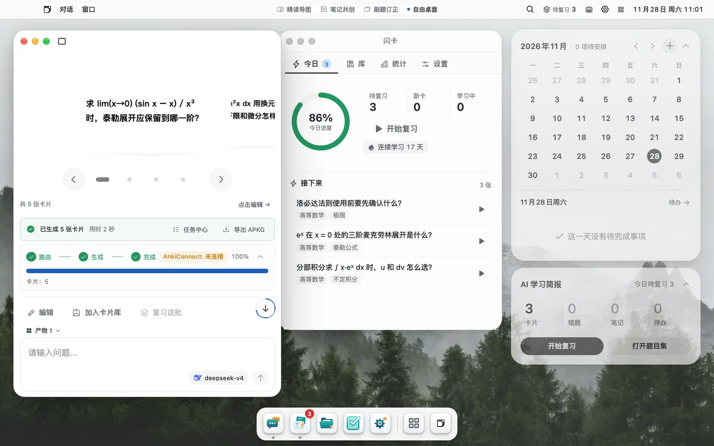

# 快速上手

> 从下载安装到真正用起来，不需要懂任何技术词：3 步完成初次启动，再按你的目标挑一个 **3 分钟场景速通** 跟着做一遍，马上就能上手学习。
>
> English version: [Quickstart & 3-Minute Workflows (EN)](./en/01-quickstart.md)

## 第 0 步：安装并首次打开

前往 [官网下载页](https://deepstudent.cn/download)（国内镜像更快）或 [GitHub Releases](https://github.com/helixnow/deep-student/releases/latest) 下载对应安装包：

| 平台 | 安装包 |
|---|---|
| macOS | Apple 芯片（M 系列）与 Intel 各一个 `.dmg` |
| Windows | `.exe` 安装程序 |
| Linux | `.AppImage` 或 `.deb`（均为 x86_64） |
| Android | `.apk`（ARM64） |

iPhone / iPad 目前暂无官方安装包；如需在手机或平板浏览器中使用，可在电脑或服务器上开启 [WebUI 与 PWA 自托管](./21-WebUI与PWA自托管.md)。

> **macOS 提示「已损坏，无法打开」？** 正式发布包已通过 Apple 签名与公证；如果你下载的是预览版或自行构建版本，打开「终端」粘贴下面这行并按回车（输入开机密码时屏幕不会显示字符），再重新打开即可：
>
> ```bash
> sudo xattr -r -d com.apple.quarantine "/Applications/Deep Student.app"
> ```

### 首次打开的「欢迎使用 DeepStudent」引导

无需注册账号，所有资料和聊天记录默认保存在你自己的电脑或手机里。首次打开空白工作区时，会弹出简洁的 **「欢迎使用 DeepStudent」** 引导窗：

1. **切换界面语言**：顶部可随时在 **「简体中文」** 与 **「English」** 之间切换，立即生效。
2. **连接 AI（或确认已就绪）**：
   - 如果还没有配置过模型，弹窗内会直接显示 **「一键 API Key 自动配置」** 卡片——粘贴任意受支持服务商的 API 密钥，应用会自动识别服务商并配好常用能力；想慢慢配置也可以点左下角 **「前往完整模型设置」**，或直接点右下角 **「先随便看看」**。
   - 如果你使用的环境已经预配置好可用模型，弹窗会显示绿色的 **「AI 服务已就绪」** 卡片，点右下角 **「开始使用」** 即可出发（也可点 **「管理 AI 模型」** 调整）。
3. **三步开始高效学习（点击选择起点）**：弹窗下方有三张可直接点击的起步卡片，选哪张，进入应用后就会直接帮你打开对应工作区：
   - **「1. 导入学习资料」**：进入资料与笔记工作区，马上把教材、课件拖进来；
   - **「2. 向 AI 提问与记笔记」**：直接打开对话窗口并把光标放进输入框；
   - **「3. 制作闪卡与复习」**：直接打开闪卡页面，体验间隔重复复习。

条款说明已改为窗口底部的非阻塞提示，不再额外弹窗打断流程；随时点底部的《用户协议》或《隐私政策》链接即可查阅。


---

## 3 分钟场景速通

不想逐项看设置？挑一个你现在最需要的场景，照着 3 步做一遍，就能体会 Deep Student 最顺手的学习闭环。

### 3 分钟考前冲刺

**你想做什么**：把一堆复习讲义或历年真题变成今晚就能背、能刷、能追着考期跑的复习队列。

1. **导入资料并让 AI 备料**：把复习讲义或真题 PDF 拖进「资源库」，然后在「对话」里引用这份资料说一句：「把这份重点整理成 10 张闪卡和 10 道选择题」。等 AI 生成后，点卡片上的「加入卡片库」和题目集入口即可入库。
2. **设定考期与每日预算**：打开底部程序坞（Dock）里的「全部应用」→ **「闪卡」**，切到 **「今日」** 页签，点击 **「调整考期与每日冲刺预算」**，填上考试日期和每天的 **「每日冲刺时长」**。
3. **一键开始冲刺**：点击 **「开始今日冲刺」**。

**你会看到什么**：系统会自动把今天到期的闪卡、错题本里的薄弱题、以及思维导图背诵模式下没记牢的节点合并成一条高收益队列，并显示考前预测提取率；临考前 3 天还会自动进入 **「考前缓冲期 · 暂停普通新卡」**，把时间全部留给考前巩固。完整玩法见 [闪卡复习](./13-闪卡复习.md) 与 [题目集与练习](./11-题库与练习.md)。

### 3 分钟精读 40 页论文

**你想做什么**：快速摸清一篇长论文的核心贡献，边读边记带页码出处的笔记，最后把高亮和批注整洁地导出来。

1. **30 秒抓主线**：把论文 PDF 拖进「资源库」并双击打开；点击顶部阅读工具栏的 **「AI 论文导读」** → **「提炼全文核心贡献与脉络」**，让 AI 先帮你列出研究问题、核心贡献和方法框架。
2. **沉浸精读 + 边读边问**：在阅读器里选 **「单栏贴合（185%）」**（双栏论文看着最省眼），打开分屏「边读边问」。读到关键处直接按键盘数字 `1`–`5` 打五色语义高亮（核心结论 / 研究方法 / 背景定义 / 存疑局限 / 公式数据）；遇到跨页还要反复对照的架构图或公式，用框选工具选中后点 **「钉住对照」**，它会浮在角落陪你翻页。
3. **沉淀笔记与导出带批注 PDF**：读完打开右侧批注列表，点 **「导出为笔记（N）」** 汇总成结构化笔记——每条摘录都会附带 **「来源 · 来自资料 · 第 N 页」**，以后复习点一下就能瞬间跳回 PDF 原页；需要提交或分享批注版文档时，点 **「导出带批注的 PDF」**（即使原 PDF 有横向旋转页面或加密限制，也能正常保留高亮导出）。

**你会看到什么**：一份随时能点回原文页码的论文笔记，外加一份批注位置准确的成品 PDF。完整玩法见 [文档阅读与翻译](./05-文档阅读与翻译.md) 与 [笔记](./07-笔记.md)。

### 1 分钟安全模式自救

**你想做什么**：安装或试用第三方插件后遇到界面卡顿、报错、窗口排版错乱，或者弹出 **「插件配置文件（user.profile.json）已损坏」**，希望立刻恢复正常且不丢任何学习资料。

1. **进入安全模式**：打开「插件工坊 / 插件管理」点击 **「安全模式排查」** 即可自动重启进入安全模式（如果应用连续启动崩溃，下次打开时也会自动提示以安全模式启动；极端打不开时也可参考下方折叠栏用命令行启动）。
2. **定位并清理问题**：安全模式下，**你的所有笔记、资料、闪卡和对话记录分毫不动**，仅暂停加载第三方社区插件并暂停外部自定义 MCP 自动连接。按你的情况执行一步：
   - 某个插件报错：在列表里直接停用或卸载标有异常提示的插件；
   - 提示插件配置损坏：点击 **「备份并重置损坏的插件配置」**（系统会先自动备份旧文件再重建干净配置）；
   - 窗口排版卡死：点击 **「重置界面布局缓存（不删除学习数据）」**。
3. **安全恢复正常启动**：点击 **「退出安全模式并恢复正常启动」**，在确认弹窗里核对或一键勾选停用仍异常的插件，确认后应用即恢复正常运行。

**你会看到什么**：1 分钟内恢复清爽稳定的学习环境，原有学习数据完整保留。更多插件与排查说明见 [AI 插件工坊与插件管理](./20-AI插件工坊与插件管理.md)。

<details>
<summary>高级备选：如果连界面都打不开，如何用命令行进入安全模式？</summary>

关闭所有 Deep Student 进程后，在终端带上 `--safe-mode` 参数启动应用即可强制进入安全模式：
- **macOS**：`"/Applications/Deep Student.app/Contents/MacOS/Deep Student" --safe-mode`
- **Windows（PowerShell）**：`& "$env:LOCALAPPDATA\Programs\Deep Student\Deep Student.exe" --safe-mode`
- **Linux**：`deep-student --safe-mode`（或对 `.AppImage` 追加 `--safe-mode`）

</details>

---

## 先认识一下桌面端界面

桌面端（以及用电脑宽屏浏览器打开的自托管 WebUI）默认进入 **「学习桌面」**：



- **底部程序坞（Dock）**：默认固定了「对话」「资源库」「设置」「待办」四个常用应用；最右侧的 **「全部应用」** 里收录了闪卡、音视频、Anki 制卡、插件工坊、番茄钟等全部功能。
- **独立窗口与一键排布**：每个应用和每份教材都是独立窗口，拖到屏幕左右边缘松手就能自动半屏平铺，顶部状态栏中央的 **「精读导图 / 笔记共创 / 刷题订正 / 自由桌面」** 还能一键切换常用学习排布。
- **全局随手搜**：随时按 `⌘K`（Windows / Linux 为 `Ctrl+K`）打开命令面板，不仅能搜应用和命令，还能直接搜并跳进具体的闪卡、笔记和历史会话。

如果你更习惯「左侧导航 + 单页」的传统经典布局，点左上角 DeepStudent 图标选 **「退出学习桌面」** 即可，之后在「设置 → 学习桌面」随时能切回来。完整操作见 [学习桌面](./18-学习桌面.md)。

---

## 完整上手 5 步走

### 第 1 步：配好模型服务

Deep Student 本身不捆绑云端模型，需要连接你自己的模型服务。如果你在欢迎引导里已经看到 **「AI 服务已就绪」** 或刚完成自动配置，可以直接跳到第 2 步。

如果你之前点了 **「先随便看看」**，之后在「对话」输入框上方会看到一条清晰的提醒横幅：**「尚未配置 AI 模型，连接一个模型服务后即可开始对话与学习」**——直接点右侧的 **「配置 AI 模型」** 按钮就会一步跳到配置页，不用到处找设置。

不确定选哪种接入方式？按手头情况对号入座即可：

| 你现在的情况 | 推荐方式 | 所需步骤 |
|---|---|---|
| 手头已经有一把 API 密钥（DeepSeek、OpenAI、硅基流动等） | **方式 A：一键 API Key 自动配置** | 粘贴密钥，自动识别服务商并配好主要能力 |
| 还没有密钥，想一次配齐对话、检索、OCR 和制卡 | **方式 B：硅基流动一键分配** | 注册后粘贴密钥，点「一键分配」全套搞定 |
| 只想用电脑本机模型，数据完全不出本机 | **方式 C：本机模型（Ollama 等）** | 添加供应商并填本机地址，勾选「无需 API Key」 |

**方式 A：顶部「一键 API Key 自动配置」（最快）**

打开「设置 → 模型服务」，顶部自带 **「一键 API Key 自动配置」** 卡片。粘贴任意受支持服务商的密钥，应用会自动识别服务商、探测可用模型并填好对话、检索、制卡等各能力槽位；若该服务商不提供向量接口，会自动保留原有配置并用关键词检索兜底。


**方式 B：15 家预置供应商一键分配或手动配置**

应用预置了 **15 家**模型供应商：**SiliconFlow（硅基流动，置顶推荐）**、**OpenCode Go**，以及 DeepSeek、通义千问、智谱AI、字节豆包、MiniMax、月之暗面、OpenAI、Codex、Anthropic、Mistral、NVIDIA、Xiaomi MiMo、Google Gemini。

- **硅基流动一键分配（新手最省心）**：选中 SiliconFlow，点「访问官网」注册（[注册入口](https://cloud.siliconflow.cn/i/deadXN1B)，邀请链接）并新建 API 密钥；粘贴后点 **「保存 API 密钥」**，再点 **「一键分配」**，即可一次配齐对话、制卡、批改、检索、翻译、OCR 和语音识别。
- **OpenCode Go 一键分配**：保存密钥后点 **「一键分配」**，会自动配好对话相关的 Agent 槽位，不改动你的其他非对话槽位。
- **其他预置供应商**：在官网获取密钥 → 粘贴并点 **「保存 API 密钥」**（Codex 可用 ChatGPT 账号登录），再在「设置 → 模型分配」里选好 **「对话模型」** 即可开始对话。

**方式 C：本机模型（无需密钥）**

如果你在本机运行了 Ollama、vLLM 或 llama.cpp，在「模型服务」点「添加供应商」，选 Ollama（或通用兼容服务），填好本机地址（Ollama 默认 `http://localhost:11434/v1`）并勾选「无需 API Key」，保存后即可自动拉取本地模型。

更多模型配置技巧见 [模型与供应商配置](./14-模型与供应商配置.md)。

### 第 2 步：发出第一条消息

1. 打开「对话」（点程序坞图标，或在经典布局点左侧「新会话」）。
2. 在输入框写一个问题，按 `Enter` 发送。
3. 看到回复正常流出，说明模型已经接通。

> 如果输入框上方仍显示 **「尚未配置 AI 模型，连接一个模型服务后即可开始对话与学习」** 横幅，点横幅右侧的 **「配置 AI 模型」** 补齐密钥或选定对话模型即可立即恢复发送。

### 第 3 步：导入第一份学习资料

1. 打开「资源库」，直接把 PDF 教材、Word 讲义、Markdown 笔记或网课视频拖进窗口（或点「新建」→「导入资料…」）。
2. 导入后资料会自动建立检索索引，左侧「知识库索引」状态变为 **「已索引」** 后，学习 Agent 就能在对话里随时检索这份资料。详见 [资源库](./04-学习资源中心.md)。

### 第 4 步：带着资料提问

- **方式 A（边读边问）**：在资源库双击打开 PDF，勾选想问的页面（一次最多 10 页），选中的页码会自动出现在对话输入框上方，发送问题后回答会附带页码出处，点一下即可跳回原文。
- **方式 B（对话里引用资料）**：点对话输入框左侧的「＋」→「添加文件」→「资源库」，勾选教材、笔记或整个文件夹再提问；图片和 PDF 也可以直接拖进对话窗口。详见 [AI 对话与会话管理](./02-AI对话与会话管理.md)。

### 第 5 步：一句话生成复习产物，顺手开好自动备份

你可以直接用自然语言让学习 Agent 把资料整理成不同形式：

- **思维导图**：「帮我生成这份资料第三章的思维导图」→ 点导图卡片即可编辑或背诵（见 [思维导图](./08-思维导图.md)）。
- **闪卡与题目集**：「把这几页重点做成 10 张闪卡 / 出 10 道选择题」→ 直接进入闪卡库或题目集开始练习（见 [闪卡复习](./13-闪卡复习.md)、[题目集与练习](./11-题库与练习.md)）。
- **网课精学**：打开「音视频」贴入 B 站课程链接或本地录音，边看边问，点回答里的 `mm:ss` 时间戳直接跳回对应讲课片段（见 [音视频](./19-音视频.md)）。
- **养成备份习惯**：打开「设置 → 数据与系统 → 数据治理 → 备份」，先点一次「完整备份」并打开「自动备份」。每次恢复旧备份前，系统也会自动先留存一份安全快照，误操作随时能撤回（见 [数据管理与云同步](./16-数据管理与云同步.md)）。

---

## 可选进阶：联网搜索与 Anki 联动

- **联网搜索**：内置 **9 家**搜索引擎，默认自带免费的 **Bing RSS**，零配置即可联网检索；想获得更稳定的中文或学术结果，可在「设置 → 外部搜索」切换为智谱 AI 搜索、博查 AI 搜索、DeepSeek 官方搜索等。详见 [深度调研与智能记忆](./03-深度调研与智能记忆.md)。
- **Anki 联动**：不需要安装 Anki 就能直接在内置「闪卡」里按遗忘曲线复习；如果你想同步到 [Anki](https://apps.ankiweb.net/) 桌面版，打开 Anki 并安装 **AnkiConnect**（插件代码 `2055492159`）即可一键同步，也可导出 `.apkg` 文件。详见 [Anki 制卡与模板](./12-Anki制卡与模板.md)。

---

## 你的数据和隐私

- **资料留在本地**：教材、笔记、聊天记录与索引默认保存在你自己的设备上，不上传到 Deep Student 官方服务器。
- **密钥加密保管**：API 密钥使用系统安全存储或本机加密方式保存。
- **外部服务透明可控**：只有在你提问或主动启用功能时，相应内容才会发往你自己配置的模型服务商、搜索引擎、MCP 服务或云同步存储。
- **记忆与同步随时可关**：AI 长期记忆可在「设置 → 记忆」随时查看、逐条删除或完全关闭；云同步默认关闭。

<details>
<summary>查看默认本地数据存放路径</summary>

| 平台 | 默认位置 |
|---|---|
| macOS | `~/Library/Application Support/com.deepstudent.app/` |
| Windows | `%APPDATA%\com.deepstudent.app\` |
| Linux | `~/.local/share/com.deepstudent.app/` |

</details>

## 📱 移动端说明

Android 版的上手顺序和桌面端完全一致，界面针对单手操作改为「顶栏 + 左侧抽屉」：

- 点左上角 **☰** 或从屏幕左边缘右滑打开抽屉：上半部分是当前页列表，下半部分是 **4×2 应用启动器**（会话、资源、音视频、待办、技能、闪卡、数据、设置）。
- 对话输入框「＋」→「添加文件」里多了 **「拍照」**，随手拍教材、黑板或试卷就能提问和录题。
- 首次打开同样享有「欢迎使用 DeepStudent」三步起步引导与未配模型内联提醒横幅。

完整移动操作与多端对照见 [移动端指南](./17-移动端指南.md)。

## 下一步去哪里

| 你想做什么 | 去看哪一章 |
|---|---|
| 摆放窗口、用学习流预设和快捷键 | [学习桌面](./18-学习桌面.md) |
| 了解学习空间、交互卡片与对话里的记忆归因 | [AI 对话与会话管理](./02-AI对话与会话管理.md) |
| 做多步联网调研、调教长期记忆硬规则与画像回滚 | [深度调研与智能记忆](./03-深度调研与智能记忆.md) |
| 管理资料、文件夹与知识库索引 | [资源库](./04-学习资源中心.md) |
| 精读 PDF / Word / EPUB、导出带批注 PDF 与翻译 | [文档阅读与翻译](./05-文档阅读与翻译.md) |
| 看网课、导入 B 站字幕与按播放时刻伴读提问 | [音视频](./19-音视频.md) |
| 搜索并下载学术论文 | [论文搜索](./06-论文搜索.md) |
| 记笔记、建思维导图 | [笔记](./07-笔记.md) · [思维导图](./08-思维导图.md) |
| 批改作文 | [作文批改](./09-作文批改.md) |
| 待办、番茄钟、学习统计与 `⌘K` 全局内容跳转 | [效率工具](./10-效率工具.md) |
| 刷题、组卷与 FSRS-6 闪卡冲刺 | [题目集与练习](./11-题库与练习.md) · [闪卡复习](./13-闪卡复习.md) |
| 扩展 AI 技能与 MCP 工具 | [技能与 MCP 扩展](./15-技能与MCP扩展.md) |
| 使用 `.dspack` 学习包、AI 造插件与安全模式排查 | [AI 插件工坊与插件管理](./20-AI插件工坊与插件管理.md) |
| 多设备备份、扫码配对与云同步 | [数据管理与云同步](./16-数据管理与云同步.md) |
| 自托管 WebUI 与手机 / 电脑浏览器 PWA 访问 | [WebUI 与 PWA 自托管](./21-WebUI与PWA自托管.md) |

<!-- 2026-11-25 对照 v0.20.9 全面重写：更新零术语三步起步欢迎引导（非阻塞条款提示、AI 服务已就绪、1/2/3 可点击起步卡片、前往完整模型设置/管理 AI 模型）；补齐对话输入框未配置模型内联引导横幅（配置 AI 模型）；新增三大 3 分钟场景速通（3 分钟考前冲刺 / 3 分钟精读 40 页论文 / 1 分钟安全模式自救）；统一 15 家预置供应商与学习桌面 WebUI 口径，去工程术语化 -->
