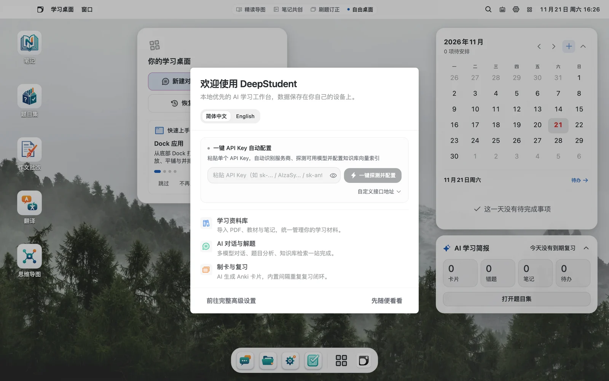
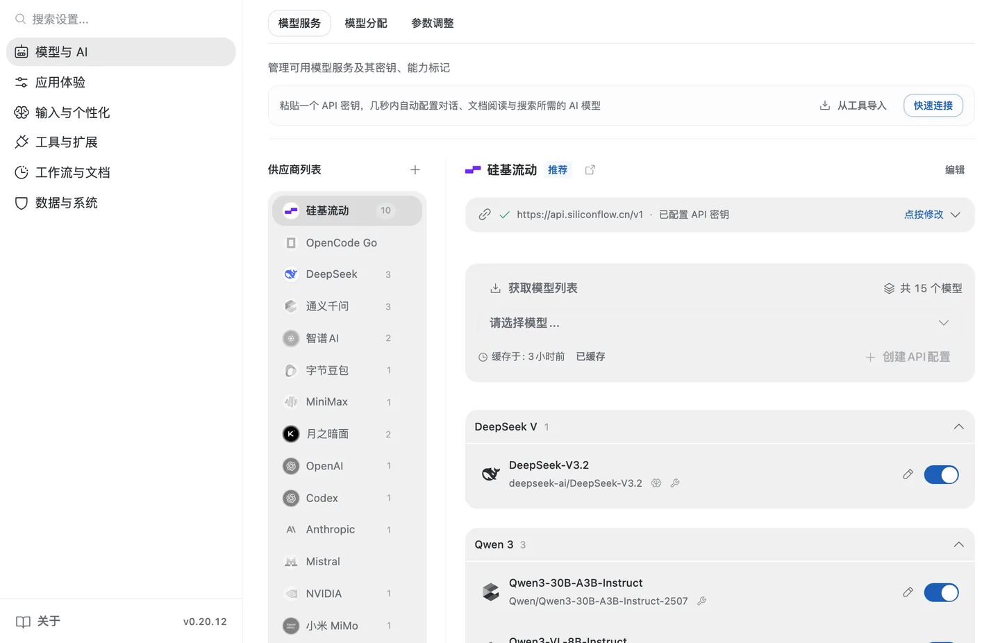

# 快速上手

> 从下载安装到跑通「配好模型 → 导入资料 → 带着资料提问 → 生成导图、卡片或题目集」，大约 10 分钟。

## 第 0 步：安装并打开

前往 [官网下载页](https://deepstudent.cn/download)（默认国内镜像，下载更快）或 [GitHub Releases](https://github.com/helixnow/deep-student/releases/latest) 获取安装包：

| 平台 | 安装包 |
|---|---|
| macOS | Apple 芯片（M 系列）与 Intel 各一个 `.dmg` |
| Windows | `.exe` 安装程序 |
| Linux | `.AppImage` 或 `.deb`（均为 x86_64） |
| Android | `.apk`（ARM64） |

iPhone / iPad 目前暂无官方安装包；如需在手机或平板浏览器中使用，可参考 [WebUI 与 PWA 自托管](./21-WebUI与PWA自托管.md)。

> **macOS 提示「已损坏，无法打开」？** 正式发布包已通过 Apple 签名与公证；如果你下载的是未公证的预览版或自构建包，打开「终端」执行下面这行（会要求输入开机密码），再重新打开即可：
>
> ```bash
> sudo xattr -r -d com.apple.quarantine "/Applications/Deep Student.app"
> ```

首次打开应用会看到两步引导：

1. **用户协议与隐私政策**：阅读后点「我已阅读并同意」。
2. **欢迎弹窗**：选好界面语言后，可以直接在弹窗里的「**一键 API Key 自动配置**」卡片中粘贴任意一把 API 密钥——应用会自动识别服务商、探测可用模型并填好各功能槽位，点「**开始使用**」就能直接进入对话。如果想稍后手动配置或先看看界面，也可以点底部的「**前往完整高级设置**」或「**先随便看看**」。



无需注册 Deep Student 账号，学习资料与聊天记录默认保存在本机（路径见文末）。

## 先认识一下桌面端界面

桌面端默认进入「**学习桌面**」：


- **底部 Dock**：默认固定了「对话」「资源库」「设置」「待办」四个应用；最右边的「全部应用」里还有闪卡、音视频、Anki 制卡、插件工坊、番茄钟等。
- **独立窗口**：每个应用、每份资料都在独立窗口里打开，拖到屏幕左右边缘松手就能自动半屏平铺，边看教材边提问很顺手。
- **顶部状态栏**：汇总今日到期闪卡、错题、制卡任务与番茄钟，中间可一键切换学习布局预设；随时按 `⌘K`（Windows / Linux 为 `Ctrl+K`）搜索应用、资料和命令。

如果你更习惯「左侧导航 + 单页」的经典布局，点状态栏最左侧的 DeepStudent 图标选「退出学习桌面」即可，之后在「设置 → 学习桌面」随时能切回来。下文按学习桌面介绍，括号里标注经典布局的对应入口。完整说明见 [学习桌面](./18-学习桌面.md)。

## 第 1 步：配好模型服务（必做）

Deep Student 本身不内置云端模型，需要接入你自己的模型服务。如果在欢迎弹窗里已经配好，可以直接跳到第 2 步；否则打开「设置 → 模型服务」（Dock 里的「设置」；经典布局在左侧导航底部）。

不确定选哪种方式？按你手头的情况对号入座即可：

| 你现在的情况 | 推荐方式 | 所需步骤 |
|---|---|---|
| 手头已经有一把 API 密钥（DeepSeek、OpenAI、硅基流动等） | **方式 A：一键 API Key 自动配置** | 粘贴密钥，自动识别服务商并配好主要槽位 |
| 还没有密钥，想一次配齐对话、检索、OCR 和制卡 | **方式 B：硅基流动一键分配** | 注册后粘贴密钥，点「一键分配」全套搞定 |
| 只想用电脑本地模型，完全不走云端 | **方式 C：本机模型（Ollama 等）** | 添加供应商并填本机地址，勾选「无需 API Key」 |

**方式 A：顶部「一键 API Key 自动配置」（最快）**

「设置 → 模型服务」页面顶部自带「**一键 API Key 自动配置**」卡片（尚未配置时默认展开，配好后会折叠为「快速配置」条）。粘贴任意受支持服务商的密钥，应用会自动识别服务商、探测可用模型并填好 8 大能力槽位与向量维度；如果这家服务商不提供嵌入接口，会自动用关键词检索兜底并保留你原有的向量设置。



**方式 B：预置供应商一键分配或手动配置（共 15 家）**

应用预置了 **15 家**模型供应商：**SiliconFlow（硅基流动，置顶第 1 带推荐徽标）**、**OpenCode Go（置顶第 2）**，以及 DeepSeek、通义千问、智谱AI、字节豆包、MiniMax、月之暗面、OpenAI、Codex、Anthropic、Mistral、NVIDIA、Xiaomi MiMo、Google Gemini。

- **硅基流动一键分配（新手最省心）**：选中 SiliconFlow，点「访问官网」注册（[注册入口](https://cloud.siliconflow.cn/i/deadXN1B)，邀请链接）并新建 API 密钥；粘贴后点「**保存 API 密钥**」，再点「**一键分配**」，即可自动配好对话、制卡、题目集批改、嵌入、重排序、翻译、OCR 和语音识别等一整套模型。
- **OpenCode Go 一键分配**：选中 OpenCode Go 保存密钥后点「**一键分配**」，会将对话、标题/标签生成、上下文压缩 3 个 Agent 槽位设为 `DeepSeek V4.1 Flash (Go)`，不改动其他非 Agent 槽位（仅建议用于学习 Agent 对话）。
- **其他预置供应商**：在对应官网获取密钥 → 粘贴并点「保存 API 密钥」（Codex 直接用 ChatGPT 账号浏览器或设备码登录）。随后打开「设置 → 模型分配」，至少选好「**对话模型**」；若希望 AI 检索导入的教材与笔记，再在同一页的「嵌入维度管理」里配好嵌入模型。

**方式 C：本机模型（无需密钥）**

如果你在本地运行了 Ollama、vLLM 或 llama.cpp，在「模型服务」点「添加供应商」，从 19 项供应商类型里选 Ollama（或通用适配器），填好本机地址（Ollama 默认为 `http://localhost:11434/v1`）并勾选「无需 API Key」，保存后会自动拉取本地模型列表。

更多细节（含 DeepSeek 官方 9 项应用能力、协议规则与五档思考强度）见 [模型与供应商配置](./14-模型与供应商配置.md)。

## 第 2 步：发出第一条消息

1. 点 Dock 里的「对话」，再点「新建会话」（经典布局：左侧导航的「新会话」）。
2. 在底部输入框写一个问题，按 `Enter` 发送。
3. 看到正常回复，说明模型已经接通。

如果发送按钮是灰的，或提示「当前会话尚未就绪」，回到「设置 → 模型分配」确认「对话模型」已选中。

## 第 3 步：导入第一份学习资料

1. 点 Dock 里的「资源库」（经典布局：左侧导航的「资源库」）。
2. 把一份 PDF 教材直接拖进窗口，或点工具栏「新建」→「导入资料…」选择文件。
3. 导入后资料会自动排队建立索引（提取文字 → 分块 → 向量化）。在左侧「知识库索引」里可以看到进度，状态变为「已索引」后，学习 Agent 就能随时检索这份资料。

详见 [资源库](./04-学习资源中心.md)。

## 第 4 步：带着资料提问

两种常用方式，看顺手选哪一种：

**方式 A：边读边问**

1. 在资源库里双击打开刚导入的 PDF。
2. 勾选页面角落的选择框，选中一两页（一次最多 10 页）；选中的页码会以标签形式出现在对话输入框上方。
3. 在对话里提问并发送，回答会附带页码出处，点引用就能跳回原文。

**方式 B：在对话里引用资料**

1. 点对话输入框左侧的「＋」→「添加文件」→「资源库」。
2. 勾选要引用的教材、笔记或整个文件夹，再发送问题。

图片、PDF 也可以直接拖进对话窗口当附件提问。详见 [AI 对话与会话管理](./02-AI对话与会话管理.md)。

## 第 5 步：生成第一个学习产物

直接用一句话，让学习 Agent 把你的资料整理成能复习、能练习的东西：

- **思维导图**：说「帮我生成这份资料第三章的思维导图」，点回复里的导图卡片就能打开编辑或遮住要点背诵。详见 [思维导图](./08-思维导图.md)。
- **闪卡与 Anki 卡片**：说「把这几页重点做成 10 张闪卡」，逐张检查后点「加入卡片库」，到期时直接在「闪卡」里按 FSRS-6 复习。详见 [Anki 制卡与模板](./12-Anki制卡与模板.md)、[闪卡复习](./13-闪卡复习.md)。
- **题目集**：说「根据这份资料出 10 道选择题」，它会自动建好题目集，随时开始作答与判分。详见 [题目集与练习](./11-题库与练习.md)。
- **音视频网课**：打开「音视频」贴一条 B 站课程链接，不下载视频就能导入字幕，边看边问并一键整理图文讲义。详见 [音视频](./19-音视频.md)。
- **专属小工具**：有个性化学习需求时，在「插件工坊」里直接说出来，让学习 Agent 现场替你做一个小应用。详见 [AI 插件工坊与插件管理](./20-AI插件工坊与插件管理.md)。

## 第 6 步（建议）：熟悉安全边界，开好自动备份

- **执行档位与工具审批**：点击输入框「＋」→「模式」，可在四档执行档位（**谨慎 / 宽松 / 完全访问 / 危险完全访问**）中按需切换。默认「宽松」档位已经兼顾效率与安全：日常读取顺畅执行，涉及高风险修改前会弹出确认卡片，按需允许或拒绝即可。详见 [AI 对话与会话管理](./02-AI对话与会话管理.md)。
- **开启自动备份**：打开「**设置 → 数据与系统 → 数据治理 → 备份**」，先做一次「完整备份」，再打开「自动备份」。养成习惯后，误删或换机都不用慌。详见 [数据管理与云同步](./16-数据管理与云同步.md)。

## 可选：联网搜索

需要查最新资料时，学习 Agent 会自动联网搜索。应用内置 **9 家**外部搜索引擎，默认自带免费的 **Bing RSS**，不用配置就能用；想要更稳定、更贴合中文或学术场景的结果，可在「设置 → 外部搜索」切换为 **Google CSE、SerpAPI、Tavily、Brave、SearXNG、智谱 AI 搜索、博查 AI 搜索**，或 **DeepSeek 官方搜索**（留空密钥可直接复用模型服务里的官方 DeepSeek 密钥，支持返回网页正文），配置后点「测试可用性」即可。详见 [深度调研与智能记忆](./03-深度调研与智能记忆.md)。

## 可选：同步卡片到 Anki 桌面版

想把卡片一键同步到 [Anki](https://apps.ankiweb.net/)，需要本机已打开 Anki 并安装 **AnkiConnect** 插件（插件代码 `2055492159`）。不装也没关系：你可以导出 `.apkg` 手动导入，或者直接用应用内置的「闪卡」完成每日复习。详见 [Anki 制卡与模板](./12-Anki制卡与模板.md)。

## 你的数据和隐私

**默认数据保存位置**

| 平台 | 默认位置 |
|---|---|
| macOS | `~/Library/Application Support/com.deepstudent.app/` |
| Windows | `%APPDATA%\com.deepstudent.app\` |
| Linux | `~/.local/share/com.deepstudent.app/` |

**隐私须知**

- 资料、笔记、聊天记录与检索索引默认保存在本机，不会上传到 Deep Student 的服务器。
- API 密钥使用系统安全存储或 AES-256-GCM 加密保存在本机。
- 使用 AI 对话或检索时，提问与引用内容会发送给**你自己配置的**模型服务商，受对方隐私政策约束；选用境外服务时，相关内容会传至境外服务器处理。
- AI 记忆可在「设置 → 记忆」随时关闭，关闭后不再提取、检索或注入个人记忆。
- 云同步默认关闭，只有在你主动配置 WebDAV / S3 等存储后才会向外同步。

## 📱 移动端说明

Android 版的上手顺序和桌面端一致，只是导航方式改成了更适合单手操作的抽屉：

- 点左上角 **☰** 或从屏幕左边缘右滑打开抽屉，上半部分是会话列表，下半部分是 **4×2 应用启动器**（会话、资源、音视频、待办、技能、闪卡、数据、设置）。
- 「设置」采用两级列表：先选分类，再进具体页面，顶部搜索框可直接搜设置项。
- 对话输入框「＋」→「添加文件」里多了「拍照」，随手拍教材或试卷就能提问和录题。

完整操作与桌面端功能对照见 [移动端指南](./17-移动端指南.md)。

## 下一步去哪里

| 你想做什么 | 去看哪一章 |
|---|---|
| 摆放窗口、用学习流预设和快捷键 | [学习桌面](./18-学习桌面.md) |
| 深入了解对话、学习空间、生成式 UI 与多模型对比 | [AI 对话与会话管理](./02-AI对话与会话管理.md) |
| 让 AI 做多步联网调研、管理长期记忆 | [深度调研与智能记忆](./03-深度调研与智能记忆.md) |
| 管理资料、文件夹、挂载与知识库索引 | [资源库](./04-学习资源中心.md) |
| 阅读 PDF / Word / EPUB、论文导读与翻译 | [文档阅读与翻译](./05-文档阅读与翻译.md) |
| 看网课、导入 B 站字幕与课中检查点 | [音视频](./19-音视频.md) |
| 搜索并下载学术论文 | [论文搜索](./06-论文搜索.md) |
| 记笔记、建思维导图 | [笔记](./07-笔记.md) · [思维导图](./08-思维导图.md) |
| 批改作文 | [作文批改](./09-作文批改.md) |
| 待办、番茄钟、学习统计与命令面板 | [效率工具](./10-效率工具.md) |
| 刷题、组卷与 FSRS-6 闪卡复习 | [题目集与练习](./11-题库与练习.md) · [闪卡复习](./13-闪卡复习.md) |
| 扩展 AI 能力（技能 / MCP） | [技能与 MCP 扩展](./15-技能与MCP扩展.md) |
| 用自然语言制作、安装与管理插件 | [AI 插件工坊与插件管理](./20-AI插件工坊与插件管理.md) |
| 多设备备份、扫码配对与云同步 | [数据管理与云同步](./16-数据管理与云同步.md) |
| 自托管 WebUI 与浏览器 / PWA 访问 | [WebUI 与 PWA 自托管](./21-WebUI与PWA自托管.md) |

<!-- 2026-11-21 对照 v0.20.7 核对并做上手与文风优化：修正 Linux 二选一（AppImage/deb）与 macOS 签名公证口径、统一「经典布局」与经典侧栏「资源库」、新增第 1 步 30 秒选路表、补齐音视频/插件工坊尝鲜引导与移动端 4×2 抽屉入口 -->
