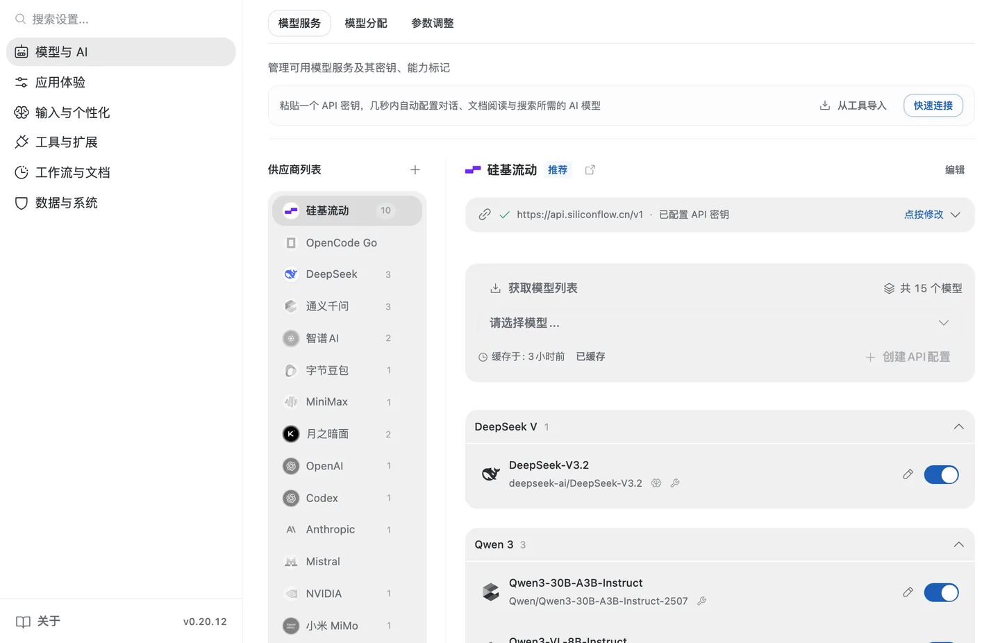
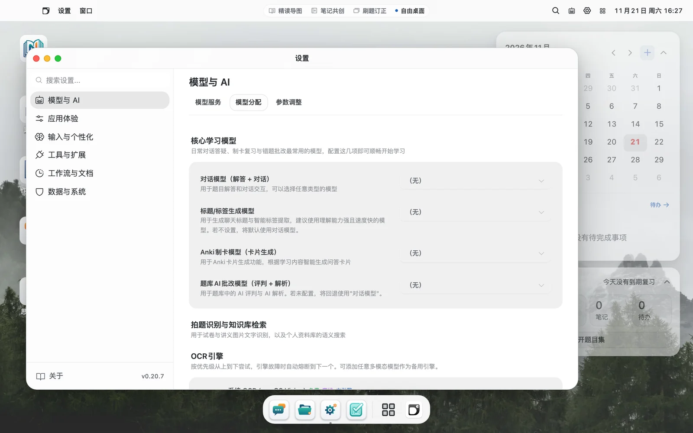

# 模型与供应商配置

> 为 Deep Student 接上你自己的 AI 模型：10 秒粘贴一把 API 密钥即可自动配齐常用能力，也支持按需为对话、制卡、批改、OCR、检索等 14 个槽位精细指定模型。

## 快速上手：你想做什么？

| 你想做什么 | 3 步操作 | 你会看到 |
|---|---|---|
| **第一次用，10 秒配好 AI** | 1. 在首次启动的「欢迎使用 DeepStudent」弹窗的「连接 AI 模型服务」卡片粘贴一把 API 密钥 → 2. 等系统自动识别供应商并点「一键连接并配置」→ 3. 点「开始使用」进入工作区 | 自动配齐 8 大常用能力槽位，无需自己研究模型参数 |
| **把 CC Switch / Magpie 等已有工具配置迁进来** | 1. 切到「连接 AI 模型服务 → 从工具导入」（或点折叠条的「从工具导入」）→ 2. 桌面端自动扫描本机 5 类工具，或选文件/粘贴 `ccswitch://` 链接 → 3. 勾选服务商并导入 | 自动过滤本地代理占位并完成增量同步，可选自动补齐空缺学习槽位 |
| **跳过引导后，在聊天页临时补配** | 1. 看对话输入框上方的「尚未配置 AI 模型…」提示条 → 2. 点「配置 AI 模型」直达「设置 → 模型服务」→ 3. 粘贴密钥点「一键连接并配置」或「从工具导入」 | 配好后返回对话，提示条自动消失，立刻可以提问 |
| **给不同任务分别选强模型和便宜模型** | 1. 打开「设置 → 模型与 AI → 模型分配」→ 2. 主对话选强推理模型，标题/翻译选轻量模型 → 3. 下拉选完即自动保存 | 底部「配置状态检查」9 个圆点直观显示各项能力是否就绪 |
| **用本机离线模型（如 Ollama）** | 1. 点「模型服务」上方「添加供应商」→ 2. 类型选 `Ollama` 并填本机地址 → 3. 勾选「无需 API Key」保存 | 自动拉取本机已有模型，全程离线不发云端 |

## 功能概览

Deep Student 不内置任何收费或限额云端 AI，所有 AI 能力都直接连接你自己配置的模型服务，费用与额度完全透明可控。相关入口都在 **「设置 → 模型与 AI」**：

- **模型服务**：管理供应商、API 密钥与模型列表。顶部内置 **「连接 AI 模型服务」** 卡片（内置 **「粘贴密钥」** 与 **「从工具导入」** 两个分段页签）；预置 **15 家**主流供应商，大多数只要粘贴一把密钥就能用；也支持手动「添加供应商」（提供 **19 项**类型，涵盖 xAI Grok、百度文心、OpenRouter、Ollama、通用适配器、自定义等），接入任意兼容接口。
- **模型分配**：按使用频率分为 **3 大区**、共 **14 个能力配置点**（另含 1 个聊天翻译显示模式项）。你可以让主对话用强模型，把标题生成、翻译、上下文压缩等轻量任务交给更便宜的小模型。

> 安全说明：你的 API 密钥会加密后**只保存在本机**，绝不会上传到任何 Deep Student 服务器。

## 入口与界面布局

有三条快捷路径进入模型配置：

1. **首次启动欢迎弹窗（「欢迎使用 DeepStudent」）**：
   - 未配置模型时，弹窗内直接展示 **「连接 AI 模型服务」** 卡片（支持「粘贴密钥」与「从工具导入」）、3 张可点击的学习起步卡（`1. 导入学习资料` / `2. 向 AI 提问与记笔记` / `3. 制作闪卡与复习`）与非阻塞底部协议说明；底部提供 **「前往完整模型设置」** 和 **「先随便看看」**。
   - 若本机或自托管环境已预先配好模型，弹窗会显示简洁的 **「AI 服务已就绪」** 卡片，底部按钮变为 **「管理 AI 模型」** 与开始使用按钮。
2. **对话页内联快捷条**：尚未配置模型时，聊天输入框上方会出现提示条「尚未配置 AI 模型，连接一个模型服务后即可开始对话与学习」，点击 **「配置 AI 模型」** 直达「设置 → 模型服务」。
3. **日常设置入口**：学习桌面点 Dock 的「设置」（或按 `⌘,` / `Ctrl+,`），在左侧「模型与 AI」下进入 **「模型服务」** 或 **「模型分配」**。找不到某项设置时，在设置窗口按 `⌘F` / `Ctrl+F` 可直接跨分类搜索。

### 「模型服务」页布局

- **顶部「连接 AI 模型服务」卡片**：未配好模型时默认展开，顶部右侧可在 **「粘贴密钥」** 与 **「从工具导入」** 间切换；配好后自动收起为一行折叠条，右侧保留 **「从工具导入」** 与 **「快速连接」** 两个快捷按钮，随时可再次展开。
- **左侧供应商列表（15 家预置 + 自定义）**：**SiliconFlow（硅基流动）** 置顶第 1，**OpenCode Go** 置顶第 2；其余 13 家为 **DeepSeek、通义千问、智谱AI、字节豆包、MiniMax、月之暗面、OpenAI、Codex、Anthropic、Mistral、NVIDIA、Xiaomi MiMo、Google Gemini**。列表顶部提供导入与添加按钮；灰色图标表示尚未填密钥，桌面端可拖动排序。
- **右侧供应商详情**：顶部是名称与「访问官网」（↗），下方是连接配置与模型列表。**官方 DeepSeek（账户余额）、OpenCode Go（实时用量与套餐额度）、Codex（ChatGPT 账号 Codex 额度窗口）** 3 家会在详情页直接展示余额或实时用量。

## 核心操作

### 方式一：快速连接与一键分配（推荐新手，3 种快捷方案）

**1. 顶部「连接 AI 模型服务 → 粘贴密钥」（任意受支持服务商）**

- **入口**：首次欢迎弹窗内直接可用；日常在「设置 → 模型服务」页面顶部点 **「快速连接」** 展开。
- **操作**：粘贴一把 API 密钥，应用会自动识别服务商（存在多种可能时可点选服务商标签，也可展开「自定义服务地址」填写中转地址），点击 **「一键连接并配置」** 后自动探测可用模型并填好 **8 大核心能力槽位与向量维度**。如果所选服务商不提供嵌入接口，应用会自动回退为关键词检索兜底，不耽误使用。

**2. 硅基流动（SiliconFlow）一键分配（一站配齐整套学习能力）**

1. 在「模型服务」左侧选中置顶第 1 的 **SiliconFlow（硅基流动）**，粘贴密钥并点 **「保存 API 密钥」**。
2. 点旁边的 **「一键分配」**。

应用会自动配好核心对话、题目集批改与解析、Anki 制卡、嵌入（自动建好 1024 维 `bge-m3` 并设为默认）、重排序、翻译、标题/标签生成、记忆决策、语音识别（ASR）以及多级 OCR 引擎。之后随时可在「模型分配」里逐项微调。

**3. OpenCode Go 一键分配（专注学习 Agent 对话）**

1. 选中置顶第 2 的 **OpenCode Go**，保存密钥后点 **「一键分配」**。
2. OpenCode Go 内置 **13 个**跨原生协议模型，主要面向 **Agent 对话**场景（若将其分配给制卡、批改、翻译等非 Agent 槽位，页面会给出合规提醒）。点「一键分配」时只会将 **对话模型、标题/标签生成、上下文压缩** 这 **3 个 Agent 槽位**设为 `DeepSeek V4.1 Flash (Go)`，**不会改动制卡、批改、嵌入、重排序、OCR 等其他槽位**。详情区还提供 **5 小时 / 本周 / 本月**实时用量与套餐额度参考。

### 外部工具一键导入与增量同步（CC Switch / Magpie / OpenCode / Claude Code / Codex）

如果你平时已经在其他 AI 工具或代理管理器里维护好了模型供应商和 API 密钥，可以直接把真实上游配置导入 Deep Student，不必逐条复制：

- **4 个快捷入口**：
  1. 首次欢迎弹窗或「设置 → 模型服务」顶部卡片 **「连接 AI 模型服务 → 从工具导入」**；
  2. 模型服务页顶部折叠条上的 **「从工具导入」** 按钮；
  3. 左侧供应商列表顶部的外部工具导入按钮；
  4. 在「粘贴密钥」输入框中直接粘贴 `ccswitch://` 深链、环境变量块或配置片段时，会自动识别并切入导入面板。
- **本机自动扫描（桌面端只读）**：在「本机自动扫描」页签自动只读发现本机 **Magpie**（`providers.json`）、**CC Switch**（`cc-switch.db` / `config.json`）、**OpenCode**、**Claude Code**、**Codex** 共 **5 类**工具配置。
- **粘贴与文件导入（全端可用）**：桌面端、WebUI 与移动端均可点击 **「选择配置文件」** 导入 `.db` / `.sql` / `.json` / `.jsonc` / `.toml` / `.env` 文件，或在「粘贴链接或配置」页签直接粘贴 `ccswitch://` 链接、环境变量块（`export` / `$env:`）、JSON/JSONC 或 SQL 备份片段。
- **智能过滤与增量重同步**：
  - **自动跳过本地代理占位**：自动过滤 Magpie / CC Switch 的本地代理接管占位地址，只导入真实上游服务商；
  - **增量重同步不重复建项**：逐项识别 **`新增`** / **`对齐内置厂商`** / **`增量更新`** / **`已同步`** 状态，再次导入时只合并新模型与备用密钥，不会重复创建供应商；
  - **按需探测与自动补齐**：对未显式列出模型的供应商可随时点 **「探测模型」** 拉取并勾选；勾选底部的 **「自动补齐未配置的学习功能模型」** 后，系统仅为当前空缺的学习槽位绑定合适模型，完整保留你已有的配置（尤其是已配置的嵌入模型与向量维度）。

### 方式二：为预置供应商保存 API 密钥

1. 打开「设置 → 模型服务」，左侧任选一家预置供应商（如 DeepSeek、通义千问或 OpenAI）。
2. 点名称旁的 **「访问官网」** 注册并创建一把 API 密钥。
3. 回到应用粘贴进「API 密钥」框，点 **「保存 API 密钥」**（只粘贴不保存不会生效；保存后会显示「已安全保存，下次无需重新输入」）。
4. 在下方模型行点 **「测试连接」**，提示通过即可开始使用。

已配置过密钥的供应商会自动收起连接区为一行「已配置 API 密钥」，点击展开即可更换或「清除」密钥。15 家预置供应商入口本身不可删除，但下面的模型配置可以自由编辑和删除。

### 方式三：用 ChatGPT 账号登录 Codex（无需 API Key）

1. 在供应商列表选择 **「Codex」**。
2. 点 **「使用浏览器登录」**（移动端或受限环境可选 **「使用设备码登录」**），在浏览器完成 ChatGPT 授权。
3. 登录后可直接看到套餐信息与「Codex 额度」窗口用量，随时可「刷新额度」或「退出登录」。

### 方式四：添加自定义供应商（Grok / OpenRouter / Ollama 等）

1. 点供应商列表上方的 **「添加供应商」**（`＋`）。
2. 填名称，从 **19 项**「供应商类型」下拉中选择（含 **xAI (Grok)、百度文心、OpenRouter、Ollama、通用适配器、自定义** 等）。
3. 选择「API 协议」（多数兼容接口保持默认即可），填「接口地址」和「API 密钥」；若连接本机部署的 Ollama / vLLM / llama.cpp，勾选 **「无需 API Key」**，保存后会自动拉取本机模型列表。
4. 按需还可配置「备用 API 密钥」（每行一把，主密钥失效时自动切换）、「最大输出 Token 上限」、超时时间及自定义请求头。

> 提示：自定义供应商创建完成后，点「编辑」只修改名称、类型、协议与地址；要修改或清除密钥，请点击展开详情页中折叠的 **「连接配置」** 区。修改接口地址时，你保存或手动选择的协议会被自动保留，不会被误覆盖。

### 获取模型列表与手动添加模型

- **自动拉取**：在供应商详情点 **「获取模型列表」**，搜索并勾选想用的模型（或点「全选新模型」），点 **「添加 N 个模型」** 即可自动填入上下文窗口与输出上限。
- **手动添加**：点 **「添加模型」**，填写真实调用模型名，在「能力」标签页勾选多模态、推理、嵌入、重排序、生图、工具调用等标签（这决定了它能出现在哪些功能槽位里），按需在「参数」「推理」标签微调后保存。

### 为各功能分配模型（3 大区渐进披露）

打开 **「设置 → 模型与 AI → 模型分配」**，下拉选完即自动保存，底部配有 **9 项状态圆点**的「配置状态检查」：

**① 核心学习模型（常显，4 项）**

| 槽位 | 说明 |
|---|---|
| 对话模型 | **必配**，所有对话答疑与学习助手的基础 |
| 标题/标签生成模型 | 自动总结会话标题和标签，不配时回退对话模型 |
| Anki 制卡模型 | 把学习资料整理成闪卡，不配时回退对话模型 |
| 题库 AI 批改模型 | 批改题目集作答并写解析，不配时回退对话模型 |

**② 拍题识别与知识库检索（常显，2 个面板）**

- **OCR 引擎**：识别拍照题目、图片和扫描件文字。内置 **6 种引擎类型**：`DeepSeek-OCR`、`PaddleOCR-VL-1.5`、`PaddleOCR-VL`、`GLM-4.6V`、`通用多模态模型`、`系统 OCR`。支持多引擎按优先级自动切换与对比测试（若开启了 DeepSeek 官方 OCR 能力，会自动加入 `DeepSeek OCR (Official)`）。
- **嵌入维度管理**：想让 AI 语义检索你导入的教材和笔记，需要配置默认嵌入维度并关联嵌入模型：
  1. 先在「模型服务」添加一个勾选了「嵌入模型」能力的模型（如 `BAAI/bge-m3`）；
  2. 在「嵌入维度管理」点 **「新建维度」**（或选「常用维度」，例如 `bge-m3` 对应 `1024`）；
  3. 关联该嵌入模型并点 **「设为默认」**。注意：删除维度会同时清掉该维度下的向量数据，需重新建索引。

**③ 更多专项模型设置（默认折叠，徽标 `已配置 X/8`）**

展开后可精细配置以下 **8 个专项槽位** 与 **1 个显示模式项**：

| 配置项 | 说明 |
|---|---|
| 题库 AI 出题模型 | 按资料自动出题 |
| 翻译专用模型 | 文献与对话翻译，不配时回退对话模型 |
| 聊天翻译显示模式 | 设置对话内翻译显示为「短语对照」或「流式译文」 |
| 语音识别（ASR）模型 | 用于「语音听写」及音视频字幕转写，支持 `DeepSeek ASR` 及硅基流动、阿里云百炼、OpenAI 等兼容 ASR 模型（纯实时流或异步文件接口不可选） |
| 生图模型 | 在对话或学习材料中生成配图 |
| 记忆决策模型 | 判断与整理个人学习记忆 |
| 上下文压缩模型 | 长对话自动摘要，推荐选便宜且上下文长的模型 |
| 重排序模型 / 多模态重排序模型 | 进一步提升资料库文本与图文检索精准度，不配时跳过重排 |

### DeepSeek 官方应用能力（9 项可选）

如果配置了内置官方 DeepSeek（`https://api.deepseek.com`），在 **「设置 → 模型服务 → DeepSeek → 应用能力」** 中可按需打开 **9 项**官方能力，每一项都有独立开关与「测试」按钮（开开关本身不计费，仅在点「测试」或实际调用时发出请求）：

- **4 项对话能力**（需使用 `deepseek-flash` 且走 `OpenAI Responses` 协议）：对话联网搜索、对话读链接、对话文件解析（单次最多引用 20 个文件）、对话内容审核。
- **5 项独立接口**：Search 网页搜索（支持直接返回网页正文）、Fetch 网页抓取（失败自动回退本地抓取）、OCR 文字识别、ASR 语音识别（支持 16-bit PCM WAV 或 Ogg Opus，≤120 秒、≤8 MiB）、TTS 朗读语音（可选系统语音、`Stella` 或 `Tide`）。

### 本地编程 CLI 配置（桌面端）

如果你在本机安装了命令行编程工具，无需另外配 API 密钥，也能直接把它们接入对话工作台协同处理代码与学习项目：

- **配置入口**：打开 **「设置 → 工具与扩展 → 编程 CLI」**。
- **自动探测与自定义**：支持自动探测本机 **Claude Code**、**Codex CLI**、**OpenCode**、**Pi Agent**、**Antigravity CLI（`agy`）**、**DeepSeek Harness（`dsh`）** 6 类常用编程 CLI，并支持添加 **自定义命令行工具**；每个工具均可自定义可执行文件路径与附加启动参数，改完点 **「保存并检测」** 立即验证。
- **协作与安全选项**：在「协作与安全」区可开关 **「默认在原目录直接协作」**（每轮自动生成无侵入隐藏快照以便随时回退）、**「并发文件防冲突锁」**（多工具并发写入时按路径协调防覆盖）、**「共享当前学习上下文」**（按需让外部 CLI 读取当前会话关联的笔记与资料片段）以及 **「连续自动接力上限」**。在对话中调用与协同的具体用法见 [AI 对话与会话管理](./02-AI对话与会话管理.md#本地编程-cli-与多工具协同桌面端)。

## 进阶用法

- **统一的五档思考强度**：在模型编辑的「推理」标签中可切换思考开关与 **低 / 中 / 高 / 极高 / 最高** 五档思考强度，系统会自动映射到 OpenAI、Claude、Gemini、DeepSeek、通义千问、豆包、Kimi、智谱等各家原生参数，不用逐家查文档。
- **外部搜索引擎（9 家）**：在「设置 → 外部搜索」配置联网搜索源（默认免费的 Bing RSS，以及 DeepSeek 官方搜索等共 9 家），详见 [深度调研与智能记忆](./03-深度调研与智能记忆.md#调研前的准备配置搜索引擎)。

技术细节：4 种 API 协议与保留规则

- 应用支持 **4 种 API 协议**：`OpenAI Chat Completions`、`OpenAI Responses`、`Google GenerateContent`、`Anthropic Messages`。
- **官方 DeepSeek**：默认 `OpenAI Responses`（列名模型 `deepseek-flash`、`deepseek-v4-flash`、`deepseek-v4-pro`、`deepseek-chat`、`deepseek-reasoner` 走 Responses，V3.x 与中转站自动回落 `OpenAI Chat Completions`）。
- **Mistral**：官方地址 `https://api.mistral.ai/v1` 默认走 `OpenAI Responses`，未指定协议的网关继续走 `OpenAI Chat Completions`。
- **修改 URL 保留协议**：编辑自定义或网关供应商接口地址时，已保存或手动选中的协议会被保留（仅官方 Anthropic 与 Gemini 域名强制原生协议）。
- 密钥均使用 AES-256-GCM 加密并仅保存在本机。

## 移动端说明

- 从抽屉菜单进入「设置」，按「模型与 AI → 模型服务 / 模型分配」两级页面操作，功能与桌面端一致；顶部「连接 AI 模型服务 → 从工具导入」同样支持选择配置文件或粘贴 `ccswitch://` 链接与配置片段导入。
- 触屏上供应商列表不支持拖动排序；Codex 若遇浏览器授权受限，改用 **「使用设备码登录」** 即可；「本地编程 CLI」为桌面端专属能力。

## 常见问题

**Q1：填了密钥还是发不出消息？**
A：依次检查三步：① 确认点过 **「保存 API 密钥」**；② 在「模型分配」确认已选好 **「对话模型」**；③ 在「模型服务」对该模型点 **「测试连接」** 查看具体报错。

**Q2：资料导入了，AI 却说搜不到？**
A：检查「模型分配 → 嵌入维度管理」是否已建好默认维度并关联嵌入模型，再回资源库「知识库索引」确认文件状态为「已索引」。若通过「一键连接并配置」接入的服务商不含嵌入接口，应用会先用关键词检索兜底。

**Q3：编辑自定义供应商时找不到密钥输入框？**
A：点「编辑」只改名称、地址和协议；要录入、更换或清除密钥，请点击展开详情页中折叠的 **「连接配置」** 区。

**Q4：15 家预置供应商可以删掉不用的吗？**
A：预置模板本身不可删除，不填密钥闲置即可，不会发任何请求；供应商下的单个模型可以自由删除。删除自建供应商会连同其下模型一起移除。

**Q5：只配一个对话模型，其他 13 个槽位都不配能用吗？**
A：完全可以！翻译、标题生成、上下文压缩、Anki 制卡、题目集批改等都会自动回退到对话模型；重排序不配会自动跳过。只有「对话模型」（以及要用知识库语义检索时的「嵌入模型」）建议优先配置。

**Q6：怎么用本机离线模型？**
A：本机启动 Ollama / vLLM / llama.cpp 后，在「模型服务」点「添加供应商」→ 类型选 `Ollama`（或通用适配器）→ 填本机地址（如 `http://localhost:11434/v1`）→ 勾选 **「无需 API Key」**，保存后自动拉取本机模型。

<!-- 2026-11-27 对照 v0.20.10 更新：同步「连接 AI 模型服务」卡片（「粘贴密钥」/「从工具导入」分段页签、「一键连接并配置」、折叠条「从工具导入」+「快速连接」）；移除 SiliconFlow 已下线的「推荐」徽标描述；补充 OpenCode Go 内置 13 个跨原生协议模型与非 Agent 槽位提醒；新增外部工具一键导入与增量同步（CC Switch / Magpie / OpenCode / Claude Code / Codex）与桌面端「设置 → 工具与扩展 → 编程 CLI」配置入口；移除标题 Emoji -->
