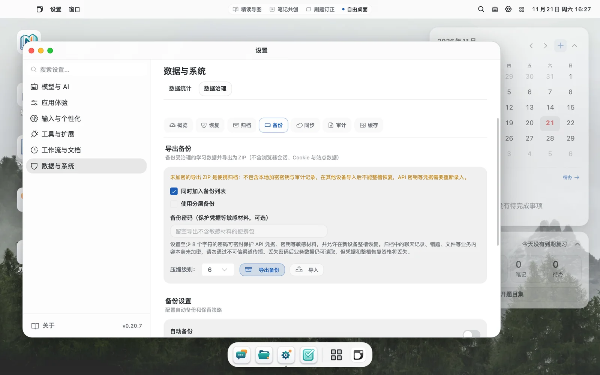

# 数据管理与云同步

> 你的学习数据全部存在本机，由你完全掌控——这一章介绍本地备份与恢复、跨设备配对与云同步（含 Sync V5 引擎）、从 0.11.x 原地升级，以及隐私与数据治理。

## 功能概览

Deep Student 是**本地优先**的应用：对话记录、笔记、文件、闪卡、题目集、设置等全部保存在你设备上的本地数据库和文件里，不会在你不知情的情况下上传到任何服务器。**本地备份**是基础安全层：可在本机创建完整恢复点，支持自动定时备份、完整性验证与 A/B 数据空间恢复。

需要使用自己的云存储时，应用提供**两套彼此独立的云端机制**，请勿混淆：

1. **云端整包备份（实验性）**：把整包备份上传到你自己的 WebDAV / S3 兼容存储 / FTP（各平台支持情况见下文），按版本保留，换机或灾备时从云端下载。⚠️ 请留意[「云端整包备份 / 从云端恢复」](#云端整包备份-从云端恢复)中的加密与恢复限制。
2. **记录级双向同步（实验性）**：基于变更记录的多设备同步，支持自动同步开关、后台租约心跳保护、冲突检测、合并策略与隔离区，并配合「设备配对」快速把配置迁到另一台设备。v0.20 引入了新一代 **Sync V5 同步引擎**（详见下文，注意区分当前 UI 与引擎边界）。

此外还有：

- **数据导入导出**：ZIP 备份可导出到任意位置、在另一台设备导入；错题等数据还支持 JSON / CSV 导出。
- **隐私控制**：API 密钥等敏感数据使用系统安全存储或 AES-256-GCM 加密保存；无行为追踪；匿名错误报告默认关闭；记忆功能可随时关闭（关闭后不再提取、检索或注入用户记忆，记忆内容不会发送给外部 AI 服务）。

## 入口与界面布局

从 `v0.20.7` 起，数据相关入口做了清晰收口：

- **统计总览中心**（学习桌面或经典侧栏中的「数据管理」）：收口为学习与存储统计总览页，页面底部提供直达数据治理的快捷入口。
- **完整数据治理入口**：统一在 **「设置 → 数据与系统 → 数据治理」**，生产版顶部分为 **7 个标签**（`调试` 标签仅在开发构建中可见）：
  - **概览**：全局版本、健康状态、各数据库状态，可「运行健康检查」。
  - **恢复**：查看并管理 **A/B 数据空间切换**（仅原生桌面端与移动端可见，自托管 WebUI 隐藏；启动检测到两套可能有效的数据时会在此让你选择），底部「危险操作」区还收纳了 **「清空所有数据」**（三步确认 + 5 秒冷静期，下一次重启生效）。
  - **归档**：管理已归档的聊天会话（恢复或永久删除）。
  - **备份**：本地备份的创建、分层备份、备份列表与自动备份策略。
  - **同步**：自动同步开关、设备配对（`DSPAIR1`）、云存储配置、云端整包备份、云端仓库巡检、记录级双向同步、冲突检测与解决、同步隔离区及未同步文件清单。
  - **审计**：所有迁移 / 备份 / 恢复 / 同步操作的完整日志，方便排障追溯。
  - **缓存**：媒体缓存管理（PDF 预览图片、压缩图片、OCR 文本、向量索引）。

另外，「设置 → 常规」里有「隐私与数据」区块（「匿名错误报告」开关与「数据流向说明」）；记忆开关与存储位置在单独的「设置 → 记忆」页。

## 各平台云存储支持矩阵

不同运行形态可用的云存储后端不同，跨端同步前请先核对下表：

| 运行平台 / 形态 | WebDAV | S3 兼容存储 | FTP / FTPS（实验性） |
|---|---|---|---|
| 原生桌面端（Windows / macOS / Linux） | ✅ | ✅ | ⚠️ 实验性 |
| 桌面浏览器访问自托管 WebUI | ✅ | ✅ | ⚠️ 实验性 |
| 手机浏览器访问自托管 WebUI | ✅ | ✅ | ❌（界面隐藏） |
| Android 原生客户端 | ✅ | ❌ | ❌（仅支持 WebDAV） |

如果你需要在电脑和 Android 手机之间通过同一个云端目录同步，请统一选择 **WebDAV**。

## 核心操作

### 创建一次本地备份

1. 打开「设置 → 数据与系统 → 数据治理 → 备份」。
2. 点击「完整备份」（或「快速备份」）。想直接得到 ZIP 文件，点「导出备份」并选择保存目录。
3. 备份过程展示进度条与预计剩余时间；完成后新备份会出现在「备份列表」，可执行「验证」「导出为 ZIP」「恢复」「删除」。

备份按层级组织（在「分层备份」中可按需勾选，默认勾选**核心数据 + 重要数据**并开启「包含资产文件」，覆盖资源库原始文件；可按需增减）：

- **核心数据 (P0)**：聊天记录、虚拟文件系统、主数据库（闪卡 / 设置等）
- **重要数据 (P1)**：P0 + 使用统计、笔记附件
- **可重建数据 (P2)**：P0–P1 + 向量索引（可通过重新索引恢复）
- **大型资产 (P3)**：P0–P2 + 图片 / 文档 / 音视频等媒体文件

### 开启自动备份

1. 在「备份」标签找到「备份设置」。
2. 打开「自动备份」，选择「备份间隔」（6 到 72 小时可选）与「最大备份保留数」（超出上限自动清理最旧备份）。
3. 自动备份始终创建包含受治理数据库与资产的完整恢复点；旧版「精简备份」选项已停用。需要只保存部分内容时请使用分层备份，但分层产物属于部分归档，不能替代整个数据槽。
4. 备份目录可在当前「备份」标签的「本地备份」设置中自定义；留空则使用默认目录。

### 从本地备份恢复数据

1. 在「备份列表」选择一个备份并点击「恢复」，或先「导入」外部 ZIP 备份文件。
2. 确认提示：恢复会替换当前数据，系统会在恢复前**自动创建预恢复备份**。
3. 恢复过程中请勿关闭应用；完成后按提示「立即重启」以完整加载新数据。

原生客户端采用双数据空间设计（A/B 槽位）：导入的备份先写入非活动空间，重启后再切换，避免恢复过程损坏现有数据。如需手动排查或切换数据空间，可前往 **「设置 → 数据与系统 → 数据治理 → 恢复」**。

### 配置云存储与端到端加密（WebDAV 为例）

1. 打开「设置 → 数据与系统 → 数据治理 → 同步」，在「云端同步」区域点击「去配置云存储」。
2. 「存储类型」选择 **WebDAV**（适用于坚果云、Nextcloud、自建 WebDAV 等）。
3. 填写「服务器地址」（如坚果云为 `https://dav.jianguoyun.com/dav/`；若同步目录位于「我的坚果云」等含中文或空格的路径下，请直接写进地址，如 `https://dav.jianguoyun.com/dav/我的坚果云/`，应用会统一解码列举结果，避免因路径编码不一致导致静默列空）、「用户名」与「密码」——强烈建议使用**应用专用密码**。
4. 可修改「根目录」（云端存放数据的目录，默认 `deep-student-sync`）。
5. **强烈推荐设置「端到端加密密码」**：
   - **新设密码规则**：至少 **8** 个字符（按 Unicode 码点计数，不能为空白；例如 4 个 emoji 只算 4 个字符），且会执行**弱口令校验**，过于简单的密码会被拒绝保存。
   - **存量旧短密码兼容**：若老版本曾设置过短密码，升级后界面允许在**二次确认后沿用旧密码**，避免历史备份被锁死（仍建议择机迁往新目录并更换强密码）。
   - **加密范围**：启用后，**整包 ZIP 备份**、**记录级同步的变更记录 / 同步清单 / 删除标记**，以及 **workspace 数据库、VFS blob 与资产文件**都会用 AES-256-GCM 端到端加密，云服务商无法读取内容（对象路径仍使用明文内容哈希用于去重）。启用加密前已上传的明文遗留对象会被拒绝下载，需用同一密码重新同步完成迁移。
   - **停用加密保护**：停用端到端加密需要经过显式危险确认；即便你在本机清除了密码，只要云端目录仍存在 `.encryption-marker`（或本机记住了该目录曾经加密），应用仍会**拒绝明文上传**。
   - **读不到本机密码时拒绝导出**：当配置显示已启用加密、但应用无法从本机安全存储读取该密码时，云端整包导出会直接拒绝导出，绝不会套用已存密码缺失后的明文降级为便携包。
   - ⚠️ 密码只以加密形式保存在本机，不会上传。**遗忘密码则无法恢复任何已加密的云端数据**，所有参与同步的设备必须使用同一密码。
6. 点击「测试连接」确认可用，再点击「保存配置」。

加密容器与云端密码校验子携带的 Argon2id 参数来自云端，应用会在密钥派生前执行硬上限检查：内存成本最多 **1 GiB**、迭代次数最多 **16**、并行度最多 **8**；超限参数会被当作损坏或不兼容数据直接拒绝。应用自身默认写出参数为 64 MiB / 3 次 / 并行度 4。

原生桌面端与桌面浏览器 WebUI 还支持 **S3 兼容存储**（AWS S3、Cloudflare R2、阿里云 OSS、MinIO 等；控制台复制的带 bucket 前缀域名如 `https://mybucket.oss-cn-hangzhou.aliyuncs.com` 可直接粘贴，应用会自动剥离前缀避免拼出 `bucket.bucket` 域名）和 **FTP / FTPS**（实验性，存在已知数据一致性风险）。使用明文 `http://` / `ftp://` 连接时会收到安全警告，建议始终使用加密连接。

### 设备配对（`DSPAIR1`）与 Sync V5 引擎

#### 用「设备配对」快速把配置迁到新设备

在「设置 → 数据与系统 → 数据治理 → 同步」中，你可以使用内置的 **「设备配对」** 功能，把常用同步与 AI 配置安全传到另一台设备，无需逐项手抄：

1. **发起端打包**：点击「设备配对」，勾选需要传输的内容——可选包括**云存储配置**、**AI 供应商与 API 密钥**、**技能 / 插件同步偏好**。
2. **6 位 PIN 加密生成 `DSPAIR1` 载荷**：系统使用随机或指定的 **6 位 PIN 码**将所选配置加密为 `DSPAIR1` 配对码，可展示为二维码、导出为 **SVG** 文件，或一键复制文本配对码。
3. **接收端导入**：在目标设备的「同步」页签打开设备配对导入，支持**摄像头扫码**、**读取二维码图片**或**粘贴配对码文本**，输入同一 6 位 PIN 码即可解密落地。

#### 自动同步与 Sync V5 同步引擎

「同步」页签现已提供**自动同步开关**，并在后台同步周期内启用**租约心跳保护**，降低多设备并发写入或异常中断导致的锁冲突风险。

同时，从 `v0.20` 起，Deep Student 在后端引入了新一代 **Sync V5 同步引擎**，重点解决多设备同步中最容易踩坑的四类问题：

- **更少乱序覆盖**：通过混合逻辑时钟（HLC）按因果顺序排列跨设备修改，降低不同设备系统时间偏差带来的覆盖风险；
- **更快差异比对、更省同步流量**：通过版本向量、可压缩快照与加密分片索引（`.dsix`）配合按需分片读取，只拉取缺失的数据段，不必反复全量扫描；
- **断网刷题不丢进度**：支持 FSRS 题目复习计划跨端原子合并与离线对齐，多台设备离线各自刷题后也能平稳合并；
- **防回滚演进协议**：底层内置防重放与防回滚的新一代配对协议（`DSPAIR2`）。

> **如实说明当前界面与引擎边界（v0.20.7）**：Sync V5 核心引擎与后端 FSRS 复习计划原子合并能力已随 `v0.20.x` 落地；前端的一键同步操作流与设备配对界面正逐步切换接入（当前设备配对 UI 使用的是 **`DSPAIR1`** 协议）。日常仍建议保持本地自动备份开启。

### 云端整包备份 / 从云端恢复

1. 配置好云存储后，点「立即备份到云端」，可附一条备注（如「升级前备份」）。每次成功备份都会把当前数据打成**完整 ZIP** 作为**单个对象**上传并生成新版本；超出保留数的旧版本会自动清理。新版本编号为随机 ID，不再包含备份时间或设备名。
   - **未配置云端端到端加密密码**：上传的是便携归档（**不会**带备份密码，也不包含本地加密密钥与审计数据）；
   - **已配置云端端到端加密密码**：使用已存密码导出加密全保真 ZIP（外层 DSBK 与内层备份密码一致），解包并通过校验后可整槽恢复；若已配置但读不到本机密码，会直接**拒绝导出**（不会套用已存密码的明文替代或静默降级为便携归档）。
2. 「从云端恢复」会先下载并导入该 ZIP，再执行整槽恢复校验。便携归档在导入与恢复阶段校验会明确拒绝，不会覆盖当前数据；历史版本与状态卡上已知便携归档的恢复按钮会直接禁用，未标注类型的早期历史版本仍先走确认框，下载后再由整槽校验兜底拦截。
3. 操作前仍建议先在本机创建一次本地完整备份。

从云端下载大备份包时支持**断点续传**（WebDAV 与支持 S3 的桌面/WebUI 端）：网络中断后对同一版本重新下载可从断点续传，完成后对完整文件执行 SHA-256 校验；记录级同步里的工作区 / blob / 资产大文件同样走按内容哈希区分的 `.ds-dl.part` 续传路径。**FTP 不支持续传**，中断后需整包重下。所有云端下载均核对实际字节数与声明大小，绝不把半包当作成功保存。

> ⚠️ **便携 ZIP 与全保真换机说明**：「导出备份」未填备份密码时生成的是便携归档（剥离本地加密密钥与审计数据），不能直接整槽恢复。需要**全保真换机**时，请在「导出备份」时填写 **「备份密码（保护凭据等敏感材料，可选）」**（以 Argon2id + AES-256-GCM 密封敏感材料），在新设备导入时输入同一密码即可整槽恢复。⚠️ 该备份密码只加密保护敏感凭据，ZIP 内的归档内容本身未加密，请勿通过不可信渠道传播。

### 云端仓库巡检（只读体检）

「云存储」面板底部提供**云端仓库巡检**，用于定期确认云端历史备份真正可用：

1. 先「测试连接」，再点击「开始巡检」。
2. 巡检会逐个下载云端清单引用的备份对象，校验**存在性**、**SHA-256 校验和**与（启用加密时）**加密头完整性**，同时报告无清单引用的**孤儿对象**。耗时和流量与云端仓库总大小相当，建议在 Wi-Fi 下执行（WebDAV 与 S3 巡检同一对象时支持**断点续传**，FTP 仍整包重下）。
3. 巡检全程**只读**，不会改动或删除任何云端文件，并给出三种结论：**全绿**、**发现问题**（附处置指引）或**巡检不完整**（列表被截断或个别读取失败时会如实拒绝给出全绿）。

### 未同步文件清单（只读）

「同步」标签底部的「未同步文件」面板只读比对云端清单与本机文件，列出尚未安全落盘的附件或资产（如下载未完成、明文遗留被拒收、文件名大小写冲突、净化后重名或非法路径）。点「重新检查」只刷新视图，不改数据；可重试项可直接点「重试下载同步」，命名冲突则需在源设备重命名后再同步。

### 记录级双向同步与冲突解决（实验性）

1. 选择「合并策略」：保留最新 / 保留本地 / 使用云端 / 手动处理。
2. 点击「双向同步」（或单向「上传」「下载」），也可开启「自动同步」让后台按租约周期自动运行。
3. 检测到冲突时，会区分数据库级与记录级冲突，可批量按策略处理或逐条「手动合并」；无法安全应用的云端变更会进入「同步隔离区」，不阻塞后续同步。

### 记录级时点恢复（本机自动快照）

批量解决记录冲突或执行库级覆盖前，应用会自动保存受影响记录的本机快照（每个数据库最多保留最近 50 批），可在记录冲突面板的「自动快照（可撤销）」中点击「回退此批」恢复（回退本身也可撤销）。快照只存在本机，不直接作为同步记录上传。

### 从 0.11.x 原地无损升级到 0.20.x

Deep Student `v0.20.x` 从底层切换至 Electron 45 + Cordis 4 架构，但专门保证了从旧版 `0.11.x` 的**原地无损升级**体验：

- **业务数据目录不变**：你的业务数据仍原样存放在 `com.deepstudent.app` 目录中；Electron 自身的浏览器内核缓存被独立隔离在 `com.deepstudent.app.electron`，不会污染业务数据目录。
- **原地挂载与自动迁移**：首次启动新版本时，会原地挂载原有的 SQLite 数据库与 LanceDB 向量索引，并自动回放新增的 SQL 迁移脚本，无需手动导出再导入。
- **`localStorage` 原子迁移**：首次启动会自动从旧版 Tauri WebView 原子迁移界面偏好与本地配置项。⚠️ 注意：**旧版内嵌浏览器的网站登录态（Cookie / Session）不会迁移**，升级后在内置浏览器中重新登录对应网站即可。
- **Windows 自动清理旧版安装**：在 Windows 上使用新版安装包的 `/UPDATE` 更新流程时，会自动检测并卸载旧版 Tauri 安装项，避免系统里残留两个 Deep Student 入口。
- **用户插件与工坊完整保留**：升级只替换官方应用包，应用数据目录中 `<app-data-dir>/plugins/` 里的用户插件、插件工坊源码、插件配置与权限同意账本均完整保留（详见 [AI 插件工坊与插件管理](./20-AI插件工坊与插件管理.md)）。

尽管支持原地无损升级，跨大版本更新前仍建议先顺手创建一次本地完整备份。

### 关闭记忆 / 控制隐私

1. 打开「设置 → 记忆」，关闭「启用」开关：学习 Agent 将不再提取、检索或注入你的用户记忆。
2. 在「设置 → 常规」的「隐私与数据」区块中，「匿名错误报告」默认关闭，并可查阅完整的「数据流向说明」。
3. 使用 AI 功能时，相关请求只会发送给你自己配置的模型服务商（见 [模型与供应商配置](./14-模型与供应商配置.md)）；不使用云同步时，数据不出本机。

### 云端目录的加密标记与「密码不一致」解锁

开启端到端加密后，云端根目录下会写入 `.encryption-marker`（加密标记）并携带不可逆的密码校验子，用于拦截向加密目录的明文上传及配错密码的设备。本机同时保存一份「该云端目录曾经加密」的本机记忆（只存单向指纹与首次观察时间，不上云）作为第二道门禁。

**提示「尚未完成的加密认领」时**：新版客户端会在 `.encryption-marker.pending/` 中暂存认领登记，完成后自行删除。请等待其他设备完成再重试；若确认其他设备均已停止且不会恢复旧请求，才可用网盘工具清理 `.encryption-marker.pending/` 中的残留登记（**无需删除 `.encryption-marker` 或任何备份对象**）。

**旧标记被错密码设备抢先升级导致的被锁场景**：若早期无校验子的 `.encryption-marker` 被一台填错密码的设备抢先升级，持有正确密码的设备上传时会提示「加密密码与该云端目录既有加密备份使用的密码不一致」。此时**下载与恢复不受标记影响**，请在持有**正确密码**的设备上按以下 4 步解锁：

1. **先自证密码正确**：在本机对该目录执行一次「从云端恢复」任一历史版本，确认下载与解密成功。
2. **删除云端标记**：在网盘网页版或控制台打开同步根目录（默认 `deep-student-sync`），删除根目录下的 `.encryption-marker` 这一个文件，不要碰 `backups/`、`manifests/` 等任何备份对象目录。
3. **用正确密码重新登记**：回到本机点「立即备份到云端」，应用会用正确密码重新写入带校验子的标记。
4. **纠正配错密码的设备**：把另一台设备的加密密码改成一致即可。

如果两台设备确实分别用不同密码上传过密文，删标记无法让两套密文互通，请让其中一台换用新的云端根目录。

## 进阶用法

- **审计日志**：「审计」标签记录每次迁移 / 备份 / 恢复 / 同步的时间、目标、耗时与结果，排查问题首选此页。
- **清理缓存**：「缓存」标签可分类清理 PDF 预览图、压缩图片、OCR 结果和向量索引。⚠️ 清理向量索引后，知识库语义检索会失效，需重新建立索引。
- **归档会话**：聊天侧栏归档的会话集中在「归档」标签管理，可随时恢复或永久删除。
- **清空所有数据**：已迁至 **「设置 → 数据与系统 → 数据治理 → 恢复」** 页面底部的「危险操作」区（不再在调试页）。执行需要**三步确认 + 5 秒冷静期**，确认后在**下一次重启应用时生效**；本机已创建的备份文件会保留，但当前全部学习数据将被清空且不可撤销，执行前请务必备份。

## 📱 移动端说明

- 移动端通过「设置 → 数据与系统 → 数据治理」进入，整体备份与恢复流程与桌面端一致，但存在以下平台差异：
  - **Android 原生客户端仅支持 WebDAV**：不支持 S3 兼容存储与 FTP/FTPS（尝试保存会被配置层直接拒绝，桌面端写入的 S3 / FTP 配置也不会被加载）。若电脑端使用 S3，想同步到 Android 手机，请改用 WebDAV 或通过加密 ZIP 导入。
  - **固定使用 `slotA`，无 A/B 切槽与后台定时自动备份**：移动端受系统资源限制不提供 A/B 双槽切换与后台定时备份，建议定期手动导出加密备份 ZIP。
  - **支持 SAF 导出与临时中转**：Android 端现已接入系统存储访问框架（SAF），可将加密备份 ZIP 直接导出到手机任意文件夹；由于 `content://` URI 需先经私有临时目录中转，操作前请保证设备剩余空间**至少约为备份 ZIP 大小的两倍**，完成后临时文件会自动清理。
  - 恢复或清空数据后按提示重启应用；若系统未自动重启，手动关闭应用再重新打开即可。

## 常见问题

**Q：我的数据到底存在哪里？**
A：全部存在本机的应用数据目录（桌面端业务目录为 `com.deepstudent.app`）中的本地数据库与文件库里。备份 ZIP 的默认保存路径可在 **「设置 → 数据与系统 → 数据治理 → 备份」** 的「本地备份」设置中查看和自定义。

**Q：换新电脑怎么迁移全部数据？**
A：可靠换机有两条路：一是老设备在「备份」页点击「导出备份」并设置**备份密码**，把加密全保真 ZIP 拷到新设备导入并输入同一密码整槽恢复；二是两端配置同一云存储和同一端到端加密密码，用「立即备份到云端」/「从云端恢复」（或先用「设备配对」快速把云存储与 AI 配置迁到新电脑）。新设备为 Android 原生客户端时云端只能用 WebDAV。

**Q：云备份、本地备份、双向同步有什么区别？**
A：**本地备份**是基础安全层，本机完整快照最可靠；**云端整包备份**按版本把整包上传到你的网盘，适合灾备与换机；**记录级双向同步**按变更记录多端合并，带冲突解决。三者互不替代，日常建议始终保留本地备份。

**Q：为什么在 WebUI 里看不到 A/B 数据空间切换？**
A：A/B 数据空间切换仅在原生桌面端与移动端架构下按需提供，自托管 WebUI 隐藏了该项；请通过本地备份列表或加密 ZIP 导出/导入管理恢复点。

**Q：忘记了端到端加密密码怎么办？**
A：无法找回，已加密的云端数据将永远无法解密。你可以清除云存储配置、更换一个新的云端根目录并设置新密码重新上传（本机数据不受影响）。

**Q：上传时提示「加密密码与该云端目录既有加密备份使用的密码不一致」怎么办？**
A：先确认本机输入的是否与首次开启加密时的密码一致；若确认本机密码正确、怀疑是早期无校验子标记被另一台填错密码的设备抢先升级所致，请按上方[「云端目录的加密标记与『密码不一致』解锁」](#云端目录的加密标记与密码不一致解锁)中的 4 步（先自证密码正确 → 仅删除 `.encryption-marker` → 重新登记 → 纠正错误设备）处理。

**Q：备份失败或恢复中断怎么办？**
A：应用会记住未完成的任务，重新打开「数据治理」时会提示恢复续跑。若反复失败，请到「审计」标签查看报错详情，常见原因是磁盘空间不足。

**Q：卸载应用会删除数据吗？**
A：行为因操作系统而异，部分平台会一并清除应用数据目录。卸载前请务必通过「导出备份」把备份保存到应用目录以外的位置（或同步到云端）。

<!-- 基于 v0.20.7 代码核对，2026-11-21：路径收口为 设置→数据与系统→数据治理（7标签，数据管理收口为统计总览）；纠偏 A/B 数据空间与清空所有数据迁入「恢复」标签并修正 FAQ 路径；更新端到端加密弱口令/旧短密码/停用确认/缺密拒导规则；补设备配对 DSPAIR1 与 Sync V5（如实区分引擎与UI边界）；补四平台云存储支持矩阵；新增 0.11.x→0.20.x 原地无损升级小节 -->
