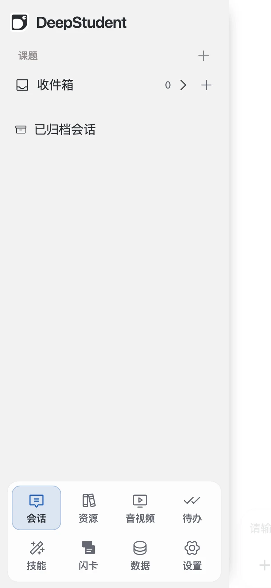

# 移动端指南

> 专为手机和平板设计的单手学习体验：抽屉与三屏切换、系统分享一键入库、窄屏防遮挡适配，以及桌面端、WebUI 与移动端完整功能对照。

## 安装要求与升级说明

- **Android**：支持 **Android 7.0（API 24）及以上 ARM64** 设备，官方提供正式签名的 `.apk` 安装包。
- **iOS**：目前暂不提供 App Store 官方包。iPhone / iPad 用户可以直接用 Safari 访问自托管 WebUI 并添加到主屏幕作为全屏应用使用（详见 [WebUI 与 PWA 自托管](./21-WebUI与PWA自托管.md)）；开发者也可通过 Xcode 从源码自行构建。
- **本地存储保护提醒**：首次启动时应用会向系统申请持久化存储，防止手机存储紧张时被系统清理缓存。如果顶部出现存储持久化提醒横幅，建议保持手机剩余空间充裕，并定期导出加密备份或开启云同步。
- **从 `v0.11.0` 直接升级**：支持用新版官方 `.apk` 原地覆盖安装，首次启动会自动迁移原有的资料、PDF 教材、聊天记录与基础设置。为稳妥起见，覆盖安装前仍建议先导出一次加密备份 ZIP。

给进阶用户与开发者：移动端底层运行架构

移动端基于 **Capacitor 8.6 + Web Worker Host + `@sqlite.org/sqlite-wasm` / OPFS** 构建（`host/profiles/mobile.json` 装配 37 个零 Node 依赖模块），与桌面端共享同一套 React 前端与本地数据库结构。

## 移动端界面总览

移动端采用 **「文档流顶栏 + 左侧抽屉 + 三屏切换」** 结构，单手拇指就能覆盖主要操作：

- **顶部导航栏（文档流布局）**：顶栏嵌入在主内容区顶部并随页面一起平滑滑动，不会悬浮挡住左侧抽屉或正文开头；左侧 `☰` 按钮打开抽屉，中间显示当前页标题，右侧放 1–2 个高频按钮（如新建对话）。手机横屏时顶栏自动收窄为紧凑高度，自动避让刘海、挖孔与手势条。
- **左侧滑出抽屉**：上半部分是**当前页面的内容列表**（如会话列表、待办清单），下半部分是 **4×2 共 8 格应用启动器**：
  - 第一行：**会话** · **资源** · **音视频** · **待办**
  - 第二行：**技能** · **闪卡** · **数据** · **设置**
  - 制卡任务与模板管理集中在「闪卡」页内切换。

- **三屏结构**：主要页面分为「左抽屉 – 中屏主区 – 右屏预览/编辑」。右屏用于承载文件预览、资料引用、笔记/技能编辑器等，从右侧滑入、可整屏返回。
- **两级设置页**：点抽屉里的「设置」先进入带搜索框的分组首页，再进入具体设置项；用顶栏返回箭头或系统返回键逐级退回。
- **快捷直达**：模板管理、统计中心等次级入口也可以通过「搜索与命令」直接搜到。

## 手机端顺手交互与窄屏（360px）防遮挡适配

- **单手边缘滑动**：从屏幕左边缘向右滑打开抽屉；在带右屏的页面，从右边缘向左滑打开预览/编辑器。PDF 阅读、笔记编辑与思维导图画布内的拖拽不会误触边缘导航；软键盘弹出时也会自动屏蔽抽屉误滑。
- **Android 返回键浮层优先**：按系统返回键会依次关闭弹窗、命令面板、抽屉或大图预览，再逐级返回上一页，最后才退到后台，不会误杀正在进行的学习任务。
- **空对话页「今日待复习」与未配模型引导**：新建空白对话时可直接看到「今日待复习」提醒，打开手机就能衔接当天的闪卡与错题；尚未配置 AI 模型时，输入框上方会显示内联引导横幅与 **「配置 AI 模型」** 按钮，点一下直达配置。
- **系统「分享到 Deep Student」**：在浏览器、相册、微信或文件管理器里点系统「分享」并选择 Deep Student，可一键**存入资源库**或**直接发往对话**。即使应用曾在后台被系统回收，重新唤起后仍会安全续传并自动去重，不会重复导入。
- **一键导出与调用系统应用打开**：支持通过 Android 系统文件选择器把资源库文件、音视频字幕、讲义 / 笔记 Word 文档及加密备份 ZIP 存到手机任意文件夹，也可直接调用手机上的其他应用打开或转发。
- **平板宽屏与沉浸式全屏**：自动避让异形屏与系统手势条；在「设置 → 常规」打开 **「沉浸式全屏」**，阅读 PDF、看网课或刷题时视野更宽阔。
- **窄屏 / 360px 视口下的学习桌面自适配**（当你用手机浏览器或窄窗口通过 `?shell=desktop` 使用学习桌面时）：
  - **底部程序坞自动收起与输入避让**：打开任意窗口或在聊天输入框打字时，底部 **「程序坞」** 会自动收起并保留底部安全间距，绝不会挡住输入框的「＋」附件按钮或发送按钮；
  - **居中「程序坞」唤出把手**：收起状态下，屏幕底部居中会出现专属的 **「程序坞」** 触控唤出把手，轻点即可滑出程序坞切换应用，点击外部、切回前台窗或点 **「收起程序坞」** 立即收起；
  - **窄窗侧栏改为文档流导航条**：设置、待办等带侧栏的窗口在 360px 窄屏下不再使用容易挡字的边缘悬浮小按钮，而是在窗口顶部以文档流形式提供紧凑导航条（点击 **「显示导航」** 或标题栏 **「切换边栏」** 滑出导航抽屉），正文文字零遮挡。
- **视图保活与界面缩放**：为节省手机内存，后台最多保活 4 个页面状态，切回更早页面会自动重新加载且已保存内容绝不丢失；「设置 → 外观」中的全局界面缩放同样可用。

## 各主要页面的移动形态

- **会话（AI 对话）**：左抽屉管会话（置顶 / 课题 / 归档）；中屏保留附件、资源库引用、**拍照提问**、技能、远程 MCP、思考深度与语音输入；右屏按需滑入资源库、互动预览与制卡面板。
- **资源库**：左抽屉切分类与知识库索引、AI 记忆；中屏支持列表/网格切换、搜索与多选批量操作；右屏支持多标签文件预览、系统分享与导出。
- **音视频**：顶部固定播放器，下方切「字幕 / 讲义 / 问答 / 练习」四标签，支持伴读问答点击 `mm:ss` 跳转与导出字幕 / Word 讲义。
- **待办与番茄钟**：左抽屉选清单与四象限，主区带快速添加框（如 `明天交作业 !高 #标签`）和番茄钟（支持可选 Android 后台闹钟提醒）。
- **技能 / 闪卡**：技能与卡片模板为「列表 + 右屏编辑器」；闪卡含「今日 / 卡片库 / 统计」三标签，支持滑动评分和「今日冲刺」。

## 桌面端 vs 移动端功能对照表

| 模块 | 桌面端 | Android 原生 | 说明 |
|---|---|---|---|
| AI 对话（会话、多模型与记忆归因） | ✅ | ✅ | 三屏布局；拍照提问、附件、技能、远程 MCP、语音输入与记忆内核归因气泡均可用 |
| 深度调研 / Memory v2 长期记忆 | ✅ | ✅ | 入口在资源库的「AI 记忆」或「设置 → 记忆」，支持硬规则、画像回滚与梳理建议 |
| 资源库（导入、导出与系统分享） | ✅ | ✅ | 右屏预览；支持系统文件选择器导出、系统应用打开与「分享到 Deep Student」 |
| 音视频（转写 / 字幕 / 讲义 / 伴读问答） | ✅ | ⚠️ | 完整流程可用；移动端单次转写上限 **32 MiB / 20 分钟**，需在前台进行 |
| PDF / 文档阅读（含高亮导出与朗读） | ✅ | ⚠️ | 紧凑工具栏与双指缩放；仅支持云端 OCR 与 DeepSeek 语音朗读，无系统本地 OCR / 朗读 |
| 翻译 / 论文搜索 / 作文批改 | ✅ | ✅ | 从资源库或对话入口进入 |
| 笔记 / 思维导图 | ✅ | ✅ | 笔记支持 Word 导出与出处回跳；导图支持触屏编辑与双指缩放 |
| 待办与番茄钟 | ✅ | ⚠️ | 两屏布局与沉浸专注可用；Android 后台闹钟提醒受手机系统省电策略限制 |
| 题目集与练习 | ✅ | ✅ | 支持 13 种题型、9 种练习模式与错题自动复习 |
| Anki 制卡 / 模板管理 / 闪卡复习 | ✅ | ✅ | 集中在「闪卡」页内切换，支持滑动评分、今日冲刺与本地午夜精准换日 |
| 设置：模型服务 / 模型分配 | ✅ | ✅ | 两级导航，支持 15 家预置供应商与一键 API Key 自动配置 |
| 技能系统（含社区技能市场） | ✅ | ✅ | 右屏编辑；内置 57 个技能（不含桌面浏览器自动化技能） |
| AI 插件工坊与插件管理 | ✅ | ❌ | 桌面端与自托管 WebUI 可用（手机浏览器访问自托管 WebUI 也可使用） |
| 内置浏览器 / 浏览器自动化 | ✅ | ❌ | 仅 Windows / macOS 桌面端可用 |
| MCP：远程服务器（SSE / HTTP / WebSocket） | ✅ | ✅ | 8 个预置远程 MCP 服务均可用 |
| MCP：本机命令行进程 / 浏览器 OAuth 登录 | ✅ | ❌ | 移动端无法启动本机后台进程 |
| 数据备份与云同步 | ✅ | ⚠️ | 支持手动备份、导出加密 ZIP 与扫码配对（含整屏截图识别与粘贴兜底）；**Android 原生仅支持 WebDAV**（手机浏览器访问自托管 WebUI 则支持 WebDAV 与 S3） |
| 定时自动化任务 | ✅ | ⚠️ | 稳定后台调度以桌面端为主，手机端受系统后台限制 |
| 学习桌面 / 快速学习小窗 | ✅ | ❌ | 桌面端与宽屏桌面 WebUI 默认使用学习桌面；Android 原生固定使用抽屉壳（手机浏览器访问 WebUI 可按需切 `?shell=desktop`） |

✅ 可用 · ⚠️ 部分可用 / 形态不同 · ❌ 不可用

## 常用操作速查

### 1. 拍照问作业或随手入库

1. 打开左侧抽屉进入「会话」，点输入栏左侧「＋」→「添加文件」→ **「拍照」**，拍下题目或板书直接提问。
2. 或者在微信、浏览器里点系统「分享 → Deep Student」，直接选存入资源库或发往对话。

### 2. 导出笔记、字幕或加密备份

1. 在笔记、音视频或「设置 → 数据与系统 → 数据治理 → 备份」里点「导出」。
2. 在弹出的系统文件选择器里挑一个手机目录保存即可。

### 3. 手机和电脑同步学习资料

1. 在电脑端「设置 → 数据与系统 → 数据治理 → 同步」配好 **WebDAV** 地址和端到端加密密码，点 **「本机生成二维码」**。
2. 在手机端同一页面点 **「新设备扫码 / 接入」** 扫一下（也可以直接选整张手机截图自动识别，或点 **「改用粘贴配对码」** 粘过来），输入 6 位配对码即可导入全部同步配置。
3. 也可以在电脑导出加密备份 ZIP 传到手机，在手机「备份」页导入并输入同一备份密码恢复。

> 注意：**Android 原生客户端仅支持 WebDAV**（不支持 S3 与 FTP）。如果你用 S3 兼容云存储，可通过手机浏览器访问自托管 WebUI（支持 WebDAV 与 S3，隐藏 FTP），详见 [数据管理与云同步](./16-数据管理与云同步.md) 与 [WebUI 与 PWA 自托管](./21-WebUI与PWA自托管.md)。

## 常见移动端问题

**Q：顶部出现持久化存储提醒横幅怎么办？**
A：表示系统尚未为本地数据库授予持久化保护标记，手机空间极度不足时缓存有被清理风险。请保持手机留有充足剩余空间，并定期导出加密备份 ZIP 或开启 WebDAV 同步。

**Q：进了某个页面找不到返回按钮？**
A：直接用 Android 系统返回键或侧滑返回即可，应用会先关闭弹窗/抽屉，再逐层退回上一页，不会直接退出或丢失数据。

**Q：手机上能不能用 AI 插件工坊？**
A：Android 原生客户端暂不支持运行插件工坊。想在手机上使用自己做的插件，可以在电脑或服务器上运行 [WebUI 与 PWA 自托管](./21-WebUI与PWA自托管.md)，用手机浏览器访问即可（默认自动切为单手移动壳，也可通过 `?shell=desktop` 体验紧凑学习桌面）。

**Q：顶部内容有一点点被状态栏或挖孔挡住？**
A：可在「设置 → 常规」检查「沉浸式全屏」开关，或在「开发者选项」微调顶部安全边距。

<!-- 基于 v0.20.9 代码核对，2026-11-25：去工程术语化（底层架构细节收进折叠栏）；新增文档流顶栏、360px/窄屏程序坞自动收起+居中唤出把手+输入避让、窄窗侧栏文档流导航条说明；对齐 Android 原生（仅 WebDAV）与手机浏览器 WebUI（支持 WebDAV + S3）边界、整屏截图扫码与粘贴兜底、15 家供应商与未配模型内联横幅 -->
