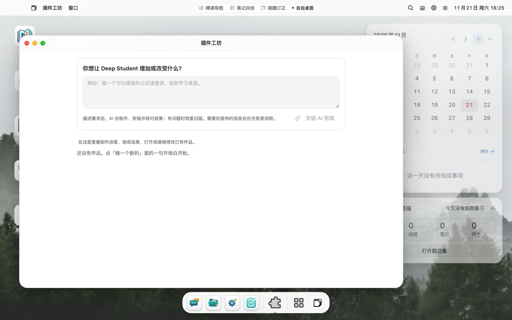
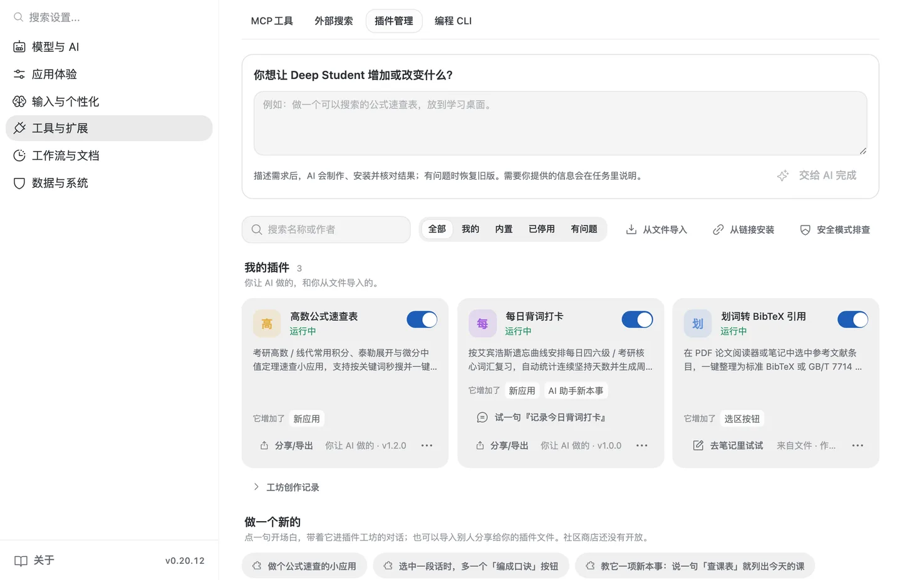
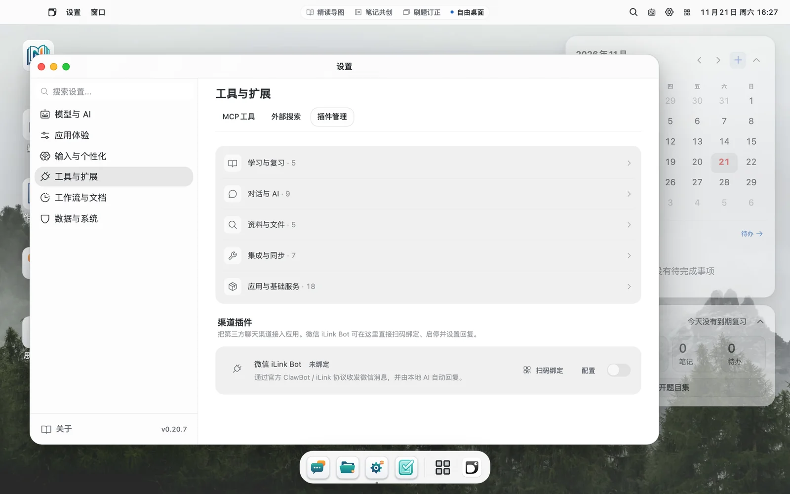

# AI 插件工坊与插件管理

> 从零代码一键分享的 `.dspack` 学习包，到用大白话让 AI 现场制作的小应用，再到 1 分钟就能搞定的安全模式自救——这一章带你安心玩转 Deep Student 的 Plugin v2 扩展生态。

> **适用平台**：AI 插件工坊、插件管理与 `.dspack` / `.dstuplugin` 安装目前支持**桌面端（Windows / macOS / Linux）与自托管 WebUI**；Android 原生客户端暂不支持。

## 快速上手：你想做什么？

| 你想做什么 | 3 步操作 | 你会看到 |
|---|---|---|
| **导入同学分享的学习包（`.dspack`）或插件** | 1. 打开「设置 → 插件」（面板标题为「插件管理」）→ 2. 点「从文件导入」（或「从链接安装」粘贴 `https://` 链接）→ 3. 看清权限说明后点「允许并启用」 | 立即生效无需重启，在「它增加了什么」一眼看到新增入口 |
| **不会写代码，让 AI 现做一个小工具** | 1. 打开「全部应用 → 插件工坊」（或在对话中输入 `/workshop`）→ 2. 说出想法点「交给 AI 完成」→ 3. 等自动检查通过后点「安装」 | 装好即用；打开小应用后随时可点悬浮的 **`让 AI 优化`** 继续打磨 |
| **装了坏插件导致界面卡死或打不开（1 分钟自救）** | 1. 点「安全模式排查」（或启动连崩 2 次后按提示进安全模式）→ 2. 在「插件管理」停用/卸载标红插件 → 3. 点「退出安全模式并恢复正常启动」确认重启 | 笔记与学习数据丝毫无损，重启即恢复正常 |
| **提示 `user.profile.json` 损坏无法保存插件开关** | 1. 打开「设置 → 插件」→ 2. 找到顶部的损坏修复提示卡 → 3. 点 **`备份并重置损坏的插件配置`** | 自动先备份旧文件再重建干净配置，学习资料不受任何影响 |

## 三层扩展体系：从零代码学习包到完整插件

Deep Student 的 **Plugin v2** 把扩展分成由浅入深的三层，绝大多数同学从第一层和第二层就能覆盖日常需求：

| 层级 | 包格式 | 需要写代码吗？ | 适合做什么 |
|---|---|---|---|
| **第一层：零代码学习包** | `.dspack` | **完全不需要** | 打包分享学科批改与学习规则、纯 Markdown 学习技能与提示词、闪卡/笔记模板、记忆牌组或学习工作流（例如「考研数学学习包」「雅思作文批改包」） |
| **第二层：AI 插件工坊作品** | `.dstuplugin`（工坊自动生成） | **用大白话让 AI 写** | 定制学习桌面小应用（公式速查、背词打卡、课程表）、阅读器/笔记选区快捷按钮、对话卡片；可按你授权安全联动学习数据、AI 模型与系统通知 |
| **第三层：完整功能插件** | `.dstuplugin` | 面向开发者 | 深度扩展对话流程、自定义批改引擎、间隔复习调度器、记忆内核或外部聊天渠道（如微信 iLink Bot） |

> 还不确定该选「技能」「MCP」还是「插件/学习包」？可以先对照 [技能与 MCP 扩展](./15-技能与MCP扩展.md#功能概览技能mcp-与插件怎么选) 的对比表。

## 用 AI 插件工坊造一个专属小应用

### 四条入口随时开做

1. **学习桌面**：打开「全部应用 → 插件工坊」（可右键固定到 Dock）。
2. **对话斜杠命令**：在聊天框中输入 `/workshop` 进入工坊模式（激活后输入栏左侧会显示工坊状态徽章，可随时退出）。
3. **普通对话直说**：直接在聊天里提需求（例如「帮我做一个每日背词打卡小应用，记录连续天数」），AI 会自动发起工坊提案卡片。
4. **插件管理页**：在 **「设置 → 插件」**（面板标题为「插件管理」）顶部输入框直接写需求点 **「交给 AI 完成」**，或点击现成的 **3 条开场白胶囊**（如「做个公式速查的小应用」「选中一段话时，多一个『编成口诀』按钮」）。

### 从一句话到装进应用的完整闭环

1. **看计划再开工**：AI 先给出提案卡片，写清准备做什么、装好后在哪里找到它、需要哪些权限。你点 **「开始做」** 后才开始编码和自检（这一步还不会真正安装）。
2. **自动检查与自修**：系统在后台自动编译并试装试卸，检查是否能正常启动和退出；发现问题会自动修复（最多 3 轮），也可以在「委托自主模式」下由独立的只读验收环节核对功能。
3. **填专属设置 + 核对人话权限**：如果插件需要外部链接（如课表 `.ics`）或密钥，可在卡片上直接填——**密码框里的密钥自动存入系统安全存储，绝不写进插件源码**。卡片同时透明列出本次耗时与 Token 消耗。
4. **一键安装、随时优化与回滚**：
   - 点 **「安装」** 立即生效，无需重启；
   - **窗口内随时 `让 AI 优化`**：打开你用工坊做出来的小应用后，界面里常驻悬浮的 **`让 AI 优化`** 按钮，点一下就能直接回到对应的工坊对话继续微调样式或加功能（也可在插件管理点 **「让 AI 改」**）；
   - 改得不顺手随时点 **「回到上一版（vX.Y.Z）」** 退回旧版；觉得好用可以点 **「分享/导出」** 打包成 `.dstuplugin` 或 `.dspack` 发给同学（导出时自动整理包名并剥离你的本机密钥）。

## 导入 `.dspack` 学习包与管理全部扩展

打开 **「设置 → 插件」**（面板标题为「插件管理」），所有扩展按清晰的四段排布：

1. **我的插件 + 工坊创作记录**：集中管理你让 AI 做的和从文件/链接安装的插件与学习包，支持按「全部 / 安全模式已暂停 / 我的 / 内置 / 已停用 / 有问题」筛选，并保留所有工坊草稿与可恢复的卸载记录。
2. **做一个新的 + 导入安装**：
   - **「从文件导入」**：选择本地 `.dspack` 学习包或 `.dstuplugin` 插件包；
   - **「从链接安装」**：粘贴他人分享的 `https://` 链接（以 `.dspack` 或 `.dstuplugin` 结尾）。系统会自动拦截不安全的非 HTTPS 链接、本机/内网地址和超过 **32 MiB** 的文件，并校验文件完整性。
3. **内置能力（5 组）**：按「对话与 AI」「学习与复习」「资料与文件」「集成与同步」「应用与基础服务」展示官方内置模块；带锁的为基础服务，防止误关导致核心功能不可用。其中「集成与同步」分组包含桌面端新增内置插件 **「外部编程 CLI」（`dstu.agent-mesh`）**，支持在对话内直接调用本机的 **Claude Code、Codex CLI、OpenCode、Pi Agent、Antigravity CLI、DeepSeek Harness** 及自定义 CLI，并支持多代理协同。
4. **渠道插件**：管理外部聊天渠道扩展（如微信 iLink Bot）。

### 看懂权限确认卡（Manifest v2 细粒度权限）

无论本地导入还是从链接安装，插件包落盘后**默认保持停用、不会执行代码**。首次启用（或升级后版本/权限/内容发生变化）时，系统会弹出 **「允许『某某』运行？」** 确认卡，用大白话逐项列清它能做什么，由你点 **「允许并启用」** 才运行：

- **应用能力权限**：如「用当前对话模型生成文字」「会读取和修改你的学习数据（笔记、卡片、题目、复习、待办、资料库）」「会发系统通知」「会按时自动运行」等；
- **细粒度网络权限（高风险重点标红）**：
  - **只读联网**：仅允许联网读取指定域名（例如查公开词典或订阅课表）；
  - **联网写入（高风险）**：允许向指定域名发送写入请求，卡片会明确标出目标域名；
  - **本机端口访问（高风险）**：仅允许访问本机指定端口（例如联动本机 AnkiConnect `8765` 或 Zotero `23119`）。
- **零代码学习包（`.dspack`）**：纯声明式学习包不需要额外运行权限，详情里会清晰展示它新增的「提示词与技能」「卡片模板」「牌组与词库」「批改与学习规则」「组件与工作流」。

### 日常排障小工具

- **界面自动熔断保护**：如果某个插件界面连续渲染报错 3 次，系统会自动隔离并先关掉它，弹提示告诉你「你的笔记和资料不受影响」，防止单个小应用拖垮整个桌面。
- **插件独立数据清理**：在插件详情里可看到「它存了什么」，一键 **「清空它的数据」** 只清该插件自己的记录，绝不影响主学习库。
- **版本回滚**：工坊和社区插件自动保留旧版本，点 **「回到上一版」** 即可无损切回。

## 安全模式 1 分钟自救指南

不管装了什么插件导致界面异常、白屏、卡顿，还是启动直接闪退，记住两句话：**① 你的笔记、闪卡、题库和资料都在独立数据库里，绝不会丢；② 1 分钟进安全模式就能把坏插件关掉恢复如初。**

### 第 1 步：进入安全模式（3 种方式）

- **界面一键进入（推荐）**：打开「设置 → 插件」，点击 **「安全模式排查」**，应用会自动隔离全部社区插件并以纯净官方环境重启。
- **连崩自动弹出**：如果应用在启动阶段**连续 2 次崩溃**，下次打开会自动弹出安全模式恢复入口。
- **命令行手动启动**：在终端加 `--safe-mode` 参数启动 Deep Student。

### 第 2 步：在纯净环境里定位并处理问题

进入安全模式后，顶部会出现醒目的 **「安全模式已启用」** 横幅：

- **自动隔离防护**：全部社区/工坊插件自动暂停加载；**外部自定义 MCP 自动连接也已暂停**（横幅提示：`外部自定义 MCP 自动连接也已暂停（你仍可在设置中手动查看和测试）`）。
- **查看与清理故障插件**：点横幅上的 **「前往插件管理」**，按 **「安全模式已暂停」** 筛选，或直接点提示里的 **「查看异常插件（N）」**，将有问题的插件「停用」或「卸载」。
- **界面排版错乱一键复位**：如果只是窗口拖丢了、面板卡住打不开，点横幅上的 **「重置界面布局缓存（不删除学习数据）」**，只重置窗口排版，不碰任何学习数据。
- **安全模式下的导入规则**：为了方便你安装修复版，安全模式仍允许「从文件导入」本地 `.dstuplugin` / `.dspack` 包，但导入后**自动处于「已隔离 · 安全模式暂停」状态，不会执行任何代码**；「从链接安装」在安全模式下自动暂停。

### 第 3 步：确认无误，恢复正常启动

1. 点横幅或插件管理里的 **「退出安全模式并恢复正常启动」**，会弹出 **「确认退出安全模式并恢复正常启动？」** 检查窗口。
2. 窗口会列出全部第三方插件的状态（`异常 / 已降级`、`重启后将启用`、`已停用 / 已隔离`），并**默认帮你勾选停用所有存在异常的插件**，防止重启后再次触发崩溃。
3. 你还可以勾选「正常重启前停用全部已启用的第三方插件」，或直接点 **「全部停用并正常启动」** / **「停用所选（N）并恢复正常启动」** / **「确认退出并恢复正常启动」**，应用随即恢复正常模式运行。

### 插件配置文件损坏（`user.profile.json`）一键修复

如果因异常断电、磁盘错误或手动改坏了配置文件，导致插件列表加载失败或启停状态无法保存，插件管理顶部会显示提示卡片 **「插件配置文件（user.profile.json）已损坏」**：

1. 直接点击卡片里的 **「备份并重置损坏的插件配置」**。
2. 系统会先把损坏的旧文件自动备份到磁盘留底，再生成一份干净的默认插件配置并重新加载清单。
3. **你的所有笔记、闪卡、题目集和已安装的学习包文件均不受影响**。

## 重要安全边界与跨版本升级

> **注意：请如实了解当前安全边界**——代码类社区插件与工坊插件（`.dstuplugin`）目前与主应用同进程运行，**尚未提供操作系统级物理隔离**。启用前看到的权限确认与 `受限 / 完全信任` 分档用于透明披露和防止误用未声明接口，无法拦截刻意作恶的代码。**请只安装你自己用工坊制作的、或来自可信作者的插件；零代码 `.dspack` 学习包不含可执行代码，安全风险最低。**

- **跨版本升级放心**：升级 Deep Student 只更新官方程序本体，你的用户插件、工坊源码、设置、数据与权限记录全部保留；桌面端更新前还会预先检查插件兼容性，升级后个别不兼容的插件只会自动降级并在插件管理标明原因，绝不拖垮主程序启动。

技术细节：Manifest v2 权限语法、校验机制与隔离边界

- **Manifest v2（向后兼容 v1）**：支持 `manifestVersion: 2`、`tier`（`declarative` / `ui-workshop` / `full`）、`kind`（`plugin` / `study-pack`）与纯声明式 `declarative: { rubrics, skills, cardTemplates, workflows }`。网络权限声明格式为 `net:<host>`（HTTPS GET 只读）、`net:write:<host>`（HTTPS 写请求，高风险）、`net:local:<port>`（本机端口，高风险）。
- **UI 工坊托管调用**：第二层 UI-only 工坊插件无需手写 Host 后端，可通过受控网关直接调用声明过的 `service:studyData`、`service:pluginModel`、`service:pluginNotify` 服务；后台内置 `esbuild` 编译与隔离试装载校验。
- **加载防篡改与远程安装保护**：社区插件加载前由宿主校验清单与依赖，经 `ds-plugin://` 协议读取资源时执行 SHA-256 校验并附带逐响应 CSP nonce；远程链接下载强制 HTTPS、拦截私网与不安全跳转（SSRF 防护）、限流 32 MiB 并做完整性校验。
- **插件数据隔离**：每个插件的前端状态按独立前缀存放在本地存储中，清空单个插件数据不影响主应用；历史版本保留在各自版本的 `versions/<version>/package` 目录中。

## 渠道插件：微信 iLink Bot（预览 / 接入中）

> **当前版本说明（v0.20.10）**：微信 iLink Bot 处于 **预览 / 接入中** 阶段，已完成微信扫码绑定、凭据加密存储、35 秒长轮询保活与回复模型/限频/提示词设置；远程任务派发与图片媒体收发仍在持续完善中（涉及修改本机数据的审批仍需在桌面端确认）。

1. 前往 **「设置 → 插件 → 渠道插件 → 微信 iLink Bot」**（使用时需保持电脑或自托管服务在线）。
2. 点 **「扫码绑定」** 用微信扫码确认（二维码有效 480 秒，超时前可自动刷新最多 3 次）。
3. 默认启用**单主人白名单**（只回复当前绑定账号本人），可随时「配置」回复模型、限速与提示词，或「断开连接 / 重新绑定」。

## 移动端说明

- AI 插件工坊、`.dspack` / `.dstuplugin` 导入和微信 iLink Bot 目前**暂不支持 Android 原生客户端**。
- 如果想在手机上使用桌面端建好的工坊小应用或学习包，可在电脑或服务器上运行自托管 WebUI，再用手机浏览器打开（见 [WebUI 与 PWA 自托管](./21-WebUI与PWA自托管.md)）。

## 常见问题

**Q1：我完全不会写代码，能用插件和学习包吗？**
A：完全可以！导入 `.dspack` 学习包本身就是零代码；想定制小应用或选区按钮，只要在「插件工坊」里用大白话说需求，AI 会帮你写好、检查并装上，以后还能随时点窗口里的 **`让 AI 优化`** 继续改。

**Q2：装了一个坏插件导致 Deep Student 打不开怎么办？**
A：按「安全模式 1 分钟自救指南」操作即可：连崩 2 次会自动提示进入安全模式，或者在「插件管理」点 **`安全模式排查`**（或用 `--safe-mode` 启动），把标红的插件停用或卸载，再点 **`退出安全模式并恢复正常启动`**，退出弹窗还会自动勾选停用异常插件，学习资料丝毫无损。

**Q3：界面窗口错乱、点不动，是不是要重装软件？**
A：不用重装！进安全模式后点顶部横幅上的 **`重置界面布局缓存（不删除学习数据）`** 即可恢复默认排版，你的笔记、闪卡和对话都会原封不动留着。

**Q4：导出的 `.dspack` 或 `.dstuplugin` 发给同学，会泄露我的 API 密钥吗？**
A：不会。导出包时只打包插件或学习包本身，绝不包含你本机安全存储里的任何 API 密钥；同学导入后仍需亲自查看并同意权限才会运行。

**Q5：为什么提示 `user.profile.json` 已损坏？会丢笔记吗？**
A：不会丢笔记。`user.profile.json` 只记录哪些插件开启或停用。在「设置 → 插件」点 **`备份并重置损坏的插件配置`**，系统会先备份坏文件再重建干净配置，几秒就能恢复。

## 给开发者

想手动编写、调试或发布 `.dspack` 学习包与 `.dstuplugin` 完整插件，请查阅开发者文档：

- [Plugin System v2 指南（PLUGIN-V2.md）](../plugins/PLUGIN-V2.md)
- [插件系统架构（ARCHITECTURE.md）](../plugins/ARCHITECTURE.md)
- [插件 SDK 开发指南（SDK.md）](../plugins/SDK.md)
- [宿主能力与权限清单（CAPABILITIES.md）](../plugins/CAPABILITIES.md)
- [社区插件安全边界（SECURITY.md）](../plugins/SECURITY.md)
- [桌面应用升级与用户插件（UPGRADES.md）](../plugins/UPGRADES.md)

<!-- 2026-11-27 对照 v0.20.10 更新：补充桌面端「集成与同步」分组内置插件「外部编程 CLI」（dstu.agent-mesh）及其多 CLI / 多代理协同说明；对齐设置入口标签为「设置 → 插件」（面板标题「插件管理」）并更新渠道插件版本说明至 v0.20.10；清理遗留 Emoji -->
