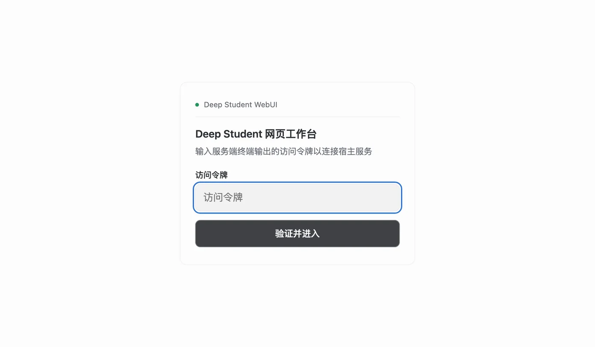
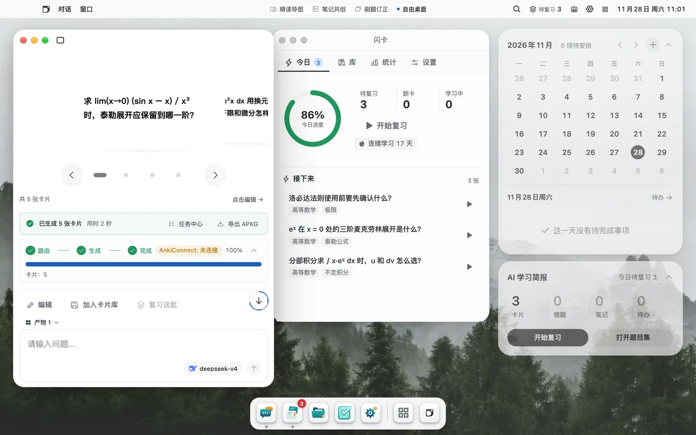
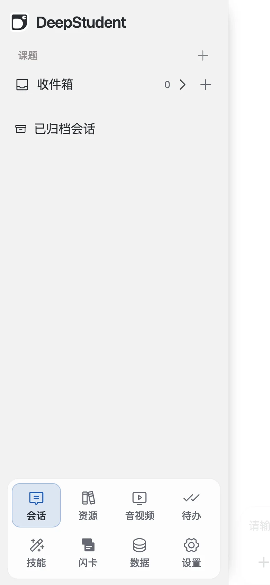

# WebUI 与 PWA 自托管

> 在自己的电脑、NAS 或私有服务器上运行一份 Deep Student，用任意现代浏览器或手机主屏幕 PWA 随时访问完整学习工作台，数据依然完全掌握在你自己手里。

## 为什么用自托管 WebUI？

除了安装桌面客户端和 Android 安装包，你还可以把 Deep Student 作为自托管网页服务运行在自己的电脑或服务器上，然后用任何设备的浏览器直接打开：

- **跨设备无感学习**：在家里电脑或服务器上挂起一份 Deep Student，出门用 iPad、iPhone、Android 或办公室浏览器直接访问你的全部资料、闪卡、长期记忆与插件工坊；
- **桌面端与手机端各得其所**：用**电脑宽屏浏览器**打开默认进入完整的窗口化 **[学习桌面](./18-学习桌面.md)**；用**手机窄屏浏览器**打开自动切换为单手顺手的 **[移动端抽屉壳](./17-移动端指南.md)**；
- **主屏幕 PWA 独立应用**：在电脑或手机浏览器上安装到桌面 / 主屏幕后，会像原生应用一样独立窗口运行，并带快捷方式和静默更新提醒；
- **零重型编译依赖**：只需要 **Node.js 24+**，无需安装任何 Rust 或复杂编译环境。

## 准备条件与避免双开冲突

- **运行环境**：需要 **Node.js 24+**。
- **不要和桌面客户端同时读写同一份数据目录**：为了防止双进程同时写入损坏数据库，同一份数据目录由锁文件保护。请先退出 Electron 桌面客户端再启动 WebUI；如果希望两者同时运行，只需给 WebUI 指定一个独立的 `DS_APP_DATA_DIR` 目录即可。

## 3 步启动自托管服务

### 推荐方式：生产构建并运行

在项目根目录执行：

```bash
npm run build:web && npm run web:prod
```

升级重新构建时，系统会先完整构建到临时目录再原子切换，不会中途把正在访问的页面搞挂。

### 本地体验 / 开发调试

```bash
npm run web
```

默认监听 `http://127.0.0.1:1428`，自带热更新。

### 自定义地址、端口与环境变量

也可以直接传入命令行参数启动：

```bash
node web/server/main.ts --prod --host 0.0.0.0 --port 8080
```

支持的参数包括 `--host`、`--port`、`--prod` 与 `--no-auth`（关闭令牌校验，**仅限完全可信的本机或受控内网环境**）。

<details>
<summary>完整环境变量清单</summary>

| 环境变量 | 默认值 | 说明 |
|---|---|---|
| `DS_WEB_HOST` | `127.0.0.1` | 监听地址；局域网或反向代理部署时可设为 `0.0.0.0` 或 `::` |
| `DS_WEB_PORT` | `1428` | 监听端口 |
| `DS_WEB_TOKEN` | 随机 48 位十六进制 | 固定访问令牌；长期自托管强烈建议显式设置强随机值 |
| `DS_WEB_NO_AUTH` | 未设置 | 设为 `1` 关闭令牌鉴权（等价 `--no-auth`），仅限可信本机环境 |
| `DS_APP_DATA_DIR` | 系统默认应用数据目录 | 自定义数据目录（暂存与导出目录也建在其下），用于与桌面端并行隔离 |
| `DS_WEB_TRUST_PROXY` | 未设置 | 设为 `1` 时采信反向代理写入的 `X-Forwarded-Host` / `X-Forwarded-Proto` / `X-Forwarded-For`；未设置时仅对回环来源采信 |
| `DS_WEB_PROD` | 未设置 | 设为 `1` 以生产模式启动（直接提供 `dist-web/` 静态产物与 PWA，等价 `--prod`） |
| `DS_WEB_SAFE_MODE` | 未设置 | 设为 `1` 以安全模式启动（暂停社区插件与外部自定义 MCP 自动连接，便于排障） |
| `DS_WEB_DATA_DIR` | 未设置 | WebUI 专用数据目录覆盖项（优先级高于 `DS_APP_DATA_DIR`） |
| `DS_WEB_DIST_DIR` | `<repoRoot>/dist-web` | 自定义生产模式静态前端构建产物的读取目录 |

</details>

## 访问令牌与安全登录



- **启动自带访问令牌**：未设置 `DS_WEB_TOKEN` 时，每次启动都会随机生成 48 位令牌并在终端打印一次性访问链接 `http://<host>:<port>/?token=<token>`。
- **一次登录，30 天免输**：打开带令牌的链接（或在登录页手动粘贴令牌）后，浏览器会建立有效期 **30 天**的安全会话，并自动把地址栏里的 `token` 参数擦除，避免截屏或浏览器历史泄露。
- **防暴力猜测**：同一客户端在 **60 秒内输错 15 次** 会暂时拦截（HTTP 429），直到冷却窗口滑过。

## 安装为 PWA 与多形态自适应

在 `https://`（或本机 `http://localhost`）下打开生产版 WebUI，可以一键安装成独立窗口应用：

- **电脑浏览器（Chrome / Edge 等）**：满足安装条件时，页面右下角会弹出「安装到桌面」胶囊（或点地址栏右侧安装图标）；安装后还可关联 `.pdf`、`.md`、`.apkg` 文件，在系统文件夹里双击即可导入资源库。
- **手机浏览器（iOS Safari / Android Chrome）**：通过浏览器分享/菜单栏点 **「添加到主屏幕」**，即可作为全屏独立应用启动。
- **长按图标 3 个快捷方式**：安装后长按应用图标，可直达 **「新建对话」**（`/?shortcut=chat`）、**「资源库」**（`/?shortcut=library`）或 **「复习」**（`/?shortcut=review`）。
- **无感升级提醒**：服务端重新构建并重启后，浏览器会在后台静默拉取新版界面并在角落温和提示「刷新启用」，不会打断正在阅读或写笔记的进度。

### 桌面壳与移动壳的自动切换（含 360px 窄屏适配）

- **宽屏桌面浏览器**：默认直接进入完整 **[学习桌面](./18-学习桌面.md)**，支持多窗口平铺、「学习流阶段预设」以及完整的「设置 → 学习桌面」开关。
- **手机 / 窄屏浏览器**：默认自动切换为单手友好的 **[移动端抽屉壳](./17-移动端指南.md)**（文档流顶栏 + 左侧抽屉 4×2 启动器 + 三屏切换）。
- **随时手动指定形态**：在网址末尾追加 `?shell=mobile` 或 `?shell=desktop` 即可强制切换。即使你在 360px 窄屏或把桌面浏览器拉窄后仍停留在学习桌面，界面也会自动启用防遮挡保护：
  - 打开窗口或在聊天输入框打字时，底部 **「程序坞」** 自动收起并留出输入栏安全间距，绝不遮挡「＋」附件按钮和发送按钮；
  - 底部居中提供 **「程序坞」** 触控唤出把手，点开即可切应用，点空白处或 **「收起程序坞」** 立即收起；
  - 设置、待办等带侧栏的窄窗口采用顶部文档流导航条（点 **「显示导航」** 或 **「切换边栏」** 滑出抽屉），不再挡住正文内容。





## 反向代理配置（用自己的域名公网访问）

如果你准备用 Nginx / Caddy / Traefik 给 WebUI 绑定域名与 HTTPS，只需确保反代满足以下 **4 条要求**：

1. **透传真实 `Host`（或开启 `DS_WEB_TRUST_PROXY=1`）**：防止严格的同源保护拒绝登录与上传（HTTP 403）。
2. **放行 `/api/ws` WebSocket 长连接**：透传 `Upgrade` / `Connection: upgrade`，并把读写超时调长（如 `3600s`）。
3. **关闭响应缓冲并透传 `Range`**：让大 PDF 与音视频保持分片流式加载，不必等整文件下完。
4. **启用 HTTPS**：既是安全登录的前提，也是浏览器允许安装 PWA 的必备条件。

<details>
<summary>查看 Nginx 参考配置片段</summary>

```nginx
server {
    listen 443 ssl http2;
    server_name study.example.com;

    # ssl_certificate / ssl_certificate_key ...

    client_max_body_size 210m;

    location /api/ws {
        proxy_pass http://127.0.0.1:1428;
        proxy_http_version 1.1;
        proxy_set_header Upgrade $http_upgrade;
        proxy_set_header Connection "upgrade";
        proxy_set_header Host $host;
        proxy_set_header X-Forwarded-Proto $scheme;
        proxy_set_header X-Forwarded-For $proxy_add_x_forwarded_for;
        proxy_read_timeout 3600s;
    }

    location / {
        proxy_pass http://127.0.0.1:1428;
        proxy_http_version 1.1;
        proxy_set_header Host $host;
        proxy_set_header X-Forwarded-Proto $scheme;
        proxy_set_header X-Forwarded-For $proxy_add_x_forwarded_for;
        proxy_set_header Range $http_range;
        proxy_buffering off;
    }
}
```

</details>

## 功能支持与平台边界

### 完整可用的核心能力

- **多标签页实时同步**：同一个浏览器开多个标签页共享同一个后端，一页读 PDF、一页写笔记或对话，数据实时一致。
- **拖拽上传与安全下载**：支持直接拖拽上传最大 **200 MiB** 的单个教材、音视频或资料；导出的备份、笔记 Word 文档、带批注 PDF 或字幕都会生成 **30 分钟**有效的受鉴权下载链接。
- **流式打开大 PDF 与音视频**：无论电脑还是手机 Safari / Chrome，大文档与网课视频均按片段流式加载。
- **学习与扩展能力齐备**：AI 对话、Memory v2 长期记忆内核、资源库、PDF 旋转/加密带批注导出、翻译历史回退、笔记、思维导图、音视频伴读问答、题目集、FSRS-6 闪卡（含 `.apkg` 内嵌图片与音频完整展示）、技能、远程 MCP、**[AI 插件工坊与安全模式排查](./20-AI插件工坊与插件管理.md)**、微信 iLink Bot 等全部可用。
- **云同步支持**：**桌面浏览器 WebUI** 支持 **WebDAV、S3 兼容存储与实验性 FTP**；**手机浏览器 WebUI** 支持 **WebDAV 与 S3 兼容存储**（界面隐藏 FTP）。详见 [数据管理与云同步](./16-数据管理与云同步.md)。

### 当前边界说明

- **需要保持与自托管服务连通**：PWA 仅缓存界面外壳，断网或停止后端服务后无法读写资料库与对话。
- **不含桌面操作系统原生外壳能力**：WebUI 不提供桌面内置原生浏览器 / 浏览器自动化、操作系统级多窗口、全局系统快捷键（快速学习小窗）与应用内自动更新。
- **备份恢复方式**：「数据治理与同步 → 恢复」页中隐藏 A/B 槽位切换，请直接使用本地备份列表（含恢复前自动留存的 `pre_restore` 安全快照）与加密 ZIP 导入导出。

## 常见问题

**Q：开着桌面版 Deep Student 再运行 `npm run web` 为什么提示被占用？**
A：桌面版和 WebUI 默认共用同一个数据目录，互斥锁会阻止双开以保护本地数据库。先退出桌面版，或给 WebUI 设置独立的 `DS_APP_DATA_DIR` 即可并行运行。

**Q：用内网 IP（例如 `http://192.168.1.10:1428`）打开，为什么不能安装 PWA？**
A：浏览器规定只有在 `https://` 或本机 `http://localhost` 下才允许安装 PWA。给内网或公网服务套一层 HTTPS 反向代理（如 Caddy / Nginx）即可。

**Q：忘了启动时随机生成的访问令牌怎么办？**
A：查看启动终端的日志输出即可找回；长期后台运行建议直接用 `DS_WEB_TOKEN` 环境变量固定一个强随机令牌。

**Q：WebUI 里能不能像桌面客户端一样同时开多个窗口？**
A：可以！用电脑宽屏浏览器打开 WebUI 默认就会进入窗口化 **[学习桌面](./18-学习桌面.md)**，支持多窗平铺与布局预设；同时也可以利用浏览器多标签页共享同一个后端。

## 延伸阅读

需要深入了解 WebUI 鉴权细节、Service Worker 缓存策略与公网延迟优化，请参阅开发者技术规格：

- [WebUI 与 PWA 架构与技术规格（WEBUI-AND-PWA.md）](../WEBUI-AND-PWA.md)

<!-- 基于 v0.20.10 代码核对，2026-11-27：补充可选次级环境变量 DS_WEB_PROD / DS_WEB_SAFE_MODE / DS_WEB_DATA_DIR / DS_WEB_DIST_DIR（对照 web/server/main.ts 与 web/server/gateway.ts 核实） -->
