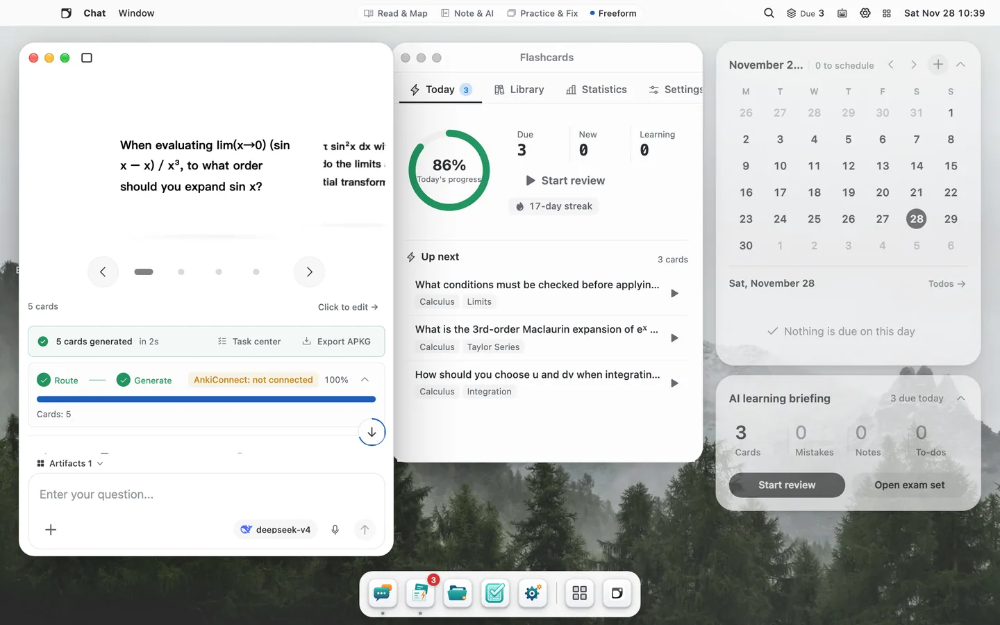

# 01 · Quickstart & Three-Minute Workflows

> Go from a fresh install to a working study loop in minutes — whether you are cramming for next week's exam, reading a dense 40-page paper, or rescuing your workspace from a misbehaving plugin.

---

## First Run in 3 Steps

**What you want to do**: Open DeepStudent for the first time, connect an AI model, and launch directly into real study work without getting lost in settings menus.

1. **Pick a starting task on the Welcome screen**: When **Welcome to DeepStudent** appears, choose one of the three clickable starter cards — **1. Import your study materials**, **2. Ask AI & take notes**, or **3. Make flashcards & review** — or click **Just look around first** to explore freely. (The Terms & Privacy notice sits quietly in the footer and never blocks you from getting started.)
2. **Connect an AI provider**:
   - **Already configured**: If your workspace or self-hosted server already has a model configured, you will see an **AI service is ready** card and can jump straight in (click **Manage AI Models** anytime later).
   - **Fastest setup (Welcome dialog)**: Use the embedded **Connect an AI Service** card right inside the Welcome dialog — switch between **Paste Key** (paste an API key or a `ccswitch://` import link) and **Import Tools**, then click **Connect & Set Up** to auto-detect the provider, probe available models, and assign study feature slots automatically.
   - **15 built-in providers** (**Settings → Model Service**): Click **Open AI Settings** to configure any of the **15 built-in providers** — including **SiliconFlow**, **OpenCode Go**, **DeepSeek**, **Alibaba Qwen**, **Zhipu AI**, **ByteDance Doubao**, **MiniMax**, **Moonshot AI**, **OpenAI**, **Codex** (ChatGPT OAuth), **Anthropic**, **Mistral**, **NVIDIA**, **Xiaomi MiMo**, and **Google Gemini**. Paste your key, click **Save API key** first, and then click **Test Connection**.
   - **Add Provider (19 custom provider types)**: Need **OpenRouter**, **xAI (Grok)**, **Baidu ERNIE**, or a keyless local **Ollama** server (toggle **No API key required**)? Click **Add Provider** in **Settings → Model Service** and choose from **19 provider types** (including **General Adapter** and **Custom**).
   - **Import Tools** (**Settings → Model Service** or the Welcome dialog): Run a one-click local scan on Desktop for **CC Switch**, **Magpie**, **OpenCode**, **Claude Code**, and **Codex**, pick `.db` / `.sql` / `.json` / `.toml` / `.env` config or backup files (**Select Config File**), or paste `ccswitch://` deep links directly into the key box. DeepStudent automatically filters out local proxy takeover placeholders so only real upstream providers are imported, and supports incremental re-sync (**Re-sync All** / **Import Selected**) as your configs evolve.
   - **Local coding CLIs (Desktop)**: If you already have local coding CLIs installed on Desktop (such as Claude Code, Codex CLI, or OpenCode), you can also invoke them directly inside Chat without duplicating API keys — see [02 · AI Chat, Study Spaces & Memory v2](./02-chat-and-memory-v2.md).
3. **Start chatting immediately — even if you skipped setup**: If you open Chat before adding an API key, you will not hit a cryptic error. An inline yellow banner appears right above the message box: *"No AI model is configured yet. Connect a provider to start chatting."* Clicking **Configure AI Model** takes you straight to API settings, and pressing `Enter` before configuring keeps your typed draft safe instead of wiping it out.

**What you get**: DeepStudent opens straight into your chosen starter app (Library, Chat, or Flashcards) with your AI assistant connected and ready to work on your local files.

---

## Know Your Workspace in 30 Seconds

On Desktop (and on desktop-width WebUI browsers), DeepStudent opens in **Study Desktop** — a multi-window workspace built for keeping a textbook, your notes, and AI side by side:

- **Dock** (bottom bar): Launch and switch between apps, or click **All Apps** to see everything. On narrow screens or while typing, you can click **Collapse Dock** (or use the compact bottom handle pill) to keep the screen clear.
- **4 one-click stage presets** (top bar): Rearrange windows instantly for what you are doing right now:
  - **Read & Map** — PDF or lecture on the left, Mind Map on the right.
  - **Note & AI** — Notes on the left, AI co-creation on the right.
  - **Practice & Fix** — Flashcards or Question Sets on the left, mistake analysis on the right.
  - **Freeform** — Your own custom floating window layout.
- **Command Palette (`⌘/Ctrl+K`)**: Jump to any app, run commands, or search directly inside your notes, flashcards, and past chats from anywhere.
- **Prefer a single-pane layout?** You can turn off Study Desktop in Settings at any time to switch to the classic left-sidebar view — every feature stays the same.

---

## Quick Scenario 1: 3-Minute Exam Cram Sprint

**What you want to do**: Turn last semester's notes or a past exam PDF into a focused daily countdown plan that automatically prioritizes what you are most likely to forget before test day.

1. **Import and generate practice material**: Drop your review sheet, lecture PDF, or past paper into **Files** (Library), open it alongside Chat (**Read alongside chat**), and ask AI to *"Generate 10 flashcards and 5 practice questions covering the highest-yield concepts and common traps in this document."* Confirm the generated cards or question draft so they enter your library.
2. **Set your exam date and daily budget**: Open **Flashcards** → **Today**, click **Set exam date**, pick your **Target exam date**, and choose a realistic **Daily sprint budget** (for example, `30m`).
3. **Run your unified sprint**: Click **Start Daily Sprint**. DeepStudent pulls together your due flashcards, overdue mistake questions, AI transfer variants, and weak Mind Map recall nodes into one timed queue — and automatically shows your **Readiness** forecast.

**What you get**: One button to click every day until the exam. In the final 3 days before test day, DeepStudent automatically activates **Pre-exam buffer · new intake paused** so you focus 100% on locking in high-yield material instead of piling on brand-new cards.

> Want to customize FSRS-6 intervals, daily rollover hours, or Anki exports? Continue to [04 · Flashcards, FSRS-6, Exam Sprint & Question Sets](./04-flashcards-exams-fsrs.md).

---

## Quick Scenario 2: 3-Minute 40-Page Paper Deep Read

**What you want to do**: Understand a dense research paper fast, mark key claims and equations in color, tie your notes back to exact pages, and export a clean annotated PDF you can share or archive.

1. **Get the big picture first**: Drop the PDF into **Files** and double-click to open it. Click **AI Paper Guide** in the PDF toolbar and choose **Summarize structure & contributions** to map out the paper's core argument before reading line by line.
2. **Read side-by-side with 5-color highlights**:
   - Click **Fit single column (185%)** for comfortable reading on dense two-column papers, and click **Read alongside chat** to open AI right beside the page.
   - Select text and press **`1`–`5`** for semantic highlights: `1` **Yellow · Core Claim**, `2` **Green · Methodology**, `3` **Blue · Definition & Context**, `4` **Red · Limitation & Question**, `5` **Purple · Formula & Metric**.
   - Click **Ask about a region** to drag a box over any figure, table, or equation — choose **Ask AI** to explain or transcribe it, or **Pin Reference** to float it alongside later pages.
3. **Save linked notes and export your annotated PDF**:
   - Open the **Highlights** panel and click **Export as note (N)** to collect your highlights grouped by page. Inside your note, clicking **Source** (**From file · Page N**) jumps straight back to that exact PDF page — even in a compact split pane.
   - Click **Export annotated PDF** to save a standalone PDF with your highlights intact. Rotated pages and encrypted PDFs are handled automatically so annotations stay aligned instead of corrupting the file.

**What you get**: A structured note with clickable page citations back to the paper, plus a shareable annotated PDF ready for class or your reference manager.

> Learn more about split-pane citations, lecture Q&A, and Translation rollback in [03 · PDF Reading, Notes, Lectures & Translation](./03-pdf-notes-media-study-loop.md).

---

## Quick Scenario 3: 1-Minute Safe Mode Self-Rescue

**What you want to do**: Get back to studying immediately if a third-party plugin freezes a page, breaks startup, or corrupts your plugin configuration — with zero risk to your notes, flashcards, or files.

1. **Enter Safe Mode**:
   - If the app still opens, go to **Settings → Plugins** and click **Restart in Safe Mode**.
   - If startup crashes twice in a row, DeepStudent automatically prompts you to relaunch in Safe Mode (or you can launch from a terminal with `--safe-mode`).
   - In Safe Mode, all official study tools keep running, your data stays untouched, community plugins show as **Paused by Safe Mode**, and automatic connections to custom external MCP servers pause automatically.
2. **Fix the root cause in one click**:
   - **Faulty plugin**: Click **Inspect faulted (N)**, then disable or uninstall the plugin causing the problem.
   - **Corrupted plugin profile**: If you see **Plugin profile (user.profile.json) is corrupted**, click **Back up & reset corrupted plugin profile** — DeepStudent backs up the damaged file first and restores a clean plugin list without touching study data.
   - **Stuck window layout**: Click **Reset UI Layout Cache (keeps study data)** to reset broken window positions safely.
3. **Return to normal startup safely**: Click **Exit Safe Mode & Restart**. In the **Exit Safe Mode and restart normally?** dialog, any faulted plugins are automatically pre-checked to stay disabled so you won't trigger another crash — click **Disable selected (N) & restart** (or **Confirm exit & restart normally**).

**What you get**: A working workspace back in under a minute, with every note, highlight, flashcard, and review streak completely intact.

> Read the full guide to zero-code `.dspack` Study Packs, AI Plugin Workshop, and Safe Mode in [05 · Plugins v2, Study Packs & Safe Mode Rescue](./05-plugins-v2-and-safe-mode.md).

---

## Essential Keyboard Shortcuts

| Shortcut | Action |
|---|---|
| `⌘/Ctrl+K` | Open Command Palette (commands + deep search into Flashcards, Notes, and Sessions) |
| `⌘/Ctrl+P` | Global Search / Quick Switcher |
| `⌘/Ctrl+N` | New Conversation (in Chat) or New Note (in Notes) |
| `⌘/Ctrl+1` | Jump to Chat |
| `⌘/Ctrl+E` | Open Files (Library) |
| `⌘/Ctrl+,` | Open Settings |
| `⌘/Ctrl+S` | Save current Note |
| `⌘/Ctrl+\` | Toggle Sidebar |
| `1` – `5` | Apply 5-color semantic highlights in PDF Reader (when text is selected) |
| `⌘⌥` / `Ctrl+Alt` + `← / → / ↑ / ↓` | Tile active Study Desktop window (left / right / maximize / restore) |
| `⌘⌥` / `Ctrl+Alt` + `E` / `D` | Window overview (Exposé) / Show Desktop |

---

## Where to Go Next

- Set up persistent AI study rules and Memory v2 → [02 · AI Chat, Study Spaces & Memory v2](./02-chat-and-memory-v2.md)
- Master PDF annotations, Notes backlinks, lectures, and translation → [03 · PDF Reading, Notes, Lectures & Translation](./03-pdf-notes-media-study-loop.md)
- Sync across your laptop, phone, and self-hosted WebUI → [06 · Backups, Cloud Sync, Mobile & WebUI / PWA](./06-sync-backup-mobile-webui.md)

<!-- Baseline: DeepStudent v0.20.10 -->
