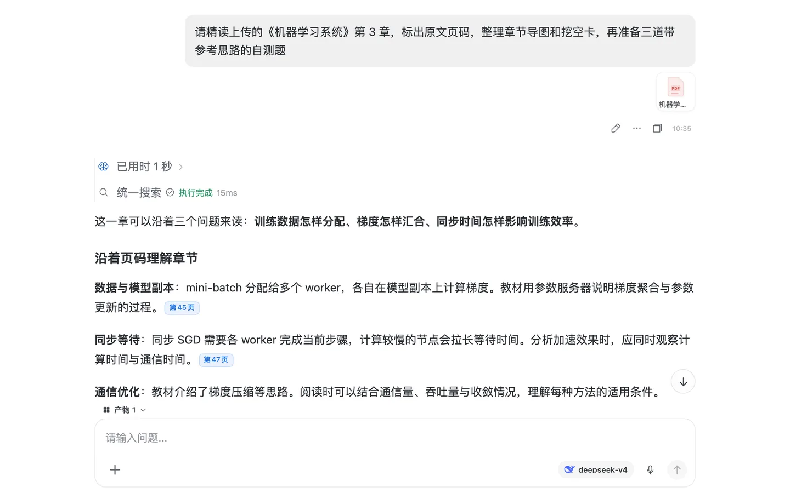

# 02 · AI Chat, Study Spaces & Memory v2

> DeepStudent's chat is built around your actual study materials — and with **Memory v2**, your AI remembers how you like to be taught, tracks your real weak spots across courses, shows you exactly which memories shaped every answer, and lets you roll back changes anytime.

---

## 1. Grounded AI Chat, Unified T3 Selector & In-Place Continuation

**What you want to do**: Ask questions grounded in your PDFs, notes, and lectures — switch models, local coding CLIs, reasoning effort, and permissions from one compact popover, and continue interrupted replies cleanly in place.

1. **Connect a model if you haven't yet**: If no model is set up, the chat composer displays a clear inline banner: *"No AI model is configured yet. Connect a provider to start chatting."* Click **Configure AI Model** to configure one of the **15 built-in providers**, click **Add Provider** for OpenRouter / xAI (Grok) / keyless local Ollama, or use **Import Tools** (CC Switch, Magpie, OpenCode, Claude Code, Codex, or `ccswitch://` links). If you hit `Enter` before adding a key, DeepStudent gently highlights the banner and keeps your typed draft intact.
2. **Use the streamlined `+` menu & attach study materials**:
   - Drag in PDFs, images, or notes directly, or click **Read alongside chat** from any open document to keep the source visible right beside the conversation.
   - Click `+` (**Add & session options**) to access four focused entries: **Add file**, **Knowledge base** (defaults to **`Scope: all materials`**, or pick **Choose retrieval scope (course / folder)** → **Only search: Folder**), **Skills** (also triggered with `/`), and **Connectors** (MCP / external tools).
3. **Switch models, CLIs, reasoning & permissions in the T3 Unified Selector**:
   - Open the model button in the composer to launch the compact **T3 unified selector**:
     - **Left icon rail**: Jump between **Favorites** (star any model on hover), each configured cloud provider, and **Local Coding CLI** (Desktop).
     - **Search & `⌘1`–`⌘9` quick pick**: Filter immediately via **Search models…** or press `⌘1`–`⌘9` to pick a model without touching the mouse.
     - **Per-CLI model drill-down**: Inside **Local Coding CLI**, drill into any installed CLI to choose **Follow CLI Default**, pick a curated model, or type a custom model ID.
     - **Reasoning Effort**: Select the active model's **Reasoning Effort** directly from the inline radio list (adapts automatically to models that support configurable reasoning depth).
     - **Bottom footer bar**: Toggle **`Web`** (web search), **`Compare`** (multi-select parallel answers), **`Params`** (temperature / sampling controls), and the active **permission preset** (**Cautious / Relaxed / Full access / Danger full access**) in one row.
4. **Continue cut-off or stopped answers in place**:
   - If a long answer stops because it hit the output length limit (*"This response may have been cut off before finishing"*) or because you clicked **Stop** (*"Generation stopped — you can continue from here"*), an inline banner appears directly under the reply.
   - Click **`Continue generating`** to resume seamlessly right inside the same assistant message — appending directly onto the existing reply without inserting an extra user turn.
5. **Turn answers into study artifacts**:
   - AI can reply with clean interactive study cards, tables, diagrams, or runnable previews alongside normal Markdown — and you can turn any explanation directly into a note, mind map, flashcard batch, or draft question set.

**What you get**: Answers anchored to your own textbook pages and notes with clickable citations, fast one-popover model and reasoning control, and zero-clutter continuation when long derivations stop mid-stream.

---

## 2. Local Coding CLI Collaboration (Desktop)

**What you want to do**: Work with locally installed command-line coding agents directly inside DeepStudent Chat — on a real project folder, with inline approvals, instant turn revert, and optional access to your study context.

1. **Detect built-in CLIs or register custom ones**:
   - Open **Settings → Tools & extensions → Coding CLI**. DeepStudent auto-detects **6 built-in CLIs**: **Claude Code**, **Codex CLI**, **OpenCode**, **Pi Agent**, **Antigravity CLI**, and **DeepSeek Harness**.
   - Click **Configure** on any CLI to override its executable path (**Browse…**) or add extra launch arguments, then click **Save & Test**. You can also add your own **Custom CLI Tools** (**Add Tool**) with a custom `@handle` ID, display name, executable command/path, and default arguments.
2. **Invoke CLIs inline in Chat**:
   - Select an installed CLI from the T3 selector's **Local Coding CLI** rail, or mention it directly with `@handle` (`@claude`, `@codex`, `@opencode`, `@all`, etc.).
   - Use `/swarm` to coordinate multiple collaborating agents in parallel and `/handoff` to pass work and changed files cleanly between agents.
3. **Bind a local project folder safely**:
   - Click **Select Project Folder** (**Link Local Project Folder**) in the composer to choose your working directory.
   - By default, CLIs **collaborate in-place** with **non-invasive hidden snapshots** before each turn so you can undo changes instantly without polluting your Git history; toggle **Use isolated Git worktree** whenever you prefer branch isolation.
4. **Approve tools, review diffs, and revert in one click**:
   - When a CLI requests a shell command or file write, an inline approval bar appears directly in the timeline with **Allow Once**, **Allow in Session**, and **Deny**.
   - Completed edits show a compact diff strip (**View Changes**, **`Revert Turn`** to restore the pre-turn snapshot immediately, and **`Summarize Changes`** to extract key takeaways into notes or flashcards).
   - Under **Collaboration & Safety** in **Coding CLI** settings, enable **Concurrent file conflict locks** (path-level write leases when multiple CLIs edit the same folder) and optionally **Share study session context** so coding CLIs can read notes and material excerpts linked to the current chat.

**What you get**: Seamless side-by-side coding and studying in one conversation timeline — with safe approvals, file leases, and reversible edits.

---

## 3. Organize by Course with Study Spaces

**What you want to do**: Keep Linear Algebra, Organic Chemistry, and IELTS Prep completely organized — each with its own materials, exam countdown, memory boundary, and window layout.

1. **Create a space**: Open the Study Space switcher and click **New Study Space**. Give it a course name and link its **Root Folder** (or add zero-copy **Cross-Space Mounts** from Library without duplicating large files).
2. **Configure goals and layout** (optional):
   - In **Goals & FSRS**, set a **Target Exam Date**, **Daily Budget (min)**, **Target Retention**, and **Default Flashcard Deck**.
   - In **Mounts & Workbench**, choose a **Workbench Layout Preset** (**Chat Focus**, **Split Reader & Chat**, **Split Notes & Chat**, **Practice & Flashcards**, or **Keep Freeform Layout**).
3. **Choose how memory behaves in this space**: Set **Memory Scope** to control whether chats in this space share global memories or stay completely separated (see the 3-layer scope guide below).

**What you get**: Switching Study Spaces restores your course's files, exam countdown badge (`D-14`), search scope, memory boundary, and preferred window layout in a single click.

---

## 4. Memory v2: Rules, Learner Profile & Dual-Zone Workbench

DeepStudent provides a transparent **Dual-Zone Memory Workbench** under **Settings → Memory** (and accessible via **AI Memory** in Files):

- **Top zone — Long-Term Memory Kernel**: Compact, structured memory that is **automatically applied on Turn 1 of every new session** and stays consistent throughout the conversation. It holds your **Interaction Hard Rules**, **Active Weak Points**, and **Learning Goals**.
- **Bottom zone — Searchable Memory Archive** *(optional)*: Longer background notes stored as regular Markdown notes in your chosen folder (**My Memories** by default). You can create subfolders right on the page and move archive memories between folders anytime.

### Add Interaction Hard Rules (100% Enforced from Turn 1)

**What you want to do**: Stop repeating the same instructions in every chat (for example, *"Always give a hint before revealing the solution"* or *"End each explanation with 1 self-check question"*).

1. Open **Settings → Memory** and locate **Interaction Hard Rules (100% enforced from Turn 1)**.
2. Type your instruction in the input box, pick a scope (**Global**, **Math**, **English**, or **Essay grading**), and optionally toggle **Pinned** so high-priority rules stay protected if your rule budget fills up.
3. Click **Add rule**.

**What you get**: Your rule takes effect on Turn 1 of every matching new session — no more reminding AI how to teach you. A live **Rules** budget meter (up to 1,500 characters) keeps your rule set crisp so AI never loses track of your preferences. Accidentally deleted a rule? Click **Undo** on the 5-second toast to bring it right back.

### Understand the 3 Layers of Scope (Without Confusion)

DeepStudent keeps scope control clean by separating three different questions:

| Layer | Where You Set It | What It Controls |
|---|---|---|
| **1. Hard Rule Scope** | **Long-Term Memory Kernel** → rule dropdown | Whether a teaching rule applies everywhere (**Global**) or only in a specific subject/mode (**Math**, **English**, **Essay grading**). |
| **2. Study Space Memory Scope** | **Edit Study Space** → **Memory Scope** | How a course space blends space-local memories with your global profile: **Space Priority + Global**, **Space Isolated Only**, or **Global Memory Only**. |
| **3. Task Workspace Folder** | Chat task settings → **Default project folder** | Optional local read-write folder for file-editing tasks (strictly bounded to that folder with approval prompts). |

### Automatic Weak Points & Learning Goals

As you review flashcards, practice Question Sets, or grade essays, DeepStudent automatically logs recurring weak spots (when accuracy drops below 65%) under **Active Weak Points** alongside occurrence counts — and lets you add explicit **Learning Goals** (such as *"Reach IELTS Writing 7.0 by December"*).

- Click **Preview prompt** at any time to inspect the exact long-term memory block AI will see on Turn 1 of your next session.
- Remember that memory stays **stable within an active session**: if you edit a rule mid-conversation, existing turns keep their original snapshot and your update smoothly applies starting on the **next turn**.

---

## 5. See & Edit What AI Remembered on Every Answer (Attribution Pill)

**What you want to do**: Check *why* AI answered in a particular style or focused on a specific weak topic — and immediately remove an outdated rule without leaving chat.

1. Look underneath an AI response for the compact badge: **`Memory Kernel · N rules / M weak points`**.
2. Click the pill to open **Active Memory Snapshot (This Turn)** — an immutable record of the exact rules, weak points, and goals injected for that specific turn (and for each alternate reply if you regenerated).
3. Adjust inline in one click:
   - Click **Forget this rule** next to any rule you no longer want (with an instant **Undo** banner if you change your mind).
   - Click **Mark mastered / forget** next to a weak point you have conquered.
   - Click **Memory settings** to open the full Memory Kernel panel.

**What you get**: Total transparency over AI personalization. If you changed rules mid-chat, the panel also displays a clear drift notice (*"Memory rules updated mid-session; changes take effect starting from the next turn"*) so you always know what is active right now versus next turn.

---

## 6. History, 10-Version Rollback & Dialectic Reflection

**What you want to do**: Undo an unwanted memory update or let DeepStudent tidy up conflicting rules and recurring mistakes automatically.

### Roll Back Your Learner Profile (Latest 10 Snapshots)

1. In **Long-Term Memory Kernel**, click the always-visible **History (N)** button.
2. Browse **Memory Change History** (every `ADD`, `UPDATE`, and `DELETE`) and **Learner Profile Snapshots (latest 10 versions, click to rollback)**.
3. Click **Rollback** next to any earlier snapshot (`vN · X weak points · Y goals`).

**What you get**: Instant peace of mind — you can experiment freely with auto-extraction (**Off** / **Balanced** / **Aggressive**) or reflection cleanup knowing you can always step back up to 10 versions.

### Clean Up with Dialectic Reflection (**Suggestions**)

1. Click **Suggestions** in the **Long-Term Memory Kernel** header.
2. DeepStudent analyzes your recurring weak points, overlapping instructions, and rule budget to generate actionable **Curation suggestions**.
3. Act on each card with one click:
   - **Promote to rule** — turn a recurring study habit or struggle into a Turn-1 Hard Rule.
   - **Remove second rule** — resolve two rules that contradict each other.
   - **Mark mastered** — clear an old weak point that no longer needs extra attention.

**What you get**: A self-maintaining memory kernel that stays lean, conflict-free, and focused on what actually improves your grades right now.

Optional technical note: How Memory v2 keeps sessions fast and predictable

On Turn 1 of a new session, DeepStudent compiles your active L1 Hard Rules and L2 Learner Profile into a compact session-frozen `<memory_kernel>` block so prompt caching stays hot and answers stay consistent. If you add, forget, or roll back a rule mid-session, DeepStudent appends a lightweight `<memory_delta>` starting on the next turn without rewriting earlier history.

---

## Next Steps

- Connect PDF highlights, split-pane notes, lectures, and translation → [03 · PDF Reading, Notes, Lectures & Translation](./03-pdf-notes-media-study-loop.md)
- Turn weak points and chat explanations into FSRS-6 flashcards and daily exam sprints → [04 · Flashcards, FSRS-6, Exam Sprint & Question Sets](./04-flashcards-exams-fsrs.md)

<!-- Baseline: DeepStudent v0.20.10 -->
