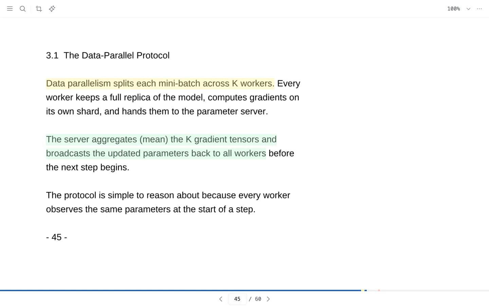
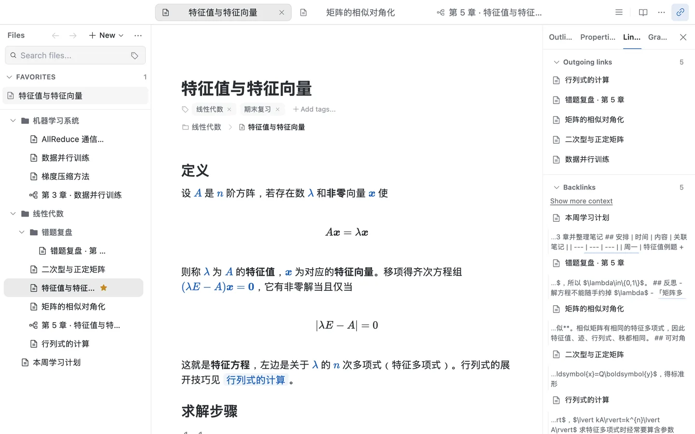
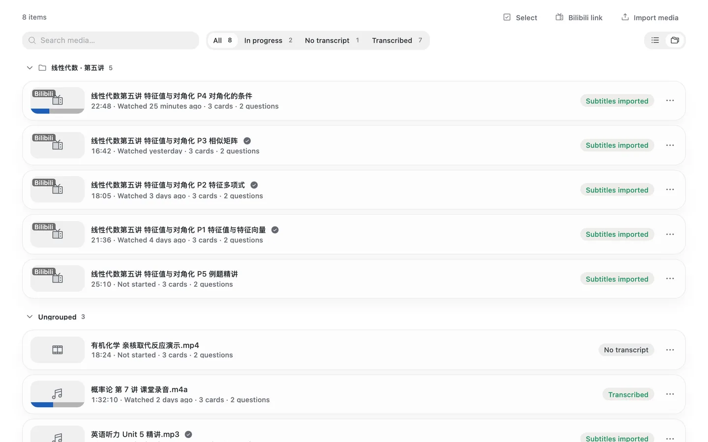

# 03 · PDF Reading, Notes, Lectures & Translation

> Reading papers, writing structured notes, watching recorded lectures, and translating dense passages all live in one connected loop — every highlight, note excerpt, and lecture Q&A stays linked straight back to its exact page or `mm:ss` timestamp.

---

## 1. PDF Deep Reading, 5-Color Highlights & Annotated Export

**What you want to do**: Read academic papers or scanned textbooks comfortably, highlight by meaning instead of random colors, and export a clean annotated PDF even when the original file is rotated or password-protected.

### Fast Paper Breakdown & Semantic Highlights

1. **Map the paper before reading**: Open any PDF from **Files**, click **AI Paper Guide** in the toolbar, and pick:
   - **Summarize structure & contributions** for a bird's-eye map.
   - **Deep-read current page** for line-by-line unpacking of dense proofs.
   - **Analyze method & reproduction details** or **Critical review & open questions**.
2. **Use comfortable reading controls & region capture**:
   - Toggle **Fit single column (185%)** to make two-column journal PDFs effortless to read.
   - Click **Read alongside chat** to open AI next to the PDF with page context attached automatically.
   - Click **Ask about a region** and drag over any diagram, table, or equation: choose **Ask AI** to transcribe it into clean LaTeX or a Markdown table, or **Pin Reference** to float the figure on screen while you read later pages.
3. **Highlight with 5 semantic colors (`1`–`5`)**: Select text and press a number key (or click a color swatch) to tag meaning as you read:
   - `1` — **Yellow · Core Claim (1)**
   - `2` — **Green · Methodology (2)**
   - `3` — **Blue · Definition & Context (3)**
   - `4` — **Red · Limitation & Question (4)**
   - `5` — **Purple · Formula & Metric (5)**
   - Click **Add note** on any highlight to jot down a question or takeaway, and filter your **Highlights** sidebar by keyword or color anytime.

*(Note: Text highlighting is paused while a page is manually rotated in the viewer — restore the original orientation to add new text highlights.)*

### Export Annotated PDFs (Rotated & Encrypted Files Supported)

**What you want to do**: Save a standalone PDF file that preserves every highlight and note you made, ready to print, email, or open in another reader.

1. Open the **Highlights** panel in the PDF toolbar.
2. Click **Export annotated PDF**.
3. Choose where to save your file.

**What you get**: A clean annotated PDF whose highlights land in the exact right position — even on tricky real-world files:
- **Rotated pages**: DeepStudent automatically transforms highlight coordinates for rotated PDF pages so boxes never drift sideways or upside down.
- **Stub-encrypted PDFs**: Files with empty/dummy protection headers have those stub flags stripped cleanly so standard PDF tools can edit and embed your highlights normally.
- **Real encrypted PDFs**: Instead of silently producing a corrupted file, DeepStudent rebuilds highlighted pages through safe high-resolution rendering (bounded at 2,000 px longest edge / 3.6 megapixels to stay crisp and memory-safe). If a locked PDF truly cannot be written back as a PDF, DeepStudent clearly guides you to click **Export as note (N)** so none of your annotations are ever lost.

---

## 2. Notes, 460px Split-Pane Citations & Tab Disambiguation

**What you want to do**: Turn PDF highlights into permanent Markdown notes, jump straight back to the source page while working in a narrow split screen, and juggle similarly named notes across courses without mixing them up.

### Export Highlights to Notes & Jump Back in Split View

1. In the PDF **Highlights** panel, click **Export as note (N)**. DeepStudent generates a structured summary note grouped by page, with every excerpt linked back to its PDF page (`pdfref://`).
2. Arrange your PDF and Note side by side (including compact **460px split-pane** windows or the **Note & AI** stage preset).
3. Look at the **Source** bar at the top of your note — showing **`From file · Page N`** (or **`From chat`** for notes created from conversations) — or open **Backlinks**. Click any source chip or page citation.

**What you get**: The paired PDF window scrolls straight to the exact cited page without covering your note or losing your cursor position.

### Smart Tab Title Disambiguation (Shared Prefixes)

When you keep multiple similarly titled notes open at once — for example, `Calculus - Chapter 1 - Limits` and `Calculus - Chapter 2 - Derivatives` — compact tabs would normally all cut off to the same truncated prefix. Instead, the Notes tab strip automatically collapses the shared prefix into a short leading hint plus `…` followed by each tab's differentiating part (such as `Calc…Chapter 1 - Limits` and `Calc…Chapter 2 - Derivatives`), snapping cleanly to word and number boundaries. Hover over any tab at any time to see the full title.

### Daily Note-Taking Essentials

- Type `[[` anywhere to link to another note (and explore connections in the local link graph).
- Press `Backspace` / `⌘+Backspace` / `Delete` on a focused note in the Notes list to move it safely to Trash.
- Press `⌘/Ctrl+K` while editing a note: when the caret is not on a link or word, it forwards straight to the global **Command Palette** so you never lose quick navigation.
- Ask AI to polish, expand, or organize a note: AI presents edits as clear block-by-block suggestions you can review and undo cleanly instead of silently overwriting your writing.
- Turn any finished note straight into a **Mind Map** or a batch of **Flashcards** from the note toolbar.

---

## 3. Media Studio: Lectures, Subtitles & Grounded Companion Q&A

**What you want to do**: Study recorded lectures, course videos, or audio recordings — ask about the exact concept the professor just explained, jump straight to `mm:ss` citations, and turn lectures into handouts or flashcards.

1. **Import and add a transcript**: Drag a video/audio file (or supported lecture link) into **Media Studio**. Click **Transcribe** — or if you already have subtitles, use **Import subtitle file…** from the item menu to import **`.srt`, `.vtt`, `.ass`, `.txt`, or Bilibili `.json`** files directly and skip transcription time and cost. Non-subtitle files are rejected cleanly instead of corrupting the transcript, and importing over an existing transcript asks for overwrite confirmation (**Replace existing subtitles?**).
2. **Use Grounded Companion Q&A while watching**:
   - Open the **Ask** tab beside the player and click **Ask about what I just watched** (or type your own question).
   - Companion Q&A automatically anchors its answer to your **current playhead timestamp and active chapter** (`At mm:ss (Chapter: ...)`), pulling the nearby transcript lines so the explanation stays strictly grounded in what the speaker actually said, and renders full **Markdown + KaTeX math** cleanly.
   - Click any `mm:ss` timestamp badge in the answer to seek the video straight to that exact moment.
   - On mobile or compact layouts, Companion Q&A protects playback state cleanly so asking a quick question never resets your position.
3. **Escalate or convert into study materials**:
   - Need full derivations, follow-up practice, or multi-turn discussion? Click **Promote to main chat** in the top-right of the Companion card — DeepStudent carries the lecture context, timestamp anchor, and the Companion AI's answer directly into a full Chat session.
   - Click **Make flashcards** to generate timestamp-linked cards in the background, build a sectioned **Handout** with key frames, or generate **in-lecture checkpoints** that quiz you every few minutes.

**What you get**: Passive video watching turns into an interactive, searchable study session where every note, card, and AI answer jumps back to the exact second in the lecture.

---

## 4. Translation Workbench: Domains, Tone Persistence & Version Rollback

**What you want to do**: Translate research abstracts, legal clauses, or foreign textbooks with consistent terminology — and compare or roll back earlier translation takes without losing edits.

1. **Set language, domain, and tone**:
   - Paste text or drag in a PDF, DOCX, TXT, MD, or image file.
   - Pick **Source Language** / **Target Language** (or **Auto Detect**), open **Translation Settings**, choose one of **7 Domain presets** (**General**, **Academic**, **Technical**, **Literary**, **Legal**, **Medical**, **Casual**), set **Tone** (**Auto**, **Formal**, or **Casual**), and optionally add fixed terms to your **Glossary**.
2. **Keep your settings automatically**: DeepStudent remembers your language pair and formality/tone using a predictable chain — your active session choice wins first, then your saved translation preferences, then built-in defaults — so switching tabs or resuming work never silently resets your tone.
3. **Iterate safely with Version History & Rollback**:
   - Press `⌘/Ctrl+Enter` (or click **Translate**) to stream your translation.
   - Want to try a different tone or model without losing what you have? Click **Save as new version** to snapshot the current translation and generate a fresh version.
   - If a re-translation isn't as good as the previous one, look at the version counter (**`N previous versions`**) and click **Restore previous** to jump straight back.

**What you get**: Publication-ready translations with enforced terminology, consistent tone across sessions, and instant rollback whenever you compare drafts.

---

## Next Steps

- Schedule your new highlights, lecture takeaways, and notes for long-term retention → [04 · Flashcards, FSRS-6, Exam Sprint & Question Sets](./04-flashcards-exams-fsrs.md)
- Pair your phone to read notes and review on the go → [06 · Backups, Cloud Sync, Mobile & WebUI / PWA](./06-sync-backup-mobile-webui.md)

<!-- Baseline: DeepStudent v0.20.10 -->
