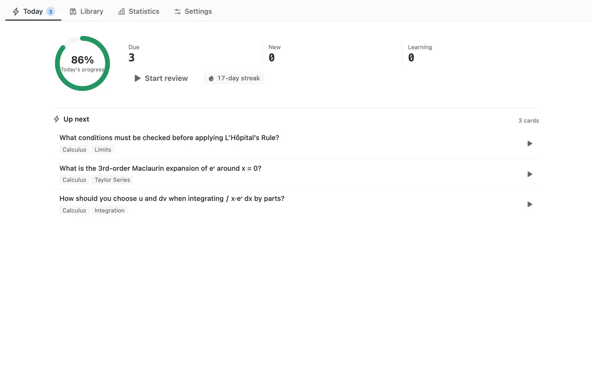
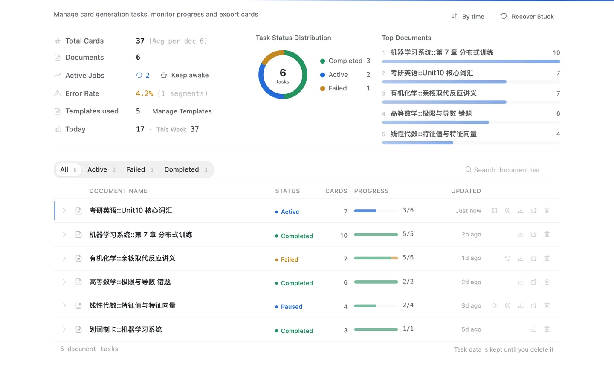
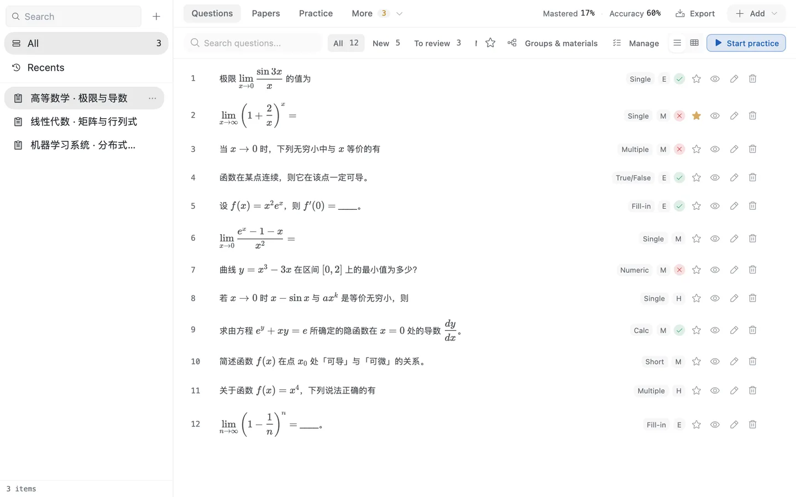

# 04 · Flashcards, FSRS-6, Exam Sprint & Question Sets

> Remember what you learn with minimal daily effort: DeepStudent combines FSRS-6 spaced repetition, a unified pre-exam sprint queue, instant search across thousands of cards, Anki compatibility, and draft-checked Question Sets.

---

## 1. Daily Flashcard Review with FSRS-6

**What you want to do**: Review cards right before you would forget them — with honest streaks and schedules that stay accurate even if you study past midnight or cross Daylight Saving Time.

1. **Open your daily queue**: Open **Flashcards** → **Today** to see your **Today's progress** ring (**Due**, **New**, **Learning**) and your **Review by deck** breakdown.
2. **Start reviewing**: Click **Start review** (or review a single deck with **Review N** / **Learn N new**). Newly AI-generated cards wait in your inbox until you click **Add to review**, so bulk generation never floods your queue unexpectedly.
3. **Flip, rate, zoom images, and rescue missed cards**:
   - Reveal the answer and rate honestly: **Again**, **Hard**, **Good**, or **Easy** (hit **Undo rating** if you tapped the wrong button). Press **`?`** anytime during review (or click **Shortcuts**) to open the **Keyboard shortcuts** sheet for flipping, rating, undoing, replaying audio, editing, skipping, and burying cards.
   - Reviewing diagrams or dense textbook crops? Click any card image to open a crisp **200-DPI image zoom lightbox** without accidentally flipping the card.
   - Stuck on a card? Click **View source** to jump back to the exact PDF page, note, or lecture timestamp it came from, or click **Ask AI about this card** for a fresh explanation and memory hook.
   - **Session-end forgotten-card rescue**: Whenever a review round finishes with cards rated **Again**, the summary card lets you immediately drill them while fresh (**Review missed cards (N)** — retry again cards) or click **Ask AI about missed cards** (ask AI to review hard cards, highlight common traps, and generate quick check questions).

**What you get**: An adaptive review plan tuned to when you actually remember or forget each concept.

### Local-Midnight & Daylight-Saving-Safe Scheduling

- **Late-night friendly day boundary**: In Flashcard **Scheduling** settings, set **Next day starts at (hour)** (default `4` — 4:00 AM) so studying at 1:30 AM still counts cleanly toward today's streak and daily limits.
- **No DST drift**: Daily due boundaries and streaks use local civil-calendar dates, so springing forward or falling back for Daylight Saving Time (or traveling across time zones) never shifts cards by a stray hour or breaks your streak.
- **Optional on-device personalization**: After a few hundred reviews, open **Personalized Memory Pacing (FSRS Optimizer)** and click **Optimize from my reviews** to tune scheduling to your own forgetting curve — completely offline on your device (click **Restore defaults** anytime).

---

## 2. Exam Sprint: Unified Countdown Review

**What you want to do**: Pull flashcards, past mistakes, and weak Mind Map topics into one realistic daily study session leading up to an exam date.

1. **Set your exam target**: In **Flashcards** → **Today** (or inside a Study Space's **Goals & FSRS** tab), click **Set exam date**, pick your **Target exam date**, and choose a **Daily sprint budget** (for example, `20m` or `30m`).
2. **Launch the sprint**: Click **Start Daily Sprint**. The **Unified Daily Sprint** player mixes your highest-priority items across four formats:
   - **Flashcard** (due FSRS cards)
   - **Mistake** (questions you previously missed)
   - **AI Variant** (**AI Variant · Transfer Check** — fresh twists on your past mistakes so you don't just memorize wording)
   - **MindMap Cloze** (hidden branches from your study mind maps)
3. **Check sources on the fly**: Use the optional **Scratchpad** to work out derivations before checking, and click **Reveal in Source** whenever you need the original textbook or note beside the question.

**What you get**: A live countdown badge (`D-7`) and **Readiness** forecast that adapts daily. In the final 3 days before exam day, DeepStudent automatically turns on **Pre-exam buffer · new intake paused** so your limited time goes strictly toward high-yield review instead of learning brand-new material.

---

## 3. Large Libraries (5,000+ Cards) & `⌘/Ctrl+K` Deep Jump

**What you want to do**: Manage thousands of flashcards across semesters without constantly losing your filter or scroll position — and jump to any specific card or note in two seconds.

### Session Memory & Manual Card Creation in the Card Library

1. Open **Flashcards** → **Library** and narrow down cards with **Search front / back / tags…**, status filters (**All**, **Due**, **New**, **Learning**, **Review**, **Suspended**, **Not enqueued**), or deck selection.
2. Click **New card** to create cards manually in either **Basic (Q&A)** or **Cloze deletion** (**Cloze**, highlighting key terms and clicking **Insert cloze** to wrap `{{c1::...}}` blanks) — saved cards join your review queue right away.
3. Expand card details, adjust your page size, or scroll deep into a 5,000-card library.
4. Switch away to **Today**, **Chat**, or **Notes**, then come back to **Library**.

**What you get**: DeepStudent remembers your active filters, search query, page size, expanded rows, and exact scroll position for the entire session — no starting over from page 1 every time you switch tabs. You can also click **Review this page** to drill just your filtered slice.

### Deep Content Jump with `⌘/Ctrl+K`

1. Press **`⌘/Ctrl+K`** from anywhere in DeepStudent to open the Command Palette.
2. Use the **scope filter chips** (**`All`** / **`Commands`** / **`Files`** / **`Cards`** [Flashcards]) — or type quick prefixes (`>` commands, `@` files, `#` cards) — and enter a keyword from a card, note, or past conversation (at least 2 characters for files, flashcards, and session history).
3. Browse live matching snippets with **match highlighting** under **Files**, **Flashcards**, and **Sessions**, then press `Enter`.

**What you get**: Instant deep jump straight to the exact matching item — picking a flashcard opens **Library** and focuses directly on that card so you can inspect, edit, or review it immediately.

---

## 4. Anki `.apkg` Compatibility & AnkiConnect v6

**What you want to do**: Move decks smoothly between DeepStudent and Anki — with every diagram, audio clip, and math equation displaying properly on both Desktop and WebUI.

### Import & Export `.apkg` (Full WebUI Media Parity)

1. In **Flashcards** → **Library**, click **Import .apkg** to import an existing `.apkg` deck, or select cards and click **Export .apkg** (or **Export .csv** for spreadsheets).
2. Right after an `.apkg` import completes, a **post-import quick-study banner** (**Deck imported**) summarizes imported cards, media, and preserved Anki review history with one-click **Start Studying Now** and **Filter Deck in Library** actions.
3. Card templates, styling, bundled math fonts (KaTeX), and embedded images or audio travel inside the `.apkg` archive.
4. Review imported `.apkg` cards anywhere — embedded images and audio render with full parity across both the **Desktop App** and **self-hosted WebUI**.

### Push Directly to Desktop Anki via AnkiConnect v6

1. Make sure desktop Anki is open with the **AnkiConnect** add-on (v6) installed and check that **AnkiConnect Status** shows **Connected**.
2. Choose how card media (images and audio) should transfer:
   - **Upload media to Anki** *(default)* — uploads media files to Anki's media folder automatically (deduplicated so shared images only upload once, up to 32 MiB per file).
   - **Embed inline** — embeds lightweight images directly into card HTML when needed.
   - **Skip media** — pushes card text only for ultra-fast sync.
3. Push your deck to Anki. If Anki is closed or **Disconnected**, DeepStudent lets you fall back to **Export .apkg** cleanly without losing generated cards.

---

## 5. Question Sets (Exam Sets) & Draft-First AI Authoring

**What you want to do**: Build structured practice sets from past exams or AI-authored questions, practice in realistic test modes, and make sure AI never dumps unverified questions into your permanent bank.

1. **Create or import a Question Set**:
   - Open **Files** → **New Question Set** (or **Question Set Workbench**) and upload an exam PDF/image set, import JSON/CSV, or ask AI in Chat to draft practice questions from your notes.
   - Supports **13 question types** (single/multiple choice, fill-in-the-blank, short answer, matching, proof, and more) and **Shared Material** passages so a reading comprehension text or common physics scenario is stored once and shown automatically alongside every child question.
2. **Review and confirm every AI draft first**:
   - Whether you upload a multi-page exam or ask AI to author questions in Chat, DeepStudent saves a **pending draft** first — never silent writes into your permanent bank.
   - Inspect shared passages, question selection, and any missing answers (DeepStudent keeps missing answers visibly blank instead of guessing), then explicitly **confirm the import** to commit formal questions.
   - Use **Groups and Materials** to reorganize shared-material question groups, **Import History and Reparse Review** to audit saved drafts, and **Original Source** to jump back to the exact exam page.
3. **Practice in 9 modes & track mistakes automatically**:
   - Switch between **Review First** (mistakes first), **Wrong Answers Only**, **Mock Exam** (custom duration, question count, type/difficulty mix), timed drills, or read-only answer review.
   - Every missed question automatically enters your cross-set mistake log and feeds into **Unified Daily Sprint** and your Memory v2 **Active Weak Points**.

**What you get**: Trustworthy, cleanly structured exam banks where shared passages never detach from their sub-questions and AI drafts always wait for your approval.

> Need full details on 20+ page exam splitting, shared-material version checks, or lossless Question Set ZIP/JSON export? Read the dedicated reference: [Question Import and Shared Materials (v2)](../question-authoring-v2-en.md).

---

## Next Steps

- Add custom exam grading rubrics, study workflows, or AI-built study widgets → [05 · Plugins v2, Study Packs & Safe Mode Rescue](./05-plugins-v2-and-safe-mode.md)
- Keep your flashcard streak synced across laptop, phone, and WebUI → [06 · Backups, Cloud Sync, Mobile & WebUI / PWA](./06-sync-backup-mobile-webui.md)

<!-- Baseline: DeepStudent v0.20.10 -->
