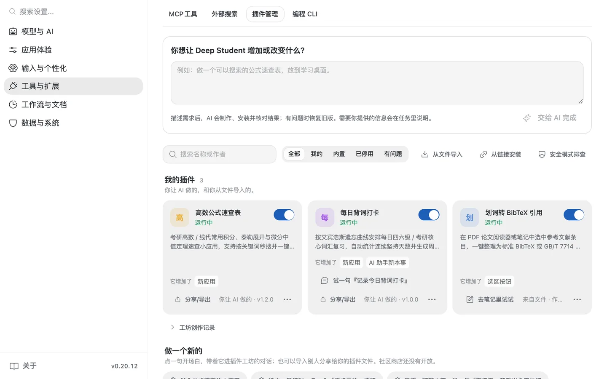

# 05 · Plugins v2, Study Packs & Safe Mode Rescue

> Extend DeepStudent without writing a line of code — install shareable `.dspack` Study Packs, ask **AI Plugin Workshop** to build and refine custom study tools for you, review every permission in plain English, and rely on **Safe Mode** for instant 1-minute self-rescue if a third-party plugin ever misbehaves.

---

## 1. Plugin v2: Three Tiers — Starting with Zero-Code Study Packs

You do not need to be a programmer to customize DeepStudent. **Plugin v2** organizes extensions into three clear tiers so you only take on the complexity (and permissions) you actually need:

| Tier | File Format | Coding Needed? | Best For |
|---|---|---|---|
| **Tier 1 · Study Packs** | `.dspack` | **Zero code** | Sharing subject rubrics (YAML), study method prompts (`SKILL.md`), flashcard templates, starter decks, and step-by-step study workflows |
| **Tier 2 · UI Workshop Tools** | `.dstuplugin` | Built for you by AI | Custom study widgets, PDF/Notes toolbar buttons, interactive calculators, and mini-apps that safely use your approved study data, AI model, or notifications |
| **Tier 3 · Full Extensions** | `.dstuplugin` | Developer-built | Deeper desktop integrations such as custom review schedulers, custom grading engines, or external channel bots |

> **From Skills to Study Packs**: DeepStudent already ships with **58 built-in study skills**. If you write pure-Markdown study skills (`SKILL.md`), grading rubrics, or card templates, you can bundle them directly into a zero-code **`.dspack` Study Pack** to share with classmates — no JavaScript or build tools required.

---

## 2. Installing Plugins & Reviewing Plain-English Permissions

**What you want to do**: Add a classmate's Study Pack or community plugin safely, knowing exactly what it can access before it ever runs.

1. Open **Settings → Plugins** and choose how to install:
   - **Import from file**: Select a local `.dspack` or `.dstuplugin` package from your computer.
   - **Install from link**: Paste a shared `https://` link pointing directly to a `.dspack` or `.dstuplugin` file. DeepStudent enforces HTTPS-only downloads, checks file integrity, caps remote packages at **32 MiB**, and automatically blocks unsafe local/private-network links or redirects.
2. **Review plain-English permissions before enabling**: Every newly installed package stays **disabled** until you explicitly review and approve its permissions. DeepStudent translates every requested capability into plain language:
   - *It needs no extra permissions* (common for pure Study Packs).
   - *Reads and changes your study data (notes, cards, questions, reviews, to-dos, library)*.
   - *Generate text with the current chat model* / *Sends system notifications* / *Runs automatically on a schedule*.
   - **Scoped network access**: *Read from `<host>` (read-only, this domain only)*, *Send write requests to `<host>` (high risk, this domain only)*, or *Connect to localhost port `<port>` (high risk, local service only)*.
3. **Approve to enable**: If a future version of a plugin asks for new permissions, DeepStudent pauses it and asks you to confirm again (*"Its permissions changed; please confirm again"*).

**What you get**: Clear, predictable boundaries — nothing downloaded from a link runs automatically behind your back.

---

## 3. AI Plugin Workshop & `✦ Refine with AI`

**What you want to do**: Ask DeepStudent to build a tailored study tool (like a searchable formula sheet, Pomodoro tracker, or citation helper) and polish it interactively as you use it.

1. **Describe what you want**: Open **Plugin Workshop** (under **Settings → Plugins** or from **All Apps**), type your idea in plain English — for example, *"Add a searchable physics formula reference app to my desktop"* — and click **Build it with AI**.
2. **Let AI build, verify, and ask for your OK**: The Workshop builds the tool, runs functional checks automatically, shows you what it adds and any permissions it needs, and installs it only after you approve.
3. **Improve on the spot with `✦ Refine with AI`**:
   - Open your Workshop plugin window and click **`✦ Refine with AI`** right in the window header whenever you want to tweak the layout, add a button, or fix a quirk.
   - Don't like the newest change? Open the plugin's menu in **Settings → Plugins** and click **Go back to the previous version (vN)** — DeepStudent reinstalls your previous working version cleanly while keeping the draft in Workshop history.

**What you get**: Bespoke study utilities created and iterated in minutes, with one-click version rollback if an edit misses the mark.

---

## 4. Safe Mode: 1-Minute Self-Rescue (Zero Data Loss)

Even with verification, a third-party plugin or broken layout can occasionally freeze a window or fail at startup. DeepStudent's **Safe Mode** is built so no third-party extension can ever lock you out of your study data.

### How to Enter Safe Mode

- **From inside the app**: Go to **Settings → Plugins** and click **Restart in Safe Mode**.
- **Automatic crash protection**: If DeepStudent crashes twice in a row during startup, it automatically offers to relaunch in Safe Mode on the next launch.
- **From a terminal / shortcut**: Launch DeepStudent with the `--safe-mode` flag.

### What Happens in Safe Mode

- **Your study data is 100% safe**: Notes, PDFs, flashcards, review streaks, Question Sets, and backups are untouched, and every official built-in app works normally.
- **Community plugins are isolated**: Third-party plugins appear under **Paused by Safe Mode** (their settings and saved data stay intact, and you can inspect faults, disable, or uninstall them).
- **Custom MCP auto-connect pauses automatically**: External custom MCP servers do not auto-connect in Safe Mode so a hanging external tool cannot block startup — you can still inspect or manually test them in **Settings → MCP Tools**.
- **Safe local import only**: You can still import a local `.dstuplugin` or `.dspack` file in Safe Mode (it is stored safely in a **Quarantined · Paused by Safe Mode** state without executing any code); remote **Install from link** downloads are paused.

### Three One-Click Rescue Tools

| Problem | Exact Rescue Button | What It Does |
|---|---|---|
| A specific plugin crashed or degraded | **Inspect faulted (N)** → disable or uninstall | Pinpoints the exact misbehaving plugin so you can turn it off or remove it. |
| Plugin configuration file is damaged (`user.profile.json`) | **Back up & reset corrupted plugin profile** (shown on the **Plugin profile (user.profile.json) is corrupted** banner) | Backs up the damaged file first, then rebuilds a clean default plugin profile — **without touching any study data**. |
| Window layout is stuck or off-screen | **Reset UI Layout Cache (keeps study data)** | Clears broken window positions and desktop layout cache while leaving all notes, files, and cards intact. |

### Exit Safe Mode Cleanly

1. Click **Exit Safe Mode & Restart**.
2. Review the **Exit Safe Mode and restart normally?** dialog:
   - Any faulted or degraded third-party plugins are **automatically pre-checked to be disabled** before restart so you do not loop back into a crash.
   - Check or uncheck any plugin, or pick **Disable all & restart normally** if you want a completely clean boot.
3. Click **Disable selected (N) & restart** (or **Confirm exit & restart normally**, or **Stay in Safe Mode** to keep inspecting).

**What you get**: A guided, zero-panic recovery flow that gets you back to studying in under a minute.

Optional developer note: Plugin v2 architecture summary

Plugin v2 separates declarative zero-code Study Packs (`kind: "study-pack"`, `.dspack`) from UI-first Workshop bundles (Tier 2, calling brokered `studyData` / `pluginModel` / `pluginNotify` services) and full host-side extensions (Tier 3). Fine-grained network permissions use `net:<host>`, `net:write:<host>`, and `net:local:<port>`, and corrupted `user.profile.json` recovery runs via an atomic backup-and-reset command without altering user databases. See `docs/plugins/PLUGIN-V2.md` in the repository for manifest schemas and API details.

---

## Next Steps

- Back up your workspace, sync across devices, or use DeepStudent on your phone and browser → [06 · Backups, Cloud Sync, Mobile & WebUI / PWA](./06-sync-backup-mobile-webui.md)
- Jump back to the 1-minute rescue checklist anytime → [01 · Quickstart & Three-Minute Workflows](./01-quickstart.md#quick-scenario-3-1-minute-safe-mode-self-rescue)

<!-- Baseline: DeepStudent v0.20.9 -->
