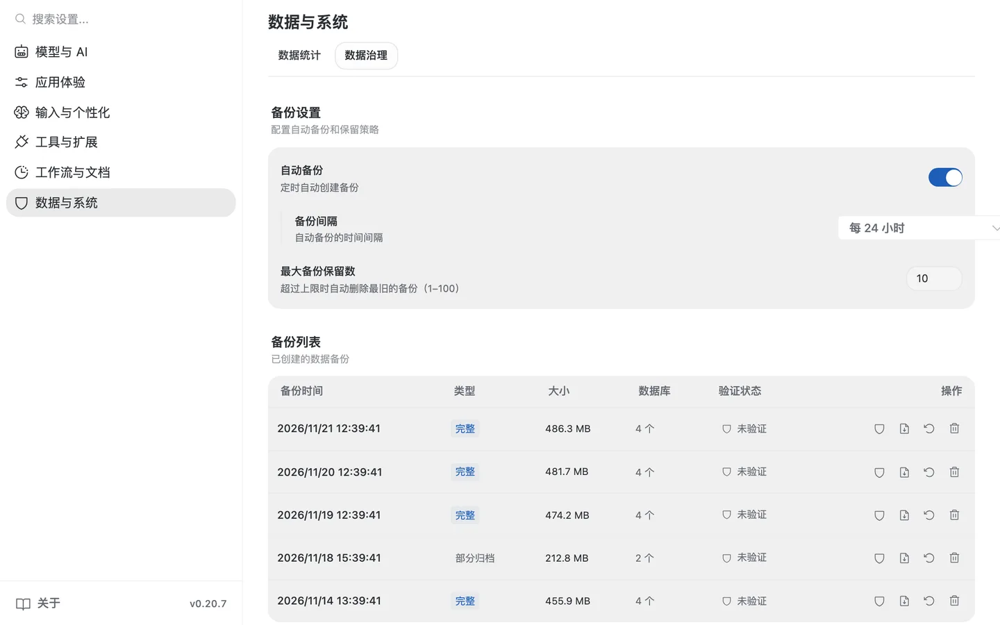
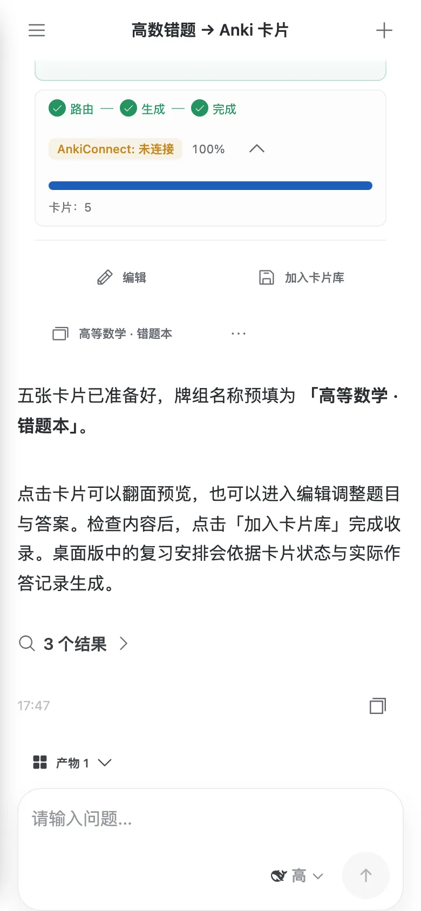
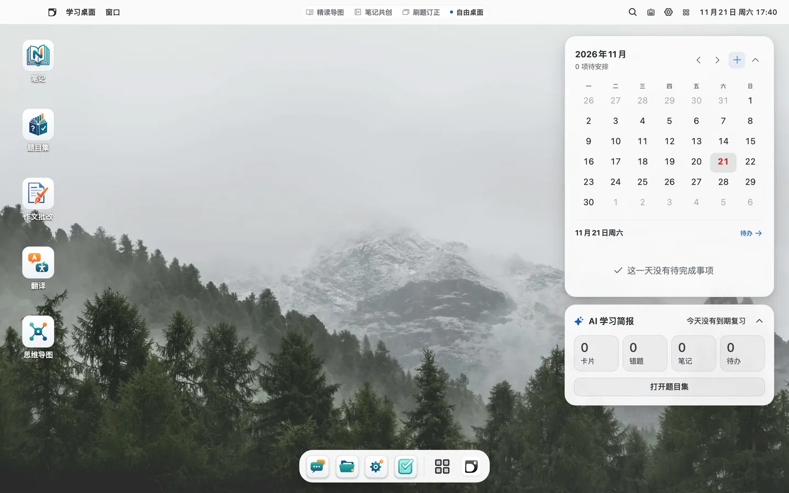

# 06 · Backups, Cloud Sync, Mobile & WebUI / PWA

> Your study library lives locally on your device first — and when you want safety snapshots, multi-device sync, phone review, or browser access from any computer, everything stays encrypted, reversible, and ergonomic even on a 360px phone screen.

---

## 1. Local Backups & Automatic `pre_restore` Safety Snapshots

**What you want to do**: Keep reliable offline copies of your study library — and restore an older backup without worrying about accidentally overwriting today's notes.

1. **Choose a backup tier**: Open **Settings → Data & Sync** and pick how much to include when running a backup or clicking **Export Backup** (ZIP):
   - **Core Data (Essential)** — chat history, study file catalog, flashcards, mistakes, and settings.
   - **Important Data (Recommended)** — Core Data plus AI usage statistics and note attachments.
   - **Rebuildable Data (Optional)** — adds local knowledge-search indexes (these can always be regenerated).
   - **Large Assets (Media Files)** — full archive including PDFs, images, audio, and video files.
2. **Restore with an automatic safety net**: Select any snapshot in your backup list (or import a ZIP archive) and confirm restore.
3. **Undo a restore if needed**: Before overwriting your active data, DeepStudent **automatically creates a `[Pre-restore safety snapshot]`** (suffixed with `_pre_restore`) and **keeps it visible in your backup list** after the restore finishes and the app reloads. If you realize you restored the wrong date, just select that `[Pre-restore safety snapshot]` and roll right back.

**What you get**: Truly reversible restores — you can recover from mistakes without ever losing your pre-restore state.

---

## 2. Cloud Sync: WebDAV, S3, End-to-End Encryption & Weak-Network Recovery

**What you want to do**: Keep notes, flashcards, review progress, and study materials in sync across your laptop, phone, and browser using your own cloud storage.

### Supported Cloud Protocols by Platform

| Platform | WebDAV | S3-Compatible (AWS S3, R2, MinIO, OSS…) | FTP (Experimental) |
|---|---|---|---|
| **Desktop App** (Windows / macOS / Linux) | Supported | Supported | Supported |
| **Desktop WebUI / PWA** | Supported | Supported | Supported |
| **Mobile WebUI / PWA** | Supported | Supported | Hidden |
| **Android Native App** | Supported | Not supported | Not supported |

*(Tip: If you sync between Desktop and the Android native app, pick **WebDAV** so every device shares the same folder. If you use Desktop + Mobile WebUI in your phone browser, both WebDAV and S3 work seamlessly.)*

### Configure Cloud Storage Safely (Credential Masking & E2EE)

1. Open **Settings → Data & Sync → Cloud Storage** and enter your **WebDAV** details (**App-specific password** recommended) or **S3** details (**Endpoint URL**, **Bucket**, **Access Key ID**, **Secret Access Key**, and **Use Path Style** for self-hosted services like MinIO).
   - **Credential masking & leave-blank-to-keep**: Once saved, passwords and secret keys are **never echoed back in plain text**. If you later edit your endpoint URL or bucket name, simply leave the password field blank to keep your saved password unchanged.
2. **Enable End-to-End Encryption (E2EE)**: Set one encryption password and use that exact same password on every device linked to the same cloud folder. Your study data is encrypted on your device before upload — the cloud provider never sees readable notes or cards.
3. **Turn on Auto Sync (optional)**: Under Sync settings, enable **Auto Sync** (**Every 15 minutes**, **Every hour**, or **Every 6 hours**). If conflicts ever occur between two offline devices, pick **Keep Local**, **Use Cloud**, **Keep Newer**, or **Smart Merge**.

### Protected Against Weak Wi-Fi & Mid-Sync Drops

- While syncing, DeepStudent holds a temporary cloud sync lock and refreshes its heartbeat automatically.
- **No blind writes on dropped connections**: If your Wi-Fi or cellular signal drops mid-sync and the heartbeat stops, DeepStudent halts remote writes safely instead of corrupting cloud data.
- **Automatic lock recovery**: On your next sync, your device cleanly reclaims its own leftover lock (or if a lock is still active from another device or a recent abrupt close, DeepStudent explains the exact auto-clear time rather than letting two devices overwrite each other).

Optional security note: End-to-end encryption details

When E2EE is enabled, DeepStudent derives encryption keys locally on your device from your passphrase and refuses to silently mix unencrypted legacy cloud files with encrypted sync sessions (preventing accidental downgrade). Keep your encryption passphrase in a password manager — it cannot be recovered from the cloud server if forgotten.

---

## 3. One-Tap QR Device Pairing & 3-Way Fallback

**What you want to do**: Connect a second laptop, phone, or browser to your cloud sync and AI providers in 20 seconds — without retyping long S3 keys, E2EE passphrases, or API keys.

### On Your Existing Device

1. Open **Settings → Data & Sync → QR Sync & Cross-Device One-Tap Pairing** and stay on **Generate QR on this device**.
2. Check what you want to transfer: **Cloud sync config & secrets**, **AI vendor configs & API keys**, and **Skill / plugin sync preferences**. *(If cloud storage hasn't been saved yet, DeepStudent warns you clearly so you don't generate an incomplete pairing code.)*
3. Enter a 6-digit PIN — or click **Quick Random PIN & QR** — then click **Generate Sync QR Code** (or **Generate & Push Latest Snapshot** to upload fresh data at the same time). Your secrets stay encrypted with that 6-digit PIN.

### On Your New Device (Camera, Full Screenshot, or 3-Way Fallback)

1. Open **Scan / Join on new device** and choose one of three ways to import:
   - Click **Scan with camera** to scan directly off your other screen.
   - Click **Import from QR image** — DeepStudent can decode the pairing QR code straight from a **full uncropped screenshot** as well as a downloaded QR image.
   - **3-Way Fallback if an image cannot be decoded**: DeepStudent presents clear one-click recovery options right in place:
     1. Click **Paste pairing code instead** to paste the encrypted `DSPAIR1:...` text code directly.
     2. Crop tightly around the QR code (keeping its white border) and click **Choose another image**.
     3. Enter the **6-digit PIN** shown on the source device to decrypt and apply.
2. Click **Apply Configuration** (or **Apply & Pull Cloud Data** to sync your study library down immediately, followed by **Run Bidirectional Sync Now** whenever you like).

**What you get**: A newly paired phone or laptop configured with your cloud sync, E2EE password, and AI providers in seconds.

*(Note: The current pairing interface uses `DSPAIR1` 6-digit PIN encrypted codes across all clients; the next-generation `DSPAIR2` pairing protocol is already prepared in the backend for future rollout.)*

---

## 4. Mobile & Compact Screens (360px Phone Ergonomics)

Whether you use the **Android native app** or open **Mobile WebUI** in your phone browser, DeepStudent is tuned for comfortable one-handed study down to **360px** screen width:

- **Smart Dock Reveal Handle & Typing Clearance**: Whenever you tap into the chat composer to type, the bottom **Dock** automatically tucks out of the way so it never covers the Send button or overlaps your phone keyboard. Whenever you want to switch apps, tap or swipe up the compact bottom **`Dock`** handle pill — and tap **Collapse Dock** to tuck it back away.
- **In-Flow Sidebar Bar & Compact Drawer**: Inside narrow windows, the sidebar bar sits cleanly in-flow rather than floating on top of page titles or action buttons, keeping every tap target unobstructed.
- **On-the-go workflows**: Review daily FSRS flashcards, read notes with math formulas, ask Companion Q&A during lectures, and share links or files directly into DeepStudent from Android's system share sheet.

---

## 5. Self-Hosted WebUI & PWA

**What you want to do**: Host DeepStudent on a home server, NAS, or VPS and open your study workspace from any computer or phone browser — or install it like a native app on your home screen.

1. **Adaptive interface by screen size**:
   - **Desktop-width browser**: Runs the **full windowed Study Desktop** by default — the same Dock, multi-window tiling, and 4 stage presets as the Desktop app (you can still switch to classic single-pane layout in Settings if you prefer).
   - **Phone / narrow browser**: Automatically switches to the touch-friendly mobile shell with the compact **Dock** handle and in-flow sidebar.
2. **Sign in & install as a PWA**: Sign in with your server token (persisted via a 30-day session cookie), then use your browser's **Install App** / **Add to Home Screen** option for a clean, distraction-free full-screen study window.
3. **Full study loop in the browser**: Chat with Memory v2, PDF reading and highlights, Markdown notes, Flashcards with **full `.apkg` embedded media parity**, Question Sets, and **WebDAV + S3** cloud sync all work right in WebUI. *(Desktop-only OS integrations such as local AnkiConnect or local host plugins remain native to the Desktop app.)*

---

## Quick Links Back

- Back to the English User Guide index → [DeepStudent User Guide (English)](./README.md)
- Revisit the 3-Minute Quickstarts → [01 · Quickstart & Three-Minute Workflows](./01-quickstart.md)
- Need the full 21-chapter Chinese documentation? → [Chinese User Guide](../README.md)

<!-- Baseline: DeepStudent v0.20.9 -->
